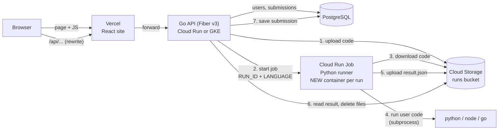
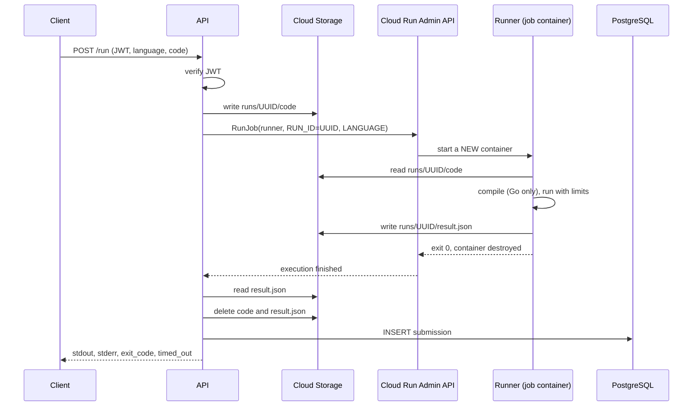
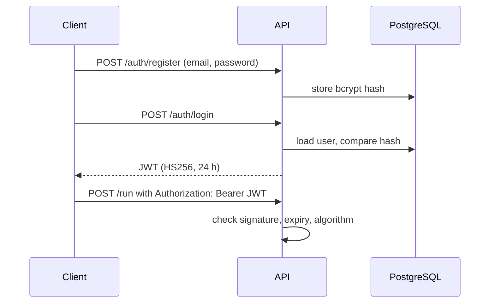
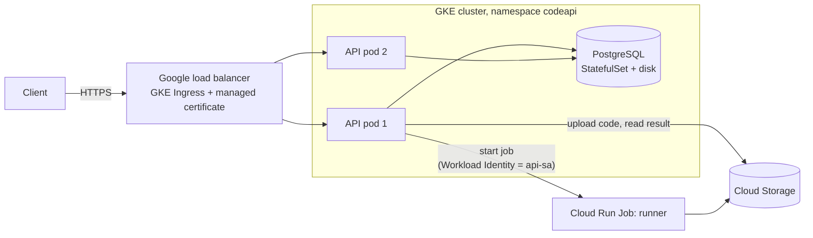

<div align="center">
  <p>
    
    
    
    
    
    
    
    
    
  </p>
</div>

<h1 align="center">Code Runner Platform</h1>

<p align="center">
  Log in, write Python, Node.js or Go, press <b>Run</b>. Every run executes in its own short-lived container.
</p>

---

## What it is

A small platform that runs code submitted by users **without ever running it inside the API**.

- The **API** (Go, Fiber v3, GORM, JWT) handles accounts and stores every submission.
- For each run, the API asks Google Cloud to start a **fresh Cloud Run Job** (a **Python runner**), hands it the code through Cloud Storage, and reads the result back.
- The container is destroyed when the run ends, so one user's files and processes can never reach the next user's run.
- A **React + TypeScript** site on Vercel is the front end.

| Part | Folder | Tech | Runs on |
|---|---|---|---|
| API | `apps/api` | Go 1.26, Fiber v3, GORM, JWT, bcrypt | Cloud Run (or GKE) |
| Runner | `apps/api/runner` | Python 3 (runs Python, Node.js, Go as subprocesses) | Cloud Run Job |
| Web | `apps/web` | React, TypeScript, Vite | Vercel |
| Infra | `infra/vercel` | Terraform | Vercel project |

---

## System design

### The big picture



### Why this shape

- **A Cloud Run container cannot start another container** (there is no Docker inside it). So the API does not start containers itself: it asks Google's Cloud Run Admin API to run a **pre-defined job**, passing a different `RUN_ID` every time.
- **A job has no return value**, it can only exit with a code. So the code goes in as a file and the result comes back as a file, both in Cloud Storage.
- **The API holds the secrets** (database URL, JWT secret). **The runner holds none**, and has no database access. User code runs in the runner, never in the API.

### One run, step by step



### Components

| Component | Responsibility | Notable details |
|---|---|---|
| **Web (Vercel)** | Login, code editor, output, past runs | Token kept in memory only; calls `/api/...`, which Vercel forwards to the API, so the browser makes no cross-site call |
| **API** | Auth, validation, starting jobs, storing results | Stateless; body limit 64 KB; login/register limited to 20 requests/min per IP; graceful shutdown |
| **PostgreSQL** | `users` and `submissions` tables | Created automatically by GORM `AutoMigrate` |
| **Cloud Storage** | Hand-off between API and runner | One folder per run: `runs/<uuid>/code` in, `runs/<uuid>/result.json` out; deleted after reading; 1-day lifecycle rule as a safety net |
| **Runner (Cloud Run Job)** | Run one program, report the outcome | New container per run; Python, Node.js or Go; 5 s run limit, 15 s Go compile limit, 64 KB output cap |
| **Secret Manager / K8s Secret** | Hold `JWT_SECRET` and `DATABASE_URL` | Only the API's identity can read them |
| **Service accounts** | Least-privilege identities | `api-sa`: start the job, read/write the bucket, read secrets. `runner-sa`: bucket only |

### Data model

| Table | Columns |
|---|---|
| `users` | `id`, `email` (unique), `password_hash` (bcrypt, never sent to clients), `created_at` |
| `submissions` | `id`, `user_id`, `language`, `code`, `stdout`, `stderr`, `exit_code`, `timed_out`, `created_at` |

### Two kinds of failure, kept apart

| What happened | Where it shows up | API response |
|---|---|---|
| The user's program crashed or timed out | Inside `result.json` (`exit_code`, `timed_out`) | `200` with the details |
| The runner itself failed (cannot read the bucket, bad image) | The job execution has no succeeded task | `502 could not run your code` |

### Authentication



### Timeouts: each outer limit is larger than the one inside it

The inner limit must fire first, so the user gets a clean answer instead of a cut connection.

| Limit | Value | Set in |
|---|---|---|
| User program runs | 5 s | `runner.py` |
| Go compile | 15 s | `runner.py` |
| Whole job container | 45 s | Cloud Run Job `--task-timeout` |
| API stops waiting | 60 s | `run.go` |
| Cloud Run request | 90 s | `gcloud run deploy --timeout` |
| API waits for in-flight requests on shutdown | 65 s | `main.go` |

### Isolation and security

- **A fresh container per run**: nothing leaks between runs.
- **The runner has no secrets and no database access**; its identity can only reach the runs bucket.
- **Resource limits** inside the runner: output size cap, process-group kill on timeout, file-size limit.
- **Passwords** are stored as bcrypt hashes. **JWTs** are validated for signature, expiry and algorithm.
- **No key files**: Cloud Run uses its attached service account; GKE uses Workload Identity.
- **CORS** is off by default. The web app talks to the API through Vercel's rewrite. Direct calls are possible by setting `ALLOWED_ORIGINS` on the API.

> This is **not a hardened sandbox**. The runner has open internet access, there is no per-user quota, and its identity can reach the runs bucket. Do not run it for untrusted users at scale without more isolation.

### Scaling and concurrency

| | All on Cloud Run | API on GKE |
|---|---|---|
| API instances | Cloud Run autoscaling | Deployment, 2 pods |
| Limit on parallel runs | `--concurrency 4` × `--max-instances 3` = 12 runs | A per-pod "seats" counter (4 per pod = 8 runs); excess requests get `429` |
| Runner | Cloud Run Job, one execution per request | Same |

The API is **stateless**: all state is in PostgreSQL and Cloud Storage, so any instance can serve any request.

### Deployment topologies

**Option 1: everything on Cloud Run.** The API is a Cloud Run service; secrets come from Secret Manager; HTTPS is provided by Cloud Run.

**Option 2: API on Kubernetes (GKE), runner on Cloud Run Jobs.** The runner part does not change at all.



| | Cloud Run | GKE |
|---|---|---|
| Google identity of the API | `--service-account api-sa` | Workload Identity link to `api-sa` |
| Secrets | Secret Manager | Kubernetes Secret |
| Database | Hosted Postgres or Cloud SQL | Postgres in the cluster (learning setup, no backups) |
| HTTPS | Built in | Ingress + managed certificate + your domain |

---

## API reference

| Method | Path | Auth | Body | Response |
|---|---|---|---|---|
| `GET` | `/health` | no | | `ok` |
| `POST` | `/auth/register` | no | `{email, password}` (password 8+ chars) | `201` user, `409` if the email exists |
| `POST` | `/auth/login` | no | `{email, password}` | `{token}` |
| `GET` | `/me` | JWT | | current user |
| `POST` | `/run` | JWT | `{language: "python" \| "node" \| "go", code}` | submission with `stdout`, `stderr`, `exit_code`, `timed_out` |
| `GET` | `/submissions` | JWT | | your past submissions |

Errors are always `{"error": "message"}`.

---

## Repository layout

```text
codeplatform/
├── apps/
│   ├── api/                    # Go API + Python runner
│   │   ├── main.go  auth.go  run.go  models.go
│   │   ├── runner/             # runner.py, requirements.txt, warm.go
│   │   ├── Dockerfile  Dockerfile.runner  cloudbuild.runner.yaml
│   │   └── k8s/                # Kubernetes manifests (GKE option)
│   └── web/                    # React + TypeScript site (Vite)
├── infra/
│   └── vercel/                 # Terraform for the Vercel project
├── package.json                # npm workspaces (web only)
└── README.md
```

## Getting started

1. **Backend:** follow the backend guide (setup from an empty folder, Google Cloud, runner image, deploy).
2. **Frontend:** follow the frontend and monorepo guide (Vite, Vercel, Terraform, CORS, cleanup).
3. Local web development: `npm install` then `npm run web:dev` from the repo root. The dev server proxies `/api` to the API.

## Status and limits (honest notes)

- The runner's logic was tested locally for all three languages. The Go API, the Docker images, the Kubernetes manifests, Terraform and the Vercel deployment were written from documentation and **not compiled or run by the author of the guides**: treat your first build and first deploy as the real test.
- Single-database, no backups on the in-cluster Postgres.
- No per-user quotas or billing limits; set a budget alert on the Google Cloud project.

## Clean up

Remove everything when done (Vercel project and token, Cloud Run service and job, secrets, buckets, images, service accounts, cluster): see section 8 of the frontend guide, or delete the whole Google Cloud project.