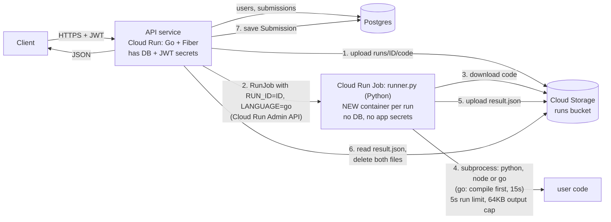
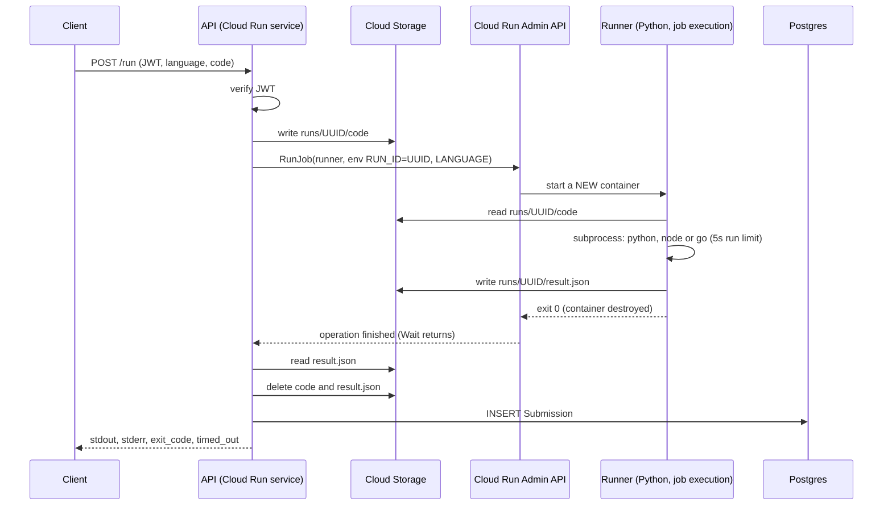
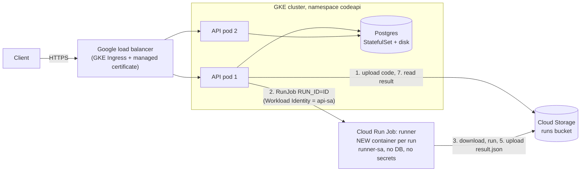

# Cloud Run Jobs: run each submission in its own container (Fiber v3, plus API on Kubernetes)

This continues the Go guide (Fiber + GORM + JWT). Before, the API ran user code as a subprocess **inside its own container**. Now the API never runs user code. It starts a **separate, short-lived container** for every submission and reads back the result.

The runner is now a **Python program** that can run **Python, Node.js and Go** code (the API is still Go). This version has simpler code than the previous one, **every code file with its path**, and a **line-by-line explanation** of the new files. The web code now uses **Fiber v3** (section 4.8 lists what changed from v2).

**Two ways to deploy it:**

- **Section 0:** step-by-step setup from an empty folder (`go mod init`, `go get`, environment variables, running locally, deploying). **Start here.**
- **Part 1 (sections 1 to 11):** the API and the runner both run on Cloud Run.
- **Part 2 (sections 12 to 22):** the **API runs on Kubernetes (GKE)** and only the **runner runs on Cloud Run Jobs**, with a full setup. Part 2 reuses the runner, bucket and service-account steps from Part 1, so read Part 1 first.

> **Status (what is and is not tested).**
> - **Tested:** the runner's logic in `runner.py` (compile, run, timeout, output cut, environment, leftover processes), run locally for **all three languages** on my machine (Python 3.13, Node.js 22, Go 1.24). Section 4.5 has the real results. The Go build-cache warm-up idea was also tested locally.
> - **Checked, not run:** all Go files pass `gofmt -e` (syntax only), and `runner.py` compiles with Python. The Kubernetes YAML parses, and my script confirmed that labels, selectors, Service names, secret names and annotations refer to each other consistently. Flag names in the `gcloud` commands were checked against `gcloud ... --help` where that works offline. The Fiber v3, GKE, Workload Identity, Ingress and managed-certificate details were read from the official docs and a third-party guide.
> - **Not done:** the Go API was **never compiled** (the Go module proxy was unreachable where I worked). The **runner Docker image was never built** (no Docker daemon was available), so the image tags (`python:3.12-slim-bookworm`, `node:22-bookworm-slim`, `golang:1.26-bookworm`) and the `apt` and `pip` steps are unverified. **Nothing was run against a real Google Cloud project or Kubernetes cluster**, and I could not schema-validate the manifests (no `kubectl` or validator available). Treat your first `go mod tidy`, first image build, first `kubectl apply` and first deploy as the test; sections 10 and 21 say what to check when something fails.

**Contents**

0. [Step-by-step setup (start here)](#0-step-by-step-setup-start-here)
1. [How it works](#1-how-it-works)
2. [Project layout and file index](#2-project-layout-and-file-index)
3. [All code files, with paths](#3-all-code-files-with-paths)
4. [Line-by-line explanations](#4-line-by-line-explanations)
5. [One-time GCP setup](#5-one-time-gcp-setup)
6. [Build the runner image and create the job](#6-build-the-runner-image-and-create-the-job)
7. [Deploy the API](#7-deploy-the-api)
8. [Test it](#8-test-it)
9. [What this does and does not protect](#9-what-this-does-and-does-not-protect)
10. [Troubleshooting](#10-troubleshooting)
11. [Clean up](#11-clean-up)

**Part 2: API on Kubernetes (GKE), runner on Cloud Run**

12. [The picture](#12-the-picture)
13. [New files](#13-new-files)
14. [Setup](#14-setup)
15. [The manifests, file by file](#15-the-manifests-file-by-file)
16. [Where the secrets live](#16-where-the-secrets-live)
17. [Deploy and test](#17-deploy-and-test)
18. [Day-two commands](#18-day-two-commands)
19. [Limit parallel runs](#19-limit-parallel-runs-you-must-add-this-on-kubernetes)
20. [What this setup does and does not protect](#20-what-this-setup-does-and-does-not-protect)
21. [Troubleshooting (Kubernetes)](#21-troubleshooting-kubernetes)
22. [Clean up](#22-clean-up)

---

## 0. Step-by-step setup (start here)

This section takes you from an empty folder to a running project, in order. **Every variable is set at the moment it first matters**, right after the thing it names has been created. Sections 5 to 8 are the longer explanations; this section is the order to do things in.

**What you end up with:** the Go API running on your computer and on Cloud Run, starting a Cloud Run Job (the Python runner) for each submission.

### How variables work (read once)

You will meet two kinds of variables:

| Kind | Used by | Examples |
|---|---|---|
| **Helper variables** | your own `gcloud` commands, so you don't retype long names | `PROJECT_ID`, `REGION`, `BUCKET`, `REPO`, `API_SA`, `RUNNER_SA`, `RUNNER_IMAGE` |
| **Program variables** | the Go API and the runner read them when they start (`os.Getenv` in Go, `os.environ` in Python) | `GCP_PROJECT`, `GCP_REGION`, `RUNNER_JOB`, `RUNS_BUCKET`, `JWT_SECRET`, `DATABASE_URL` |

Three facts about `export` in a terminal (macOS and Linux):

- `export NAME=value` creates a variable. `$NAME` (or `${NAME}`) later means "the value of NAME". The shell replaces it before the command runs, so `gcloud config set project $PROJECT_ID` really runs `gcloud config set project my-codeapi-12345`.
- A variable exists **only in that terminal window**. Close the window and it is gone. A new window starts empty.
- The fix is to keep the `export` lines in a file and load it. We use a file called **`env.sh`** in the project folder. After each step we **append** the new variable to it, then **load** it:

```bash
echo 'export BUCKET=${PROJECT_ID}-runs' >> env.sh    # append one line to env.sh
source env.sh                                        # run env.sh in THIS terminal
```

- `echo '...' >> env.sh` adds the text to the end of the file (`>>` appends, a single `>` would overwrite it). The single quotes keep `${PROJECT_ID}` as text, so it is filled in each time you load the file.
- `source env.sh` runs the file's lines in your current terminal, so the variables exist here.
- **Every time you open a new terminal:** `cd codeapi` and `source env.sh`. That is all.
- `env.sh` will contain a secret (the JWT secret). **Never commit it or upload it.** Step 2 creates `.gitignore`, `.dockerignore` and `.gcloudignore` files that keep it out of git and out of the files sent to Cloud Build.
- Windows PowerShell uses another syntax (`$env:NAME = "value"`). The short Windows version is at the end of step 7.

### Step 1: Install the tools

| Tool | Needed for | Check |
|---|---|---|
| **Go 1.26 or newer** (https://go.dev/dl) | building the API | `go version` |
| **gcloud** (previous answers, or https://cloud.google.com/sdk/docs/install-sdk) | everything on Google Cloud | `gcloud --version` |
| **Docker** (optional) | only to run a local Postgres in step 7. You do **not** need it to build images: Cloud Build does that | `docker --version` |
| **curl** and **jq** | testing the API | `curl --version`, `jq --version` |

### Step 2: Create the project folder, the Go module and the files

```bash
mkdir codeapi
cd codeapi
go mod init codeapi
touch env.sh
```

- `go mod init codeapi` creates `go.mod`, the file that makes this folder a Go **module**. `codeapi` is the module's name. All our code is one package, so the name is not used anywhere else and you may choose another. It also writes a `go` line with your installed Go version. Do not edit that line by hand; step 3 may raise it if a library needs a newer Go.
- `touch env.sh` creates the empty file where the variables will be kept.

Create these three small files (they keep `env.sh` out of git and out of Cloud Build uploads):

```bash
printf 'env.sh\n' > .gitignore
printf '.git\n*.md\nenv.sh\n' > .dockerignore
printf '.git\n.gitignore\nenv.sh\n*.md\nlifecycle.json\n' > .gcloudignore
```

Now create these files with the code from **section 3** (the path is the heading above each listing). You do not need the `go.mod` or `.dockerignore` listings: you made those already.

```
codeapi/
├── env.sh                  (you made it above)
├── .gitignore  .dockerignore  .gcloudignore   (you made them above)
├── main.go
├── models.go
├── auth.go
├── run.go
├── Dockerfile
├── Dockerfile.runner
├── cloudbuild.runner.yaml
└── runner/
    ├── runner.py
    ├── requirements.txt
    └── warm.go
```

(Use the `k8s/` files from Part 2 only if you deploy to Kubernetes.)

### Step 3: Download the libraries

```bash
go get github.com/gofiber/fiber/v3
go get github.com/golang-jwt/jwt/v5
go get golang.org/x/crypto
go get gorm.io/gorm
go get gorm.io/driver/postgres
go get cloud.google.com/go/run
go get cloud.google.com/go/storage
go get github.com/google/uuid
go mod tidy
```

- `go get <path>` downloads a library and records it in `go.mod`. There is one per library the code imports: the web framework (Fiber v3), JWT, password hashing (`golang.org/x/crypto/bcrypt`), the database layer (GORM and its Postgres driver), the Cloud Run client, the Cloud Storage client, and UUIDs.
- `go mod tidy` is the cleanup: it adds anything the code imports that is still missing, removes anything unused, and creates **`go.sum`** (a list of checksums). The Dockerfile needs `go.sum`. Run it again whenever you add an import.
- The Cloud Run client lives in the module `cloud.google.com/go/run`, and the code imports the package `cloud.google.com/go/run/apiv2`. That is why the `go get` path looks shorter than the import.

### Step 4: Check that it compiles

```bash
go build -o /dev/null .
go vet ./...
```

No output means success. I could not compile this project myself (the module proxy was unreachable from my environment), so if you get an error, it is most likely a library whose name or method differs from my docs reading. Section 10 lists the common ones and how to look the right name up with `go doc`.

### Step 5: Set up Google Cloud

Run all of these from inside the `codeapi` folder, in one terminal, and keep loading `env.sh` as shown.

**5.1 Project and region.** (You already created the project with `gcloud init`; use its ID. Mine in this example is `my-codeapi-12345`.)

```bash
echo 'export PROJECT_ID=my-codeapi-12345' >> env.sh
echo 'export REGION=asia-south1' >> env.sh
source env.sh

gcloud config set project $PROJECT_ID
gcloud config get-value project          # must print your project ID
```

- `PROJECT_ID`: the project everything lives in. `REGION`: where we put the bucket, the repository and the job. Keep them all in one region.
- `gcloud config set project` makes that project the default for every later command, so you don't need `--project` each time.

**5.2 Billing.** Cloud Run and the other services need a billing account linked to the project.

```bash
gcloud billing accounts list                       # copy the ACCOUNT_ID
gcloud billing projects link $PROJECT_ID --billing-account=YOUR_ACCOUNT_ID
```

**5.3 Turn on the services** (this is the "enable Cloud Run" step):

```bash
gcloud services enable run.googleapis.com artifactregistry.googleapis.com \
  cloudbuild.googleapis.com secretmanager.googleapis.com storage.googleapis.com
```

**5.4 The image repository** (a place to keep the runner image):

```bash
echo 'export REPO=codeapi' >> env.sh
source env.sh

gcloud artifacts repositories create $REPO --repository-format=docker --location=$REGION
```

**5.5 The bucket** (carries code in and results out):

```bash
echo 'export BUCKET=${PROJECT_ID}-runs' >> env.sh
source env.sh

gcloud storage buckets create gs://$BUCKET --location=$REGION --uniform-bucket-level-access

# safety net: delete anything older than 1 day (the API normally deletes right away)
cat > lifecycle.json <<'JSON'
{"rule":[{"action":{"type":"Delete"},"condition":{"age":1}}]}
JSON
gcloud storage buckets update gs://$BUCKET --lifecycle-file=lifecycle.json
```

The bucket now exists, so this is the moment to name it for the **programs**. The API and the runner read the bucket name from the variable `RUNS_BUCKET` (it is a different name from the helper `BUCKET`, with the same value):

```bash
echo 'export RUNS_BUCKET=$BUCKET' >> env.sh
source env.sh
echo $RUNS_BUCKET          # prints my-codeapi-12345-runs
```

**5.6 The two service accounts** (the identities the API and the runner run as; see section 5.2 for why there are two):

```bash
gcloud iam service-accounts create api-sa    --display-name="codeapi API"
gcloud iam service-accounts create runner-sa --display-name="codeapi runner"

echo 'export API_SA=api-sa@${PROJECT_ID}.iam.gserviceaccount.com' >> env.sh
echo 'export RUNNER_SA=runner-sa@${PROJECT_ID}.iam.gserviceaccount.com' >> env.sh
source env.sh

# bucket access for both (this bucket only, not the whole project)
for sa in $API_SA $RUNNER_SA; do
  gcloud storage buckets add-iam-policy-binding gs://$BUCKET \
    --member="serviceAccount:$sa" --role="roles/storage.objectUser"
done
```

(The API's access to its secrets comes later, in step 9, because the secrets do not exist yet.)

### Step 6: Build the runner image and create the job

**6.1 Build and push the image.** The image name is another helper variable, set now because the build produces it:

```bash
echo 'export RUNNER_IMAGE=$REGION-docker.pkg.dev/$PROJECT_ID/$REPO/runner:v1' >> env.sh
source env.sh

gcloud builds submit --config cloudbuild.runner.yaml \
  --substitutions _IMAGE=$RUNNER_IMAGE .
```

This is the slow step (it downloads Go and Node.js and warms Go's cache). If it fails with a permission error, see section 10.

**6.2 Create the job.** The job's name is read by the API as the program variable `RUNNER_JOB`:

```bash
echo 'export RUNNER_JOB=runner' >> env.sh
source env.sh

gcloud run jobs create $RUNNER_JOB \
  --image $RUNNER_IMAGE \
  --region $REGION \
  --service-account $RUNNER_SA \
  --set-env-vars RUNS_BUCKET=$BUCKET \
  --tasks 1 --max-retries 0 \
  --task-timeout 45s \
  --cpu 2 --memory 1Gi
```

Here you meet the third place a variable is set: `--set-env-vars RUNS_BUCKET=$BUCKET` gives the **job's container** its own `RUNS_BUCKET`. (`runner.py` reads it.) The job does not see your terminal's variables; only what you pass here. `RUN_ID` and `LANGUAGE` are added by the API on every run, so you never set them here.

**6.3 Let the API's service account start the job** (the job exists now, so this can be done):

```bash
gcloud run jobs add-iam-policy-binding $RUNNER_JOB --region $REGION \
  --member="serviceAccount:$API_SA" \
  --role="roles/run.jobsExecutorWithOverrides"
```

**6.4 Test the job by hand, for each language** (the full version, with Node.js and Go, is section 6.4):

```bash
echo 'print("hello from python")' > /tmp/code
gcloud storage cp /tmp/code gs://$BUCKET/runs/test-py/code
gcloud run jobs execute $RUNNER_JOB --region $REGION \
  --update-env-vars RUN_ID=test-py,LANGUAGE=python --wait
gcloud storage cat gs://$BUCKET/runs/test-py/result.json
```

Here you set `RUN_ID` and `LANGUAGE` yourself, only for this test. **Do not go on until this prints a good result for Python, Node.js and Go.** If the job does not work by hand, the API cannot make it work.

### Step 7: Run the API on your computer

The API talks to the **real** bucket and job from step 6, so your computer needs Google credentials. The Google libraries look in a standard place, which you fill with:

```bash
gcloud auth application-default login
```

The API then acts as **you**, not as `api-sa`. That works if you own the project. (`api-sa`'s own permissions are first tested when the API runs on Cloud Run.)

Add the remaining **program variables**, each where it makes sense:

```bash
# the two names the API reads for the project and region (same values as the helpers)
echo 'export GCP_PROJECT=$PROJECT_ID' >> env.sh
echo 'export GCP_REGION=$REGION' >> env.sh

# a local Postgres (needs Docker; otherwise install Postgres normally)
docker run -d --name codeapi-db \
  -e POSTGRES_USER=codeapi -e POSTGRES_PASSWORD=devpass -e POSTGRES_DB=codeapi \
  -p 5432:5432 postgres:16-alpine

# how the API reaches that database
echo 'export DATABASE_URL="host=localhost user=codeapi password=devpass dbname=codeapi port=5432 sslmode=disable"' >> env.sh

# the secret that signs login tokens: generate it ONCE and store the value
echo "export JWT_SECRET=$(openssl rand -hex 32)" >> env.sh

source env.sh
```

Notice the two kinds of quotes on purpose. The `JWT_SECRET` line uses **double quotes**, so the random value is made **now** and written into the file as fixed text. If it were generated again in every terminal, tokens created earlier would stop working. The other lines use **single quotes**, so `$PROJECT_ID` is filled in when the file is loaded.

Check them:

```bash
env | grep -E 'GCP_|RUNNER_JOB|RUNS_BUCKET|DATABASE_URL|JWT_SECRET' | cut -c1-60
```

You should see all six program variables (the values of the long ones are cut). Then start the server:

```bash
go run .
```

Leave it running and open a **second terminal**, where you run `cd codeapi` and `source env.sh`, then:

```bash
URL=http://localhost:8080
# now run the commands in section 8, but skip its first line (the one that sets URL)
```

The first start creates the `users` and `submissions` tables automatically (`AutoMigrate`). Every `POST /run` should add one execution in `gcloud run jobs executions list --job $RUNNER_JOB --region $REGION`. Stop the server with Ctrl+C: it finishes running requests first (section 4.4).

**Windows PowerShell version** (no `env.sh`; set each one in the window where you run `go run .`):

```powershell
$env:JWT_SECRET = -join ((1..64) | ForEach-Object { '{0:x}' -f (Get-Random -Maximum 16) })
$env:DATABASE_URL = "host=localhost user=codeapi password=devpass dbname=codeapi port=5432 sslmode=disable"
$env:GCP_PROJECT = "my-codeapi-12345"
$env:GCP_REGION = "asia-south1"
$env:RUNNER_JOB = "runner"
$env:RUNS_BUCKET = "my-codeapi-12345-runs"
go run .
```

(`Get-Random` is fine for local development; use a proper secret generator for production.)

### Step 8: Every variable, in one table

| Variable | Kind | Set in step | Used by | What it is |
|---|---|---|---|---|
| `PROJECT_ID` | helper | 5.1 | your `gcloud` commands | your project ID |
| `REGION` | helper | 5.1 | your `gcloud` commands | e.g. `asia-south1` |
| `REPO` | helper | 5.4 | your `gcloud` commands | the Artifact Registry repository |
| `BUCKET` | helper | 5.5 | your `gcloud` commands, and `--set-env-vars` for the job | the bucket name |
| `API_SA`, `RUNNER_SA` | helper | 5.6 | your `gcloud` commands | the service accounts' e-mail names |
| `RUNNER_IMAGE` | helper | 6.1 | your `gcloud` commands | the runner image name |
| `RUNS_BUCKET` | **program** | 5.5 | API (`run.go`), and the job (`runner.py`) | the bucket for `code` and `result.json` |
| `RUNNER_JOB` | **program** | 6.2 | API (`run.go`) | name of the Cloud Run Job |
| `GCP_PROJECT`, `GCP_REGION` | **program** | 7 | API (`run.go`) | project ID and region |
| `DATABASE_URL` | **program** | 7 | API (`main.go`) | how to reach Postgres |
| `JWT_SECRET` | **program** | 7 | API (`auth.go`) | signs login tokens, **at least 32 characters**, or the API refuses to start |
| `PORT` | program | (not needed locally) | API (`main.go`) | listen port; Cloud Run sets it itself; default `8080` |
| `TRUSTED_PROXIES` | program | (Kubernetes only) | API (`main.go`) | addresses allowed to tell us the client IP (Part 2) |
| `RUN_ID`, `LANGUAGE` | program | by the API, on each run | the job (`runner.py`) | which run and language; you set them by hand only when testing a job |

Where the program variables are set, depending on where the API runs:

| Where the API runs | How you set the program variables |
|---|---|
| Your computer | `env.sh` (step 7) |
| Cloud Run | `--set-env-vars` for the plain ones, `--set-secrets` for `JWT_SECRET` and `DATABASE_URL` (step 9) |
| Kubernetes | the ConfigMap and the Secret (Part 2, sections 15 and 17) |
| The Cloud Run Job | `--set-env-vars RUNS_BUCKET=...` when the job is created (step 6.2) |

If a command complains that a variable is empty, you are in a new terminal: run `source env.sh`.

### Step 9: Deploy (Part 1: everything on Cloud Run)

**9.1 A Postgres the API can reach from Cloud Run.** Use any hosted Postgres that gives you a connection string (for example Neon), and add `sslmode=require` to it. Cloud SQL also works but needs extra Cloud Run settings that this guide does not cover.

**9.2 Store the two secrets** in Secret Manager. These are **production** values: the `JWT_SECRET` is a new random value, not the local one from `env.sh`, and the database URL is the hosted database's:

```bash
printf '%s' "$(openssl rand -hex 32)" | gcloud secrets create jwt-secret --data-file=-
printf '%s' 'host=YOUR_HOST user=YOUR_USER password=YOUR_PASSWORD dbname=YOUR_DB port=5432 sslmode=require' \
  | gcloud secrets create database-url --data-file=-
```

**9.3 Let the API's service account read them** (this needs the secrets from 9.2 to exist):

```bash
for s in jwt-secret database-url; do
  gcloud secrets add-iam-policy-binding $s \
    --member="serviceAccount:$API_SA" --role="roles/secretmanager.secretAccessor"
done
```

**9.4 Deploy** with the command in section 7. It sets the program variables on Cloud Run: `--set-env-vars GCP_PROJECT=$PROJECT_ID,GCP_REGION=$REGION,RUNNER_JOB=$RUNNER_JOB,RUNS_BUCKET=$BUCKET` and `--set-secrets JWT_SECRET=jwt-secret:latest,DATABASE_URL=database-url:latest`. Then test with section 8. Its first line sets `URL` from the deployed service.

### Step 9 (alternative): Deploy the API on Kubernetes

Follow Part 2, sections 12 to 22. Skip the Secret Manager steps: there the secrets live in Kubernetes. The ConfigMap in Part 2 plays the role of the Cloud Run `--set-env-vars`.

### Quick check list

1. `go version` shows 1.26 or newer.
2. `go build` passes (step 4).
3. `gcloud run jobs execute $RUNNER_JOB ...` gives a good `result.json` for Python, Node.js **and** Go (step 6).
4. `go run .` starts, and `curl localhost:8080/health` prints `ok` (step 7).
5. A `POST /run` locally adds a new job execution (step 7).
6. The same works against the deployed URL (step 9).

If a step fails, fix it **before** the next one: each step depends on the one before.

---

## 1. How it works

A Cloud Run container cannot start another container itself (there is no Docker inside it). Instead the API **asks Google to run a pre-defined Cloud Run Job**, giving it a different `RUN_ID` each time. Google starts a fresh container from the runner image and destroys it when it exits. Because the container is new every time, one user's files and processes can never reach the next user's run.





**Why Cloud Storage in the middle?** A Cloud Run Job has no return value; it can only exit with a code. So the code goes in through a file and the result comes back through a file.

**Two kinds of failure, kept separate:**

| What happened | Where it shows up | API response |
|---|---|---|
| The user's program crashed or timed out | inside `result.json` (`exit_code`, `timed_out`) | `200` with the details |
| The runner itself failed (can't read the bucket, bad image) | the job execution has no succeeded task | `502 could not run your code` |

**What the runner can run.** `runner.py` is a Python program. It downloads the code, saves it as `main.py`, `main.js` or `main.go` depending on `LANGUAGE`, compiles it if needed (Go only), runs it as a **subprocess**, and uploads the result. The API accepts three languages: `python`, `node` and `go`.

**What changed from the previous version of this code:** the runner is now Python (it was Go), it supports three languages, the request body has a `language` field, plain functions instead of a struct with methods, and no "4 seats" semaphore. Cloud Run's own `--concurrency` and `--max-instances` settings now limit how many runs happen at once (section 7; on Kubernetes you add the limit yourself, section 19). The web code is now Fiber v3.

---

## 2. Project layout and file index

```
codeapi/
├── go.mod
├── main.go                 # CHANGED: Fiber v3, calls setupGoogle, graceful shutdown
├── models.go               # CHANGED: Submission has a Language field
├── auth.go                 # CHANGED: Fiber v3 only
├── run.go                  # REWRITTEN: uploads code, starts the job with a language, reads the result (Fiber v3)
├── runner/
│   ├── runner.py           # NEW: Python program inside the job container (runs python, node, go)
│   ├── requirements.txt    # NEW: the runner's Python library
│   └── warm.go             # NEW: fills Go's build cache while the image is built
├── Dockerfile              # CHANGED: python removed, ca-certificates added
├── Dockerfile.runner       # NEW: runner image (Python + Node.js + Go)
├── cloudbuild.runner.yaml  # NEW: how to build the runner image
├── .dockerignore
├── .gitignore              # NEW: keeps env.sh out of git
├── .gcloudignore           # NEW: keeps env.sh out of Cloud Build uploads
└── k8s/                    # Part 2 only: Kubernetes manifests (section 13)
```

| Path | Status | Runs where | Purpose |
|---|---|---|---|
| `go.mod` | new | build | module name and Go version (1.26) |
| `main.go` | changed | API container | starts the server, wires routes, stops gracefully |
| `models.go` | changed | API container | `User` and `Submission` tables (`Submission.Language` is new) |
| `auth.go` | changed (v3) | API container | register, login, JWT middleware |
| `run.go` | rewritten | API container | sends code and language to a new container, returns the result |
| `runner/runner.py` | new | **job container** | runs one user program (Python, Node.js or Go) |
| `runner/requirements.txt` | new | build | the runner's Python library |
| `runner/warm.go` | new | build | speeds up Go compiles at run time |
| `Dockerfile` | changed | build | API image |
| `Dockerfile.runner` | new | build | runner image (Python, Node.js and Go) |
| `cloudbuild.runner.yaml` | new | build | tells Cloud Build to use `Dockerfile.runner` |
| `.dockerignore` | unchanged | build | keeps junk out of images |
| `k8s/*.yaml` | new (Part 2) | Kubernetes | the API, database and public entrance on GKE |

The API is Go (`go build .`). The runner is a separate Python program in its own folder with its own image; the two only share the bucket and the four JSON keys in `result.json`.

---

## 3. All code files, with paths

Copy each file to the path shown above its code. (These listings are clean, with no line numbers. Section 4 repeats the new code in numbered pieces.)

### `go.mod`

```go
module codeapi

go 1.26
```

Run `go mod tidy` after creating the files (section 4.7). You need Go 1.26 or newer installed (`go version`). It adds the `require` lines and creates `go.sum`.

### `models.go` (changed: one new field)

```go
package main

import "time"

type User struct {
    ID           uint      `gorm:"primaryKey" json:"id"`
    Email        string    `gorm:"uniqueIndex;not null;size:255" json:"email"`
    PasswordHash string    `gorm:"not null" json:"-"` // json:"-" → never sent to clients
    CreatedAt    time.Time `json:"created_at"`
}

type Submission struct {
    ID        uint      `gorm:"primaryKey" json:"id"`
    UserID    uint      `gorm:"index;not null" json:"user_id"`
    Language  string    `gorm:"size:10;not null;default:python" json:"language"`
    Code      string    `gorm:"type:text;not null" json:"code"`
    Stdout    string    `gorm:"type:text" json:"stdout"`
    Stderr    string    `gorm:"type:text" json:"stderr"`
    ExitCode  int       `json:"exit_code"`
    TimedOut  bool      `json:"timed_out"`
    CreatedAt time.Time `json:"created_at"`
}
```

### `auth.go` (changed for Fiber v3)

```go
package main

import (
    "errors"
    "os"
    "strconv"
    "strings"
    "time"

    "github.com/gofiber/fiber/v3"
    "github.com/golang-jwt/jwt/v5"
    "golang.org/x/crypto/bcrypt"
    "gorm.io/gorm"
)

var jwtSecret = []byte(os.Getenv("JWT_SECRET"))

type credentials struct {
    Email    string `json:"email"`
    Password string `json:"password"`
}

func register(db *gorm.DB) fiber.Handler {
    return func(c fiber.Ctx) error {
        var in credentials
        if err := c.Bind().Body(&in); err != nil {
            return fiber.NewError(fiber.StatusBadRequest, "invalid JSON")
        }
        in.Email = strings.ToLower(strings.TrimSpace(in.Email))
        if !strings.Contains(in.Email, "@") || len(in.Password) < 8 {
            return fiber.NewError(fiber.StatusBadRequest, "valid email and password (8+ chars) required")
        }

        hash, err := bcrypt.GenerateFromPassword([]byte(in.Password), bcrypt.DefaultCost)
        if err != nil {
            return err
        }
        user := User{Email: in.Email, PasswordHash: string(hash)}
        if err := db.Create(&user).Error; err != nil {
            if errors.Is(err, gorm.ErrDuplicatedKey) || strings.Contains(err.Error(), "duplicate") {
                return fiber.NewError(fiber.StatusConflict, "email already registered")
            }
            return err
        }
        return c.Status(fiber.StatusCreated).JSON(user)
    }
}

func login(db *gorm.DB) fiber.Handler {
    return func(c fiber.Ctx) error {
        var in credentials
        if err := c.Bind().Body(&in); err != nil {
            return fiber.NewError(fiber.StatusBadRequest, "invalid JSON")
        }
        var user User
        err := db.Where("email = ?", strings.ToLower(strings.TrimSpace(in.Email))).First(&user).Error
        // same message for "no user" and "wrong password" (don't leak which)
        if err != nil || bcrypt.CompareHashAndPassword([]byte(user.PasswordHash), []byte(in.Password)) != nil {
            return fiber.NewError(fiber.StatusUnauthorized, "invalid email or password")
        }

        claims := jwt.RegisteredClaims{
            Subject:   strconv.FormatUint(uint64(user.ID), 10),
            IssuedAt:  jwt.NewNumericDate(time.Now()),
            ExpiresAt: jwt.NewNumericDate(time.Now().Add(24 * time.Hour)),
        }
        token, err := jwt.NewWithClaims(jwt.SigningMethodHS256, claims).SignedString(jwtSecret)
        if err != nil {
            return err
        }
        return c.JSON(fiber.Map{"token": token})
    }
}

// Middleware: runs before protected handlers.
func authRequired(c fiber.Ctx) error {
    header := c.Get("Authorization")
    if !strings.HasPrefix(header, "Bearer ") {
        return fiber.NewError(fiber.StatusUnauthorized, "missing bearer token")
    }
    raw := strings.TrimPrefix(header, "Bearer ")

    claims := &jwt.RegisteredClaims{}
    token, err := jwt.ParseWithClaims(raw, claims,
        func(t *jwt.Token) (any, error) { return jwtSecret, nil },
        jwt.WithValidMethods([]string{"HS256"}), // reject other algorithms
    )
    if err != nil || !token.Valid {
        return fiber.NewError(fiber.StatusUnauthorized, "invalid or expired token")
    }
    id, err := strconv.ParseUint(claims.Subject, 10, 64)
    if err != nil {
        return fiber.NewError(fiber.StatusUnauthorized, "bad token subject")
    }
    fiber.Locals[uint](c, "userID", uint(id)) // pass to later handlers
    return c.Next()
}

func me(db *gorm.DB) fiber.Handler {
    return func(c fiber.Ctx) error {
        var user User
        if err := db.First(&user, fiber.Locals[uint](c, "userID")).Error; err != nil {
            return fiber.NewError(fiber.StatusNotFound, "user not found")
        }
        return c.JSON(user)
    }
}
```

### `main.go` (changed)

```go
package main

import (
    "context"
    "errors"
    "log"
    "os"
    "os/signal"
    "strings"
    "syscall"
    "time"

    "github.com/gofiber/fiber/v3"
    "github.com/gofiber/fiber/v3/middleware/limiter"
    "github.com/gofiber/fiber/v3/middleware/logger"
    "github.com/gofiber/fiber/v3/middleware/recover"
    "gorm.io/driver/postgres"
    "gorm.io/gorm"
)

func main() {
    if len(jwtSecret) < 32 {
        log.Fatal("JWT_SECRET must be set and at least 32 characters")
    }

    db, err := gorm.Open(postgres.Open(os.Getenv("DATABASE_URL")), &gorm.Config{})
    if err != nil {
        log.Fatal("db connect: ", err)
    }
    if err := db.AutoMigrate(&User{}, &Submission{}); err != nil {
        log.Fatal("migrate: ", err)
    }

    if err := setupGoogle(context.Background()); err != nil {
        log.Fatal("google clients: ", err)
    }

    cfg := fiber.Config{
        BodyLimit:   64 * 1024,        // 64 KB max request (limits code size)
        ReadTimeout: 10 * time.Second, // max time to receive one request
        IdleTimeout: 620 * time.Second, // keep idle connections longer than a load balancer does
        ErrorHandler: func(c fiber.Ctx, err error) error {
            code := fiber.StatusInternalServerError
            msg := "internal error"
            var e *fiber.Error
            if errors.As(err, &e) { // errors we made with fiber.NewError
                code, msg = e.Code, e.Message
            } else {
                log.Println("error:", err) // log the real error, hide it from the client
            }
            return c.Status(code).JSON(fiber.Map{"error": msg})
        },
    }

    // Behind a load balancer (Kubernetes) every request seems to come from the
    // load balancer. TRUSTED_PROXIES lists the addresses we believe, so that
    // c.IP() (used by the rate limiter) is the real client. Unset = trust nobody.
    if list := os.Getenv("TRUSTED_PROXIES"); list != "" {
        cfg.TrustProxy = true
        cfg.ProxyHeader = fiber.HeaderXForwardedFor
        cfg.EnableIPValidation = true
        cfg.TrustProxyConfig = fiber.TrustProxyConfig{Proxies: strings.Split(list, ",")}
    }

    app := fiber.New(cfg)
    app.Use(recover.New(), logger.New())

    app.Get("/health", func(c fiber.Ctx) error { return c.SendString("ok") })

    authLimit := limiter.New(limiter.Config{Max: 20}) // 20 requests/min per IP
    app.Post("/auth/register", authLimit, register(db))
    app.Post("/auth/login", authLimit, login(db))

    app.Get("/me", authRequired, me(db))
    app.Post("/run", authRequired, runHandler(db))
    app.Get("/submissions", authRequired, listSubmissions(db))

    port := os.Getenv("PORT") // Cloud Run injects PORT
    if port == "" {
        port = "8080"
    }

    // Start the server in the background, then wait for either a start-up
    // error or a stop signal (Kubernetes and Cloud Run send SIGTERM).
    stop, cancel := signal.NotifyContext(context.Background(), syscall.SIGINT, syscall.SIGTERM)
    defer cancel()

    listenErr := make(chan error, 1)
    go func() { listenErr <- app.Listen(":" + port) }()

    select {
    case err := <-listenErr:
        log.Fatal("listen: ", err)
    case <-stop.Done():
        log.Println("stop signal received, finishing running requests...")
    }

    // Let requests that are waiting for a runner finish (one takes up to 60 s).
    if err := app.ShutdownWithTimeout(65 * time.Second); err != nil {
        log.Println("shutdown:", err)
    }
    log.Println("bye")
}
```

### `run.go` (rewritten)

```go
package main

import (
    "context"
    "encoding/json"
    "fmt"
    "io"
    "log"
    "os"
    "time"

    run "cloud.google.com/go/run/apiv2"
    "cloud.google.com/go/run/apiv2/runpb"
    "cloud.google.com/go/storage"
    "github.com/gofiber/fiber/v3"
    "github.com/google/uuid"
    "gorm.io/gorm"
)

// Settings. They come from environment variables that we set when deploying.
var (
    gcpProject = os.Getenv("GCP_PROJECT")
    gcpRegion  = os.Getenv("GCP_REGION")
    jobName    = os.Getenv("RUNNER_JOB")  // the Cloud Run Job, e.g. "runner"
    bucketName = os.Getenv("RUNS_BUCKET") // the Cloud Storage bucket
)

// Two Google clients. setupGoogle creates them ONCE when the server starts.
var (
    jobsClient    *run.JobsClient  // starts Cloud Run Jobs
    storageClient *storage.Client  // reads and writes files in the bucket
)

func setupGoogle(ctx context.Context) error {
    if gcpProject == "" || gcpRegion == "" || jobName == "" || bucketName == "" {
        return fmt.Errorf("set GCP_PROJECT, GCP_REGION, RUNNER_JOB and RUNS_BUCKET")
    }
    var err error
    jobsClient, err = run.NewJobsClient(ctx)
    if err != nil {
        return err
    }
    storageClient, err = storage.NewClient(ctx)
    return err
}

// The shape of result.json. The runner writes it, we read it.
type runResult struct {
    Stdout   string `json:"stdout"`
    Stderr   string `json:"stderr"`
    ExitCode int    `json:"exit_code"`
    TimedOut bool   `json:"timed_out"`
}

// uploadCode saves the user's code as a file in the bucket.
func uploadCode(ctx context.Context, path string, code string) error {
    w := storageClient.Bucket(bucketName).Object(path).NewWriter(ctx)
    if _, err := io.WriteString(w, code); err != nil {
        return err
    }
    return w.Close() // the upload is only finished when Close succeeds
}

// startJob starts one execution of the runner job and waits until it finishes.
func startJob(ctx context.Context, runID string, language string) error {
    req := &runpb.RunJobRequest{
        Name: fmt.Sprintf("projects/%s/locations/%s/jobs/%s", gcpProject, gcpRegion, jobName),
        // "Overrides" means: change something for THIS execution only.
        // RUN_ID tells the runner which files to use, LANGUAGE which language to run.
        Overrides: &runpb.RunJobRequest_Overrides{
            ContainerOverrides: []*runpb.RunJobRequest_Overrides_ContainerOverride{
                {
                    Env: []*runpb.EnvVar{
                        {Name: "RUN_ID", Values: &runpb.EnvVar_Value{Value: runID}},
                        {Name: "LANGUAGE", Values: &runpb.EnvVar_Value{Value: language}},
                    },
                },
            },
        },
    }

    operation, err := jobsClient.RunJob(ctx, req) // start the container
    if err != nil {
        return err
    }
    execution, err := operation.Wait(ctx) // wait until the container has finished
    if err != nil {
        return err
    }
    if execution.GetSucceededCount() == 0 {
        return fmt.Errorf("the runner container failed") // OUR failure, not the user's
    }
    return nil
}

// readResult downloads result.json and turns it into a runResult.
func readResult(ctx context.Context, path string) (runResult, error) {
    reader, err := storageClient.Bucket(bucketName).Object(path).NewReader(ctx)
    if err != nil {
        return runResult{}, err
    }
    defer reader.Close()

    raw, err := io.ReadAll(reader)
    if err != nil {
        return runResult{}, err
    }

    var res runResult
    err = json.Unmarshal(raw, &res) // JSON text -> struct
    return res, err
}

// deleteFiles removes files from the bucket. It has its own 5-second timer
// so it still works when the request's timer has already run out.
func deleteFiles(paths ...string) {
    ctx, cancel := context.WithTimeout(context.Background(), 5*time.Second)
    defer cancel()
    for _, p := range paths {
        storageClient.Bucket(bucketName).Object(p).Delete(ctx)
    }
}

// execute = upload code -> start job -> read result -> clean up.
func execute(ctx context.Context, language string, code string) (runResult, error) {
    // Give up after 60 seconds (more than the job's own 45 s limit, less than the
    // Cloud Run request timeout of 90 s).
    ctx, cancel := context.WithTimeout(ctx, 60*time.Second)
    defer cancel()

    runID := uuid.NewString() // random id, so nobody can guess the file names
    codePath := "runs/" + runID + "/code"
    resultPath := "runs/" + runID + "/result.json"

    defer deleteFiles(codePath, resultPath) // always clean up at the end

    if err := uploadCode(ctx, codePath, code); err != nil {
        return runResult{}, fmt.Errorf("upload code: %w", err)
    }
    if err := startJob(ctx, runID, language); err != nil {
        return runResult{}, fmt.Errorf("run job: %w", err)
    }
    res, err := readResult(ctx, resultPath)
    if err != nil {
        return runResult{}, fmt.Errorf("read result: %w", err)
    }
    return res, nil
}

// ---------- HTTP handlers ----------

// The languages the runner understands. Anything else is rejected with 400.
var languages = map[string]bool{"python": true, "node": true, "go": true}

type runRequest struct {
    Language string `json:"language"` // "python", "node" or "go" (default "python")
    Code     string `json:"code"`
}

func runHandler(db *gorm.DB) fiber.Handler {
    return func(c fiber.Ctx) error {
        // 1. read the JSON body
        var in runRequest
        if err := c.Bind().Body(&in); err != nil || in.Code == "" {
            return fiber.NewError(fiber.StatusBadRequest, "code is required")
        }
        if in.Language == "" {
            in.Language = "python"
        }
        if !languages[in.Language] {
            return fiber.NewError(fiber.StatusBadRequest, "language must be python, node or go")
        }

        // 2. run the code in a brand-new container
        res, err := execute(c.Context(), in.Language, in.Code)
        if err != nil {
            log.Println("execute failed:", err) // the real reason goes to our logs only
            return fiber.NewError(fiber.StatusBadGateway, "could not run your code, try again")
        }

        // 3. save the result for this user
        sub := Submission{
            UserID:   fiber.Locals[uint](c, "userID"),
            Language: in.Language,
            Code:     in.Code,
            Stdout:   res.Stdout,
            Stderr:   res.Stderr,
            ExitCode: res.ExitCode,
            TimedOut: res.TimedOut,
        }
        if err := db.Create(&sub).Error; err != nil {
            return err
        }

        // 4. send it back
        return c.JSON(sub)
    }
}

func listSubmissions(db *gorm.DB) fiber.Handler {
    return func(c fiber.Ctx) error {
        var subs []Submission
        err := db.Where("user_id = ?", fiber.Locals[uint](c, "userID")). // only YOUR rows
            Order("id desc").Limit(50).Find(&subs).Error
        if err != nil {
            return err
        }
        return c.JSON(subs)
    }
}
```

### `runner/runner.py` (new)

```python
"""The runner: runs inside a fresh Cloud Run Job container, executes ONE user
program (Python, Node.js or Go), writes the result, and exits.

Environment variables:
  RUNS_BUCKET - the Cloud Storage bucket to use
  RUN_ID      - which run this container is responsible for
  LANGUAGE    - python, node or go
"""
import json
import os
import shutil
import signal
import subprocess
import sys
import tempfile

RUN_TIMEOUT = 5          # seconds the user's program may run
COMPILE_TIMEOUT = 15     # seconds the Go compiler may take
MAX_OUTPUT = 64 * 1024   # keep at most 64 KB of stdout and 64 KB of stderr
MAX_FILE_SIZE = 1024 * 1024  # the program may write at most 1 MiB to any file (including its output)

USER_PATH = "/usr/local/go/bin:/usr/local/bin:/usr/bin:/bin"  # the only PATH user code sees
GO_CACHE = "/opt/gocache"  # Go's build cache, warmed up when the image is built

# What to do for each language: the file name, an optional compile command, the run command.
LANGUAGES = {
    "python": {"filename": "main.py", "compile": None, "run": ["python3", "-I", "-u", "main.py"]},
    "node": {"filename": "main.js", "compile": None, "run": ["node", "main.js"]},
    "go": {
        "filename": "main.go",
        "compile": ["go", "build", "-o", "prog", "main.go"],
        "run": ["./prog"],
    },
}


def cut_output(data):
    """Turn bytes into text and shorten very long output."""
    text = data[:MAX_OUTPUT].decode("utf-8", errors="replace")
    if len(data) > MAX_OUTPUT:
        text += "\n...output cut..."
    return text


def run_step(command, workdir, env, timeout, limit_file_size):
    """Run one command and report what happened (a dictionary)."""
    if limit_file_size:
        # prlimit starts the command with a cap on how big a file it may write
        command = ["prlimit", "--fsize=%d" % MAX_FILE_SIZE, "--"] + command

    # Output goes into anonymous temporary files, not pipes. A program that
    # leaves a background process behind cannot make us wait for a pipe to close.
    with tempfile.TemporaryFile() as out, tempfile.TemporaryFile() as err:
        process = subprocess.Popen(
            command,
            cwd=workdir,
            env=env,
            stdin=subprocess.DEVNULL,  # the program cannot read input
            stdout=out,
            stderr=err,
            start_new_session=True,  # its own process group, so we can stop all of it
        )
        timed_out = False
        try:
            exit_code = process.wait(timeout=timeout)
        except subprocess.TimeoutExpired:
            timed_out = True
            exit_code = -1

        # Stop everything the program started (also leftover background processes).
        try:
            os.killpg(process.pid, signal.SIGKILL)
        except ProcessLookupError:
            pass  # nothing was left
        process.wait()  # collect the exit status so no zombie remains

        out.seek(0)
        err.seek(0)
        return {
            "stdout": cut_output(out.read(MAX_OUTPUT + 1)),
            "stderr": cut_output(err.read(MAX_OUTPUT + 1)),
            "exit_code": exit_code,  # 0 = ok, 1 or more = error, negative = killed by a signal
            "timed_out": timed_out,
        }


def run_code(language, code):
    """Save the code in a private folder, compile it if needed, run it."""
    spec = LANGUAGES[language]
    workdir = tempfile.mkdtemp(prefix="run-")  # a new private folder
    try:
        with open(os.path.join(workdir, spec["filename"]), "wb") as f:
            f.write(code)

        # The program only sees these variables. No secrets, no RUN_ID.
        env = {"PATH": USER_PATH, "HOME": workdir}

        if spec["compile"]:
            compile_env = dict(env)
            compile_env.update(
                GOCACHE=GO_CACHE,       # reuse the warmed-up cache
                GOPROXY="off",          # never download packages
                GOTOOLCHAIN="local",    # never download another Go version
                CGO_ENABLED="0",        # plain Go only, no C compiler needed
            )
            result = run_step(spec["compile"], workdir, compile_env, COMPILE_TIMEOUT, False)
            if result["timed_out"]:
                result["stderr"] += "\ncompile timed out after %d seconds" % COMPILE_TIMEOUT
            if result["exit_code"] != 0:
                return result  # the compiler's messages are the answer

        return run_step(spec["run"], workdir, env, RUN_TIMEOUT, True)
    finally:
        shutil.rmtree(workdir, ignore_errors=True)  # delete the folder


def main():
    run_id = os.environ.get("RUN_ID", "")
    bucket_name = os.environ.get("RUNS_BUCKET", "")
    language = os.environ.get("LANGUAGE", "")
    if not run_id or not bucket_name or language not in LANGUAGES:
        sys.exit("RUN_ID, RUNS_BUCKET and LANGUAGE (python, node or go) are required")

    from google.cloud import storage  # imported here so the code above can be tested without it

    bucket = storage.Client().bucket(bucket_name)

    # Step 1: download the code the API uploaded.
    code = bucket.blob("runs/%s/code" % run_id).download_as_bytes()

    # Step 2: run it.
    result = run_code(language, code)

    # Step 3: upload the result for the API to read.
    bucket.blob("runs/%s/result.json" % run_id).upload_from_string(
        json.dumps(result), content_type="application/json"
    )

    # We exit normally (code 0) even if the USER's program failed. That failure
    # is stored inside result.json. Any crash above ends with exit code 1 =
    # "the runner failed".
    print("done", run_id, language, "exit_code", result["exit_code"], "timed_out", result["timed_out"])


if __name__ == "__main__":
    main()
```

### `Dockerfile` (API image)

```dockerfile
# ---- build stage ----
FROM golang:1.26-alpine AS build
WORKDIR /src
COPY go.mod go.sum ./
RUN go mod download
COPY . .
RUN CGO_ENABLED=0 GOOS=linux go build -trimpath -ldflags="-s -w" -o /app .

# ---- runtime stage ----
# No python here any more: the API never runs user code.
# ca-certificates is needed because we now call Google APIs over HTTPS.
FROM alpine:3.22
RUN apk add --no-cache ca-certificates \
 && adduser -D -u 10001 app
USER app
COPY --from=build /app /app
ENV PORT=8080
CMD ["/app"]
```

### `runner/requirements.txt` (new)

```text
google-cloud-storage
```

### `runner/warm.go` (new)

```go
// Compiled once while the runner image is built, only to fill Go's build
// cache with common packages. User programs that import them then compile fast.
package main

import (
    _ "bufio"
    _ "bytes"
    _ "container/heap"
    _ "context"
    _ "encoding/json"
    _ "errors"
    _ "fmt"
    _ "io"
    _ "math"
    _ "math/big"
    _ "math/rand"
    _ "net/http"
    _ "os"
    _ "regexp"
    _ "sort"
    _ "strconv"
    _ "strings"
    _ "sync"
    _ "time"
    _ "unicode"
)

func main() {}
```

### `Dockerfile.runner` (new)

```dockerfile
# The runner image: Python runs the runner, and can start Python, Node.js or Go programs.
FROM python:3.12-slim-bookworm

# Node.js and Go: copy just the programs from their official images.
COPY --from=node:22-bookworm-slim /usr/local/bin/node /usr/local/bin/node
COPY --from=golang:1.26-bookworm /usr/local/go /usr/local/go

# ca-certificates: HTTPS to Cloud Storage. libstdc++6: needed by node.
# util-linux: gives us "prlimit". Then a private Python environment for the
# runner's own libraries, a non-root user, and a writable Go cache folder.
RUN apt-get update \
 && apt-get install -y --no-install-recommends ca-certificates libstdc++6 util-linux \
 && rm -rf /var/lib/apt/lists/* \
 && python -m venv /opt/venv \
 && useradd --create-home --uid 10001 runner \
 && mkdir /opt/gocache && chown runner /opt/gocache

COPY runner/requirements.txt /app/requirements.txt
RUN /opt/venv/bin/pip install --no-cache-dir -r /app/requirements.txt
COPY runner/runner.py /app/runner.py

# Warm up Go's build cache as the runner user, with the same settings the runner uses.
USER runner
COPY --chown=runner runner/warm.go /tmp/warm/main.go
RUN cd /tmp/warm \
 && CGO_ENABLED=0 GOCACHE=/opt/gocache GOPROXY=off GOTOOLCHAIN=local \
    /usr/local/go/bin/go build -o /tmp/warm/prog main.go \
 && rm -rf /tmp/warm

CMD ["/opt/venv/bin/python", "/app/runner.py"]
```

### `cloudbuild.runner.yaml` (new)

```yaml
steps:
  - name: gcr.io/cloud-builders/docker
    args: ["build", "-f", "Dockerfile.runner", "-t", "${_IMAGE}", "."]
images: ["${_IMAGE}"]
```

### `.dockerignore`

```
.git
*.md
env.sh
```

---

## 4. Line-by-line explanations

Line numbers below are the line numbers of the file. Start with the runner (the Python part). Python ideas are explained next to the code in 4.2; the Go ideas for the API are in the table below.

### 4.1 Go ideas you will meet (for the API)

| Idea | Meaning |
|---|---|
| `package main` + `func main()` | This folder builds into a program you can run. |
| `import (...)` | Packages used by the file. An unused import is a compile error. |
| `:=` and `=` | `:=` declares a new variable. `=` assigns to one that already exists. |
| `err` after every call | Go has no exceptions. A function that can fail returns an `error`; you check `if err != nil`. |
| `defer` | Run this line when the surrounding function ends, however it ends. |
| `&x` | The address of `x` (a pointer). Used when a function must write into your variable. |
| `context` | A carrier for a deadline or cancel signal. `context.WithTimeout` is a stopwatch. |
| Struct tags `` `json:"stdout"` `` | Tell the JSON library what to call the field in JSON. |
| `...string` (variadic) | The function accepts any number of strings; inside it they are a slice. |
| `%w` in `fmt.Errorf` | Wrap an error with a label while keeping the original inside. |

### 4.2 `runner/runner.py`

The runner is now a **Python** program. It runs inside the job container, and starts the user's program as a **subprocess** (a separate program that Python launches and watches). The user's program can be Python, Node.js or Go.

**Lines 1 to 8: the docstring**

```python
"""The runner: runs inside a fresh Cloud Run Job container, executes ONE user
program (Python, Node.js or Go), writes the result, and exits.

Environment variables:
  RUNS_BUCKET - the Cloud Storage bucket to use
  RUN_ID      - which run this container is responsible for
  LANGUAGE    - python, node or go
"""
```

- A string in triple quotes at the very top of a file is a **docstring**: documentation for the file. It lists the three environment variables the runner reads. The API sets `RUN_ID` and `LANGUAGE` for each run; the job definition sets `RUNS_BUCKET`.

**Lines 9 to 15: imports**

```python
import json
import os
import shutil
import signal
import subprocess
import sys
import tempfile
```

- `json`: turn a dictionary into JSON text.
- `os`: environment variables, file paths, and `os.killpg` (stop a whole group of processes).
- `shutil`: `shutil.rmtree` deletes a folder with everything in it.
- `signal`: names for signals such as `SIGKILL`.
- `subprocess`: start another program.
- `sys`: `sys.exit` ends the program with a message.
- `tempfile`: temporary folders and files.
- All of these ship with Python. The one outside library, Google's storage client, is imported later (line 124).

**Lines 17 to 23: settings**

```python
RUN_TIMEOUT = 5          # seconds the user's program may run
COMPILE_TIMEOUT = 15     # seconds the Go compiler may take
MAX_OUTPUT = 64 * 1024   # keep at most 64 KB of stdout and 64 KB of stderr
MAX_FILE_SIZE = 1024 * 1024  # the program may write at most 1 MiB to any file (including its output)

USER_PATH = "/usr/local/go/bin:/usr/local/bin:/usr/bin:/bin"  # the only PATH user code sees
GO_CACHE = "/opt/gocache"  # Go's build cache, warmed up when the image is built
```

- Names in `CAPITAL_LETTERS` are a Python habit for "a constant: do not change this while running".
- Line 17: every program gets 5 seconds. Line 18: Go gets an extra 15 seconds **for compiling** (Go is compiled, then run).
- Line 19: stdout and stderr are each cut to 64 KB. Line 20: a program cannot write a file bigger than 1 MiB. Its output goes into files, so this also stops it from printing gigabytes.
- Line 22: a `PATH` is the list of folders where the system looks for programs. User code only gets these four folders, so it can find `python3`, `node` and `go`.
- Line 23: Go's build cache lives here. Section 4.6 explains why we fill it when the image is built.

**Lines 25 to 34: the language table**

```python
LANGUAGES = {
    "python": {"filename": "main.py", "compile": None, "run": ["python3", "-I", "-u", "main.py"]},
    "node": {"filename": "main.js", "compile": None, "run": ["node", "main.js"]},
    "go": {
        "filename": "main.go",
        "compile": ["go", "build", "-o", "prog", "main.go"],
        "run": ["./prog"],
    },
}
```

- A `{ ... }` with `key: value` pairs is a **dictionary** (like a JavaScript object). Here it maps a language name to a small recipe, which is itself a dictionary.
- `"filename"`: what to call the file the code is saved in.
- `"compile"`: a command to run first, or `None` (Python's "nothing", like `null`). Only Go needs one: `go build -o prog main.go` turns `main.go` into a program called `prog`.
- `"run"`: the command that runs the code. A command is a **list**: the program first, then its arguments. Python runs with `-I` (isolated mode: ignores user settings and environment variables) and `-u` (unbuffered output, so text printed before a timeout is not lost).
- **Adding a language later** means adding one entry here and installing it in the image, plus adding its name to `languages` in `run.go`.

**Lines 37 to 42: `cut_output`**

```python
def cut_output(data):
    """Turn bytes into text and shorten very long output."""
    text = data[:MAX_OUTPUT].decode("utf-8", errors="replace")
    if len(data) > MAX_OUTPUT:
        text += "\n...output cut..."
    return text
```

- `def name(parameters):` defines a function. Python uses **indentation** instead of `{ }`. The lines indented under the `def` are its body.
- Line 39: `data[:MAX_OUTPUT]` is a **slice**: the first `MAX_OUTPUT` bytes. `.decode("utf-8", errors="replace")` turns bytes into text; bytes that are not valid text become the replacement character `�` instead of crashing.
- Lines 40 and 41: if there was more, add a note. Line 42: `return` gives the text back.

**Lines 45 to 49: `run_step`, the start**

```python
def run_step(command, workdir, env, timeout, limit_file_size):
    """Run one command and report what happened (a dictionary)."""
    if limit_file_size:
        # prlimit starts the command with a cap on how big a file it may write
        command = ["prlimit", "--fsize=%d" % MAX_FILE_SIZE, "--"] + command
```

- `run_step` runs **one** command (the compiler, or the user's program) and returns what happened. Its parameters: the command list, the folder to run in, the environment variables, the time limit, and whether to cap file sizes.
- Lines 47 to 49: if we want the size cap, put `prlimit --fsize=1048576 --` in front of the command. `prlimit` is a Linux tool that starts the real command with a limit. `"--fsize=%d" % MAX_FILE_SIZE` fills the number into the text (`%d` stands for a whole number). `+` joins two lists into one.

**Lines 51 to 62: starting the program**

```python
    # Output goes into anonymous temporary files, not pipes. A program that
    # leaves a background process behind cannot make us wait for a pipe to close.
    with tempfile.TemporaryFile() as out, tempfile.TemporaryFile() as err:
        process = subprocess.Popen(
            command,
            cwd=workdir,
            env=env,
            stdin=subprocess.DEVNULL,  # the program cannot read input
            stdout=out,
            stderr=err,
            start_new_session=True,  # its own process group, so we can stop all of it
        )
```

- Line 53: `with ... as name:` runs the indented block and **cleans up at the end** (here: deletes the temporary files), like `defer` in Go. `tempfile.TemporaryFile()` is a file with no name in the file system. We make two: `out` for stdout, `err` for stderr.
- Why files and not a pipe? With a pipe, Python waits until **every** program holding the other end has finished. If user code starts a background process that keeps running, we would wait for it. With files there is nothing to wait for.
- Line 54: `subprocess.Popen(...)` **starts** the program and returns immediately with a `process` object. (Keyword arguments `name=value` are used for clarity.)
- Line 56: run inside the temporary folder (`cwd` = current working directory). Line 57: the **complete** list of environment variables the program sees.
- Line 58: `stdin=DEVNULL`: the program has no keyboard. If it calls `input()`, it gets "end of input" at once and fails with an error instead of waiting.
- Lines 59 and 60: its stdout and stderr go to our two files.
- Line 61: `start_new_session=True` puts the program in its own **process group**, so line 72 can stop the program and everything it started in one call.

**Lines 63 to 68: wait, with a stopwatch**

```python
        timed_out = False
        try:
            exit_code = process.wait(timeout=timeout)
        except subprocess.TimeoutExpired:
            timed_out = True
            exit_code = -1
```

- `process.wait(timeout=5)` waits until the program ends and returns its **exit code**. If it takes longer than the timeout, Python raises a `TimeoutExpired` **exception**.
- `try: ... except SomeError: ...` means "try this; if that error happens, do the other thing". Python uses exceptions where Go uses `if err != nil`.
- On a timeout we remember `timed_out = True` and use exit code `-1`. A timeout is the user's problem, not ours, so nothing is raised further.

**Lines 70 to 75: stop everything**

```python
        # Stop everything the program started (also leftover background processes).
        try:
            os.killpg(process.pid, signal.SIGKILL)
        except ProcessLookupError:
            pass  # nothing was left
        process.wait()  # collect the exit status so no zombie remains
```

- `os.killpg(group, SIGKILL)` kills every process in the group. Because of `start_new_session`, the group id is the program's own process id. This ends an infinite loop after a timeout, and also removes background processes that a finished program left behind.
- If nothing is left, Python raises `ProcessLookupError`; `except ... pass` means "that is fine, do nothing".
- Line 75: `process.wait()` once more so the operating system can forget the dead process (otherwise it stays as a "zombie").

**Lines 77 to 84: build the result**

```python
        out.seek(0)
        err.seek(0)
        return {
            "stdout": cut_output(out.read(MAX_OUTPUT + 1)),
            "stderr": cut_output(err.read(MAX_OUTPUT + 1)),
            "exit_code": exit_code,  # 0 = ok, 1 or more = error, negative = killed by a signal
            "timed_out": timed_out,
        }
```

- The program wrote to the files, so the "reading position" is at the end. `seek(0)` moves it back to the start.
- `read(MAX_OUTPUT + 1)` reads at most 64 KB plus **one** byte. The extra byte lets `cut_output` notice that there was more. We never load a huge file into memory.
- The returned dictionary has exactly the four keys the API expects (`runResult` in `run.go`).
- Exit code `0` is success. A positive number is an error the program chose (an uncaught exception gives `1`). A **negative** number means the operating system killed it with that signal (for example `-9`).
- Leaving the `with` block deletes the two temporary files.

**Lines 87 to 93: `run_code` (the folder and the file)**

```python
def run_code(language, code):
    """Save the code in a private folder, compile it if needed, run it."""
    spec = LANGUAGES[language]
    workdir = tempfile.mkdtemp(prefix="run-")  # a new private folder
    try:
        with open(os.path.join(workdir, spec["filename"]), "wb") as f:
            f.write(code)
```

- Line 89: look up the recipe for this language: `spec["filename"]`, `spec["compile"]`, `spec["run"]`.
- Line 90: `tempfile.mkdtemp` creates a new empty folder with a random name and returns its path. Only our user can open it.
- Lines 92 and 93: `open(path, "wb")` opens a file for **w**riting **b**ytes. `os.path.join` builds a path safely. `code` is bytes because that is what the download gives us.

**Lines 95 to 96: the environment**

```python
        # The program only sees these variables. No secrets, no RUN_ID.
        env = {"PATH": USER_PATH, "HOME": workdir}
```

- A new dictionary with only two variables. Without this, the program would inherit **everything** the runner has, including `RUN_ID` and `RUNS_BUCKET`.

**Lines 98 to 110: compile (Go only)**

```python
        if spec["compile"]:
            compile_env = dict(env)
            compile_env.update(
                GOCACHE=GO_CACHE,       # reuse the warmed-up cache
                GOPROXY="off",          # never download packages
                GOTOOLCHAIN="local",    # never download another Go version
                CGO_ENABLED="0",        # plain Go only, no C compiler needed
            )
            result = run_step(spec["compile"], workdir, compile_env, COMPILE_TIMEOUT, False)
            if result["timed_out"]:
                result["stderr"] += "\ncompile timed out after %d seconds" % COMPILE_TIMEOUT
            if result["exit_code"] != 0:
                return result  # the compiler's messages are the answer
```

- Line 98: `None` counts as false, so Python and Node skip this block.
- Lines 99 to 105: a **copy** of `env` (`dict(env)`) with four extra variables for the compiler only: where the build cache is, no downloading of packages or other Go versions (user code cannot pull code from the internet at compile time), and no C compiler. The run step later uses the plain `env`.
- Line 106: run the compiler with the 15-second limit and **no** file-size cap (the compiler must write the `prog` file).
- Lines 107 and 108: if the compiler timed out, add a clear sentence to the error text.
- Lines 109 and 110: if the compile failed, **stop here** and return the compiler's output. The user sees messages like `./main.go:5:2: declared and not used: x` in `stderr`, with `exit_code` 1. If it succeeded, the compiler's output is thrown away.

**Lines 112 to 114: run, then clean up**

```python
        return run_step(spec["run"], workdir, env, RUN_TIMEOUT, True)
    finally:
        shutil.rmtree(workdir, ignore_errors=True)  # delete the folder
```

- Line 112: run the program with the 5-second limit and the file-size cap. Python and Node are run directly; Go runs the `./prog` that was just compiled.
- Lines 113 and 114: `finally:` runs **whatever happens** in the `try` block above (success, early `return`, error). It deletes the temporary folder with everything in it.

**Lines 117 to 126: `main` (setup)**

```python
def main():
    run_id = os.environ.get("RUN_ID", "")
    bucket_name = os.environ.get("RUNS_BUCKET", "")
    language = os.environ.get("LANGUAGE", "")
    if not run_id or not bucket_name or language not in LANGUAGES:
        sys.exit("RUN_ID, RUNS_BUCKET and LANGUAGE (python, node or go) are required")

    from google.cloud import storage  # imported here so the code above can be tested without it

    bucket = storage.Client().bucket(bucket_name)
```

- Lines 118 to 120: read the three variables. `os.environ.get("NAME", "")` returns `""` if it is not set.
- Lines 121 and 122: if anything is missing, or the language is not in our table, `sys.exit("message")` prints the message and ends the program with exit code **1**. The job counts that as "the runner failed".
- Line 124: the Google library is imported here, not at the top. That lets you test everything above on a computer that does not have the library.
- Line 126: `storage.Client()` logs in automatically as the job's service account. `.bucket(name)` is a handle to our bucket.

**Lines 128 to 142: `main` (the three steps)**

```python
    # Step 1: download the code the API uploaded.
    code = bucket.blob("runs/%s/code" % run_id).download_as_bytes()

    # Step 2: run it.
    result = run_code(language, code)

    # Step 3: upload the result for the API to read.
    bucket.blob("runs/%s/result.json" % run_id).upload_from_string(
        json.dumps(result), content_type="application/json"
    )

    print("done", run_id, language, "exit_code", result["exit_code"], "timed_out", result["timed_out"])
```

- Line 129: a **blob** is a file in the bucket. Download `runs/<RUN_ID>/code` as bytes. If this fails, Python raises an exception, prints a traceback and exits with code **1**: a runner failure, which the API turns into `502`.
- Line 132: run it (everything above).
- Lines 135 to 137: `json.dumps(result)` turns the dictionary into JSON text (like `JSON.stringify`). Upload it as `runs/<RUN_ID>/result.json`.
- Line 142: one log line for the job's logs.
- We exit normally (code **0**) even when the user's program failed. That failure is inside `result.json`. Exit code 1 is reserved for **our** failures.

**Lines 145 and 146: the entry point**

```python
if __name__ == "__main__":
    main()
```

- When you run `python runner.py`, Python sets the special variable `__name__` to `"__main__"`, so `main()` runs. When another file does `import runner` (as my test script did), `main()` does **not** run. This is the Python equivalent of "this file is a program, but its functions can also be imported".

### 4.3 `run.go`

**Lines 1 to 18: imports**

```go
package main

import (
    "context"
    "encoding/json"
    "fmt"
    "io"
    "log"
    "os"
    "time"

    run "cloud.google.com/go/run/apiv2"
    "cloud.google.com/go/run/apiv2/runpb"
    "cloud.google.com/go/storage"
    "github.com/gofiber/fiber/v3"
    "github.com/google/uuid"
    "gorm.io/gorm"
)
```

- Standard library (lines 4 to 10): `context` (deadlines), `encoding/json` (JSON text to struct), `fmt` (formatting and errors), `io` (read and write helpers), `log` (print), `os` (environment variables), `time` (durations).
- Line 12: `run "cloud.google.com/go/run/apiv2"` gives the package the **alias** `run`. Its real name would be `run` already, but the alias makes it explicit that this is the Cloud Run client.
- Line 13: `runpb` holds the request and response types for that client.
- Line 14: the Cloud Storage client.
- Lines 15 to 17: Fiber (web framework), `uuid` (random ids), GORM (database).

**Lines 20 to 26: settings**

```go
// Settings. They come from environment variables that we set when deploying.
var (
    gcpProject = os.Getenv("GCP_PROJECT")
    gcpRegion  = os.Getenv("GCP_REGION")
    jobName    = os.Getenv("RUNNER_JOB")  // the Cloud Run Job, e.g. "runner"
    bucketName = os.Getenv("RUNS_BUCKET") // the Cloud Storage bucket
)
```

- A `var ( ... )` block declares several **package-level** variables. They live for the whole program and every function in the package can use them.
- `os.Getenv("NAME")` reads an environment variable (like `process.env.NAME` in Node). We set these four when deploying (section 7).

**Lines 28 to 32: the two Google clients**

```go
// Two Google clients. setupGoogle creates them ONCE when the server starts.
var (
    jobsClient    *run.JobsClient  // starts Cloud Run Jobs
    storageClient *storage.Client  // reads and writes files in the bucket
)
```

- Two package-level variables, both **pointers** (`*`). They start out as `nil` ("nothing yet") and are filled by `setupGoogle`. Creating a client is slow, so we create each one once and reuse it.

**Lines 34 to 45: `setupGoogle`**

```go
func setupGoogle(ctx context.Context) error {
    if gcpProject == "" || gcpRegion == "" || jobName == "" || bucketName == "" {
        return fmt.Errorf("set GCP_PROJECT, GCP_REGION, RUNNER_JOB and RUNS_BUCKET")
    }
    var err error
    jobsClient, err = run.NewJobsClient(ctx)
    if err != nil {
        return err
    }
    storageClient, err = storage.NewClient(ctx)
    return err
}
```

- Lines 35 to 37: if any setting is empty, return an error. `main.go` will stop the server with a clear message.
- Line 38: `var err error` declares a variable to hold errors.
- Line 39: `jobsClient, err = run.NewJobsClient(ctx)`. Note `=` and **not** `:=`. With `:=` Go would create a brand-new local `jobsClient` and the package-level one would stay `nil`.
- Lines 40 to 42: check the error.
- Lines 43 and 44: create the storage client, then `return err`. If creating it worked, `err` is `nil` and the function reports success.

**Lines 47 to 53: `runResult`**

```go
// The shape of result.json. The runner writes it, we read it.
type runResult struct {
    Stdout   string `json:"stdout"`
    Stderr   string `json:"stderr"`
    ExitCode int    `json:"exit_code"`
    TimedOut bool   `json:"timed_out"`
}
```

- The same four keys that `runner.py` puts into its result dictionary (lines 79 to 84 there). The runner writes JSON, the API reads it into this struct.

**Lines 55 to 62: `uploadCode`**

```go
// uploadCode saves the user's code as a file in the bucket.
func uploadCode(ctx context.Context, path string, code string) error {
    w := storageClient.Bucket(bucketName).Object(path).NewWriter(ctx)
    if _, err := io.WriteString(w, code); err != nil {
        return err
    }
    return w.Close() // the upload is only finished when Close succeeds
}
```

- Line 56: takes a context, the file path inside the bucket, and the code text.
- Line 57: chain of calls: choose the bucket, choose the object (file), open a writer for it.
- Lines 58 to 60: `io.WriteString(w, code)` writes the text. `_` ignores the number of bytes written.
- Line 61: `w.Close()` completes the upload and returns its error.

**Lines 64 to 94: `startJob`**

```go
// startJob starts one execution of the runner job and waits until it finishes.
func startJob(ctx context.Context, runID string, language string) error {
    req := &runpb.RunJobRequest{
        Name: fmt.Sprintf("projects/%s/locations/%s/jobs/%s", gcpProject, gcpRegion, jobName),
        // "Overrides" means: change something for THIS execution only.
        // RUN_ID tells the runner which files to use, LANGUAGE which language to run.
        Overrides: &runpb.RunJobRequest_Overrides{
            ContainerOverrides: []*runpb.RunJobRequest_Overrides_ContainerOverride{
                {
                    Env: []*runpb.EnvVar{
                        {Name: "RUN_ID", Values: &runpb.EnvVar_Value{Value: runID}},
                        {Name: "LANGUAGE", Values: &runpb.EnvVar_Value{Value: language}},
                    },
                },
            },
        },
    }

    operation, err := jobsClient.RunJob(ctx, req) // start the container
    if err != nil {
        return err
    }
    execution, err := operation.Wait(ctx) // wait until the container has finished
    if err != nil {
        return err
    }
    if execution.GetSucceededCount() == 0 {
        return fmt.Errorf("the runner container failed") // OUR failure, not the user's
    }
    return nil
}
```

- Line 65: the function now also takes the `language` (`"python"`, `"node"` or `"go"`).
- Lines 66 to 80 build the **request**. `&runpb.RunJobRequest{...}` creates the struct and takes its address in one step.
- Line 67: `Name` is the full name of the job, built with `fmt.Sprintf` (each `%s` is replaced by one of the three values).
- Lines 70 to 79: `Overrides` means "change something for this one execution only". The nesting is: overrides, then a list of container overrides, then a list of env vars. `[]*runpb....{ {...} }` is a **slice** (list) with one item.
- Line 74: set the environment variable `RUN_ID` to this run's id. (`Values: &runpb.EnvVar_Value{...}` is how Google's generated code represents "a plain value".)
- Line 75: set `LANGUAGE` the same way. This is how the runner (which is Python now) knows what to run. The API sends the language as an override for the same reason it sends `RUN_ID`: both are different on every run, while the job definition is the same.
- Line 82: `RunJob` asks Google to start the container. It returns an **operation** (a handle to something still in progress), not the finished result.
- Line 86: `operation.Wait(ctx)` blocks until the container has finished, then returns the finished `execution`.
- Lines 90 to 92: `GetSucceededCount()` is how many tasks finished successfully. We run 1 task, so `0` means the runner crashed (including `sys.exit` or an uncaught exception in `runner.py`). That is our failure.
- Line 93: all good, return `nil`.

**Lines 96 to 112: `readResult`**

```go
// readResult downloads result.json and turns it into a runResult.
func readResult(ctx context.Context, path string) (runResult, error) {
    reader, err := storageClient.Bucket(bucketName).Object(path).NewReader(ctx)
    if err != nil {
        return runResult{}, err
    }
    defer reader.Close()

    raw, err := io.ReadAll(reader)
    if err != nil {
        return runResult{}, err
    }

    var res runResult
    err = json.Unmarshal(raw, &res) // JSON text -> struct
    return res, err
}
```

- Lines 98 to 101: open `result.json` for reading.
- Line 102: close the download when the function ends.
- Lines 104 to 107: read the whole file into `raw` (bytes).
- Line 109: `var res runResult` is an empty result (all zero values).
- Line 110: `json.Unmarshal(raw, &res)` parses the JSON and **fills `res`**. We pass `&res` (its address) so the function can write into it. This is like `JSON.parse`. The runner wrote the file with Python's `json.dumps`; both sides agree on the four key names.
- Line 111: return the result and whatever error `Unmarshal` gave (`nil` on success).

**Lines 114 to 122: `deleteFiles`**

```go
// deleteFiles removes files from the bucket. It has its own 5-second timer
// so it still works when the request's timer has already run out.
func deleteFiles(paths ...string) {
    ctx, cancel := context.WithTimeout(context.Background(), 5*time.Second)
    defer cancel()
    for _, p := range paths {
        storageClient.Bucket(bucketName).Object(p).Delete(ctx)
    }
}
```

- Line 116: `paths ...string` is a **variadic** parameter: call it with any number of strings (`deleteFiles(a, b)`) and inside it is a slice of strings.
- Line 117: a new 5-second stopwatch built from `context.Background()`, not from the request. If the request's own stopwatch has run out, we still want the cleanup to work.
- Line 119: `for _, p := range paths` loops over the slice. `_` ignores the index; `p` is each path.
- Line 120: delete one file. We ignore the returned error on purpose: cleanup is best effort, and the bucket's 1-day lifecycle rule is the safety net.

**Lines 124 to 148: `execute`**

```go
// execute = upload code -> start job -> read result -> clean up.
func execute(ctx context.Context, language string, code string) (runResult, error) {
    // Give up after 60 seconds (more than the job's own 45 s limit, less than the
    // Cloud Run request timeout of 90 s).
    ctx, cancel := context.WithTimeout(ctx, 60*time.Second)
    defer cancel()

    runID := uuid.NewString() // random id, so nobody can guess the file names
    codePath := "runs/" + runID + "/code"
    resultPath := "runs/" + runID + "/result.json"

    defer deleteFiles(codePath, resultPath) // always clean up at the end

    if err := uploadCode(ctx, codePath, code); err != nil {
        return runResult{}, fmt.Errorf("upload code: %w", err)
    }
    if err := startJob(ctx, runID, language); err != nil {
        return runResult{}, fmt.Errorf("run job: %w", err)
    }
    res, err := readResult(ctx, resultPath)
    if err != nil {
        return runResult{}, fmt.Errorf("read result: %w", err)
    }
    return res, nil
}
```

- Line 125: `execute` now takes the `language` too.
- Lines 126 to 129: a 60-second stopwatch for the whole operation. It reuses the name `ctx` (the new, shorter-lived one replaces the parameter) and declares `cancel`. 60 is **more** than the job's own 45-second limit (so a slow runner is stopped by the job first) and **less** than the Cloud Run request timeout of 90, so we fail cleanly before the platform cuts the connection. Section 7 lists all the timeouts together.
- Line 131: `uuid.NewString()` gives a random id like `3f2b8a...`. Nobody can guess the file names.
- Lines 132 and 133: build the two file paths with `+` (string concatenation). The code file is now just called `code`, with **no extension**: the runner chooses the real file name (`main.py`, `main.js` or `main.go`) from the language. So the API never builds a file name from user input.
- Line 135: `defer deleteFiles(...)`. The arguments are fixed right now, and the call runs when `execute` ends, **even if it returns early with an error**. So the files are always removed.
- Lines 137 to 139: upload the code. If it fails, return the error wrapped with the label `upload code:` (`%w` keeps the original error inside).
- Lines 140 to 142: start the job (with the language) and wait.
- Lines 143 to 146: read the result.
- Line 147: success: return the result and `nil`.

**Lines 152 to 158: the languages and the request body shape**

```go
// The languages the runner understands. Anything else is rejected with 400.
var languages = map[string]bool{"python": true, "node": true, "go": true}

type runRequest struct {
    Language string `json:"language"` // "python", "node" or "go" (default "python")
    Code     string `json:"code"`
}
```

- Line 153: `languages` is a **map** (Go's dictionary) from text to `bool`. `map[string]bool{"python": true, ...}` creates it with three entries. Looking up a name that is not there gives `false`, which is what makes the check on line 170 work.
- Lines 155 to 158: the JSON the client sends: `{"language": "node", "code": "console.log(1)"}`. The tags map JSON keys to fields. If `language` is left out it becomes `""`, and the handler treats that as Python.
- **This map is the API's allow-list.** Only these three words ever reach the job. The runner checks again (line 121 of `runner.py`), so a mistake in one place does not let anything through.

**Lines 160 to 198: `runHandler`**

```go
func runHandler(db *gorm.DB) fiber.Handler {
    return func(c fiber.Ctx) error {
        // 1. read the JSON body
        var in runRequest
        if err := c.Bind().Body(&in); err != nil || in.Code == "" {
            return fiber.NewError(fiber.StatusBadRequest, "code is required")
        }
        if in.Language == "" {
            in.Language = "python"
        }
        if !languages[in.Language] {
            return fiber.NewError(fiber.StatusBadRequest, "language must be python, node or go")
        }

        // 2. run the code in a brand-new container
        res, err := execute(c.Context(), in.Language, in.Code)
        if err != nil {
            log.Println("execute failed:", err) // the real reason goes to our logs only
            return fiber.NewError(fiber.StatusBadGateway, "could not run your code, try again")
        }

        // 3. save the result for this user
        sub := Submission{
            UserID:   fiber.Locals[uint](c, "userID"),
            Language: in.Language,
            Code:     in.Code,
            Stdout:   res.Stdout,
            Stderr:   res.Stderr,
            ExitCode: res.ExitCode,
            TimedOut: res.TimedOut,
        }
        if err := db.Create(&sub).Error; err != nil {
            return err
        }

        // 4. send it back
        return c.JSON(sub)
    }
}
```

- Line 160: a function that takes the database and **returns** a handler (a function). Returning a function that remembers `db` is called a **closure**. In Node it would be `(db) => (req, res) => {...}`.
- Lines 163 to 166: `c.Bind().Body(&in)` parses the JSON body into `in` (v3's replacement for `BodyParser`). `&in` is passed so it can fill the struct. If it fails or `code` is empty: reply `400`.
- Lines 167 to 169: no language given means Python, so old clients that only send `code` keep working.
- Lines 170 to 172: `languages[in.Language]` is `true` only for the three known names. `!` means "not". Anything else gets `400 language must be python, node or go`.
- Line 175: run the code. `c.Context()` is a plain base context. It does **not** cancel when the client disconnects; the 60-second limit inside `execute` is what stops a stuck run (see section 4.8).
- Lines 176 to 179: if it failed, log the real reason (line 177) but send the client only a short, safe message with status `502`.
- Lines 182 to 190: build a `Submission` row. `fiber.Locals[uint](c, "userID")` reads the user id that the auth middleware stored. The `[uint]` says what type the stored value has (a Go **generic**), so there is no type assertion in v3. The row now also stores the `Language`.
- Lines 191 to 193: save it. `db.Create(&sub)` fills in the new row's `ID`.
- Line 196: send the saved row back as JSON.

**Lines 200 to 210: `listSubmissions`** (unchanged)

```go
func listSubmissions(db *gorm.DB) fiber.Handler {
    return func(c fiber.Ctx) error {
        var subs []Submission
        err := db.Where("user_id = ?", fiber.Locals[uint](c, "userID")). // only YOUR rows
            Order("id desc").Limit(50).Find(&subs).Error
        if err != nil {
            return err
        }
        return c.JSON(subs)
    }
}
```

- Line 203: `Where("user_id = ?", ...)` filters to **only the logged-in user's** rows. The `?` is a placeholder, which prevents SQL injection.
- Line 204: newest first, at most 50, loaded into `subs`. The dot at the end of line 203 is required: it tells Go the statement continues on the next line.

**`models.go`: one new field.** `Submission` gained `Language string` with the tag `gorm:"size:10;not null;default:python"`. `AutoMigrate` adds the column the next time the API starts; rows saved before get `python` as the default.

### 4.4 `main.go`: what changed

This file changed more than in the Fiber v2 version, so here is the whole listing in numbered pieces (the clean copy is in section 3).

**Lines 1 to 19: imports**

```go
import (
    "context"
    "errors"
    "log"
    "os"
    "os/signal"
    "strings"
    "syscall"
    "time"

    "github.com/gofiber/fiber/v3"
    "github.com/gofiber/fiber/v3/middleware/limiter"
    "github.com/gofiber/fiber/v3/middleware/logger"
    "github.com/gofiber/fiber/v3/middleware/recover"
    "gorm.io/driver/postgres"
    "gorm.io/gorm"
)
```

- `context`: we pass one to `setupGoogle`, and `signal.NotifyContext` returns one.
- `errors`: `errors.As`, used in the error handler (line 46).
- `os/signal` and `syscall`: to notice that the platform asked us to stop (`SIGTERM`).
- `strings`: `strings.Split` for the `TRUSTED_PROXIES` list.
- `time`: durations such as `10 * time.Second`.
- The Fiber import paths end in **`/v3`**.

**Lines 21 to 36: setup (same as before)**

- Check `JWT_SECRET` (22 to 24), connect to Postgres and create the tables (26 to 32), create the Google clients (34 to 36). A server that cannot reach Google should not start, so `log.Fatal` stops it.

**Lines 38 to 53: the Fiber settings**

```go
    cfg := fiber.Config{
        BodyLimit:   64 * 1024,        // 64 KB max request (limits code size)
        ReadTimeout: 10 * time.Second, // max time to receive one request
        IdleTimeout: 620 * time.Second, // keep idle connections longer than a load balancer does
        ErrorHandler: func(c fiber.Ctx, err error) error {
            code := fiber.StatusInternalServerError
            msg := "internal error"
            var e *fiber.Error
            if errors.As(err, &e) { // errors we made with fiber.NewError
                code, msg = e.Code, e.Message
            } else {
                log.Println("error:", err) // log the real error, hide it from the client
            }
            return c.Status(code).JSON(fiber.Map{"error": msg})
        },
    }
```

- Line 38: we build the settings in a variable `cfg` first, because lines 58 to 63 may add to it.
- Line 39: requests bigger than 64 KB are rejected. That limits how much code a user can send.
- Line 40: a client that is slow to send its request is cut off after 10 seconds.
- Line 41: how long an idle keep-alive connection stays open. We set it explicitly (see section 21 for why). It is longer than the load balancer's own limit, so the load balancer is the one that closes idle connections.
- Line 42: **v3 change.** A Fiber v3 handler receives `c fiber.Ctx`, **not** `*fiber.Ctx`. It is no longer a pointer.
- Lines 43 and 44: defaults for an unexpected error: status 500 and a vague message.
- Line 45: `var e *fiber.Error` declares an empty pointer. Line 46: `errors.As(err, &e)` looks inside `err` (including errors wrapped in other errors) for a `*fiber.Error`. If it finds one, it fills `e` and returns `true`. `&e` is passed because `errors.As` must be able to set `e`. This replaces the v2 style `err.(*fiber.Error)`.
- Lines 47 to 50: errors we made with `fiber.NewError(400, "...")` keep their own status and text. Any other error is logged here and hidden from the client.
- Line 51: reply as JSON, for example `{"error":"invalid email or password"}`.

**Lines 55 to 63: `TRUSTED_PROXIES`**

- Behind a load balancer, the TCP connection comes from the load balancer, so `c.IP()` would be the balancer's address and the rate limiter (line 70) would treat all users as one. The balancer puts the real client in the `X-Forwarded-For` header, but **anyone can send that header**, so we only believe it when the connection comes from an address we list.
- Line 58: if the environment variable `TRUSTED_PROXIES` is set (a comma separated list of addresses), do lines 59 to 62. If it is not set, we trust nobody, which is the safe default (and what you get on your laptop).
- Lines 59 to 62: switch on proxy trust, say which header to read, turn on validation of the IP text, and give the list. `strings.Split(list, ",")` turns `"a,b,c"` into `[]string{"a","b","c"}`.

**Lines 65 to 76: app and routes**

- Line 65: create the app from `cfg`. Line 66: `recover` turns a crash inside a handler into a `500` instead of a dead server; `logger` prints one line per request.
- Line 70: `limiter.New(limiter.Config{Max: 20})` makes a rate limiter: 20 requests per minute per IP. We store it in `authLimit` so that register and login **share** one counter.
- Lines 71 and 72: **v3 style.** Middleware goes in front of the handler on each route: `app.Post(path, middleware, handler)`. `authLimit` runs first; if it passes, `register(db)` runs.
- Lines 74 to 76: `authRequired` runs before each protected handler and stops the request when the token is bad.
- The v2 version used `app.Group("/", authRequired)`. A group's middleware depends on the **order** in which routes are registered, which is easy to get wrong, so this version puts `authRequired` directly on the three routes that need it.

**Lines 78 to 102: start and stop**

- Lines 78 to 81: the port, from the `PORT` variable (Cloud Run sets it), default `8080`.
- Line 85: `signal.NotifyContext(...)` returns a context that is **cancelled when the program receives `SIGINT` (Ctrl+C) or `SIGTERM`**. Kubernetes and Cloud Run send `SIGTERM` when they want to stop a container. We call it `stop`; `cancel` releases the resources and is deferred on line 86.
- Line 88: `make(chan error, 1)` creates a **channel**, a pipe between goroutines that carries one `error` at a time (it has room for 1). Line 89: `go func() { ... }()` starts a **goroutine** (a function that runs in the background) that starts the server and sends its result into the pipe. `app.Listen` normally never returns, so the goroutine sits there serving requests.
- Lines 91 to 96: `select` waits for whichever happens first. If the server fails to start (port in use), the error arrives from the channel, we log it and exit (92 and 93). If a stop signal arrives, `stop.Done()` fires, we log it and fall out of the `select` (94 and 95).
- Lines 98 to 101: `app.ShutdownWithTimeout(65 * time.Second)` stops accepting new requests and **waits up to 65 seconds for running requests to finish** (a `/run` request can legitimately take up to 60 s). Then `main` ends. `main` stays alive until this call returns, which is what keeps the process around while requests finish.

Why this matters: without it, stopping a container (a deployment of a new version, for example) would cut off every request that is waiting for a runner.

### 4.5 Local test results

I imported `runner.py` and called `run_code` directly (no Cloud Storage), on my own machine with Python 3.13, Node.js 22 and Go 1.24. The Go build cache was warmed first with `warm.go`, the same way the Dockerfile does it. These are real results:

| Language | User code | `exit_code` | `timed_out` | Notes |
|---|---|---|---|---|
| Python | `print(sum(range(10)))` | 0 | false | stdout `45` |
| Python | `1/0` | 1 | false | traceback in stderr |
| Python | `while True: pass` | -1 | true | stopped after 5 s |
| Python | `print("start")` then `while True: pass` | -1 | true | stdout `start` is kept (thanks to `-u`) |
| Python | `print('x'*500000)` | 0 | false | stdout cut to 64 KB plus a short "output cut" note |
| Python | prints its environment variables | 0 | false | only `HOME`, `LC_CTYPE`, `PATH`: no secrets |
| Python | `os.system('sleep 30 &')` then print | 0 | false | returns at once; the leftover `sleep` is killed |
| Python | `sys.exit(3)` | 3 | false | exit code preserved |
| Python | `print(input())` | 1 | false | `EOFError` in stderr: there is no keyboard |
| Python | `print('x'*5000000)` | 1 | false | stdout cut to 64 KB; the 1 MiB file cap makes the write fail |
| Node.js | `console.log(1+2)` | 0 | false | stdout `3` |
| Node.js | `throw new Error('boom')` | 1 | false | stack trace in stderr |
| Node.js | `while(true){}` | -1 | true | stopped after 5 s |
| Node.js | prints `process.env` keys | 0 | false | only `HOME`, `PATH` |
| Node.js | `process.exit(3)` | 3 | false | exit code preserved |
| Go | hello world with `fmt` | 0 | false | stdout `hi go`, whole run about 0.1 s with the warm cache |
| Go | `x := 1` (unused variable) | 1 | false | compiler message in stderr: `./main.go:2:14: declared and not used: x` |
| Go | index out of range | 2 | false | `panic: runtime error: ...` in stderr |
| Go | `for {}` | -1 | true | compiled fine, run stopped after 5 s |
| Go | prints `os.Environ()` | 0 | false | only `PATH` and `HOME` |
| Go | imports `github.com/google/uuid` | 1 | false | `no required module provides package`: packages cannot be downloaded |
| Go | imports `net/url` (not in `warm.go`) | 0 | false | worked, about 0.2 s |

**Go compile time.** Compiling hello-world with an **empty** build cache took about 3.8 s on my 2-CPU machine, and about 0.2 s with the warm cache. Warming the cache with `warm.go` took about 11 s, which is paid once while building the image, not on every run. Cloud Run will be slower or faster than my machine; the 15-second compile limit is a guess with room to spare, not a measurement of Cloud Run.

**What I could not test:** the Docker image build (no Docker daemon was available), the storage part of `main()` (it needs Google credentials), the job on Cloud Run, and the `prlimit` command inside the Debian-based image (it worked on my machine's `prlimit`).

**Known trade-offs:**

- Output is limited by the 1 MiB file cap and cut to 64 KB after the program ends, so the files can still hold up to 1 MiB each before being read. Cloud Run's file system lives in memory, so this counts against the job's memory.
- A **fork bomb** (a program that starts processes without end) is not capped by this runner. Memory limits and the job timeout are what stop it. If you need a cap, add a process limit (for example `prlimit --nproc=...`) and test it with Go, which uses many threads.
- Code written in different languages runs with the same user, in the same container as `runner.py` (but only one user's code per container).

### 4.6 The build files

**`Dockerfile.runner`, step by step**

| Line | Meaning |
|---|---|
| `FROM python:3.12-slim-bookworm` | Start from a small Debian image that has Python. The runner and the user's Python programs use it. |
| `COPY --from=node:22-bookworm-slim /usr/local/bin/node /usr/local/bin/node` | Take only the `node` program out of the official Node image. `--from=<image>` copies a file from another image without making it part of this one. |
| `COPY --from=golang:1.26-bookworm /usr/local/go /usr/local/go` | Same idea for the whole Go toolchain (compiler, linker and the standard library sources). |
| `RUN apt-get install ... ca-certificates libstdc++6 util-linux` | Root certificates (HTTPS to Cloud Storage), a C++ library that `node` needs, and `prlimit`. `--no-install-recommends` and removing `/var/lib/apt/lists` keep the image smaller. |
| `python -m venv /opt/venv` | A private Python environment for the runner's own library. User code runs with the system `python3`, which does **not** have Google's library installed. |
| `useradd --create-home --uid 10001 runner` | A non-root user. |
| `mkdir /opt/gocache && chown runner /opt/gocache` | A folder where Go may write its build cache. |
| `COPY runner/requirements.txt` + `pip install` | Install `google-cloud-storage` into the private environment. It is not pinned to a version; once your first build works, put the version you got into `requirements.txt`. |
| `COPY runner/runner.py /app/runner.py` | The runner itself. |
| `USER runner` | Everything after this runs as the non-root user, including the Go warm-up. |
| `COPY --chown=runner runner/warm.go /tmp/warm/main.go` | A Go file that imports many standard packages and does nothing. |
| `RUN cd /tmp/warm && ... go build ... && rm -rf /tmp/warm` | **Compile that file once while building the image.** This fills `/opt/gocache` with compiled standard packages, so a user's program that imports `fmt`, `net/http` and so on compiles in a fraction of a second at run time instead of seconds. The environment variables must match what `runner.py` sets (lines 99 to 105), otherwise Go does not reuse the cache. The folder is then deleted. |
| `CMD ["/opt/venv/bin/python", "/app/runner.py"]` | What runs when the container starts: the runner, using the private Python. |

**Image size and start-up.** This image is much larger than the old Go-only runner (it contains Python, Node.js, a full Go toolchain and a warmed cache), so it takes longer to build and the first start of a new container may be slower. I did not measure it. If start-up time matters, you can build three smaller runner images and three jobs and pick the job by language in `run.go`.

**`Dockerfile` (API)** builds `.` (the API), does **not** install Python, and installs only `ca-certificates` (the API calls Google over HTTPS).

**`cloudbuild.runner.yaml`:** `gcloud builds submit --tag` only looks for a file named exactly `Dockerfile`. This file tells Cloud Build to run `docker build -f Dockerfile.runner -t <image> .` and then push the image (`images:`). `${_IMAGE}` is filled in from `--substitutions`. The build context is the whole project folder, so `runner/requirements.txt`, `runner/runner.py` and `runner/warm.go` are found. (`.dockerignore` excludes `.git`, `*.md` and `env.sh`, so your local secrets file is never sent to the build.)

### 4.7 Dependencies

**The API (Go):**

```bash
go get cloud.google.com/go/run@latest
go get cloud.google.com/go/storage@latest
go get github.com/google/uuid
go mod tidy
```

The Cloud Run client is in the module `cloud.google.com/go/run`; the package you import is `cloud.google.com/go/run/apiv2`. `go mod tidy` also pulls in Fiber, GORM, JWT and bcrypt from your other files. It also looks at `runner/warm.go`, which only imports the standard library, so it adds nothing.

**The runner (Python):** `runner/requirements.txt` contains one line, `google-cloud-storage`. The Dockerfile installs it with `pip`. To try the runner on your computer, you can `pip install google-cloud-storage` yourself, but `run_code` works without it.

### 4.8 Fiber v3: what changed from v2

| Topic | Fiber v2 | Fiber v3 (this guide) |
|---|---|---|
| Import path | `.../fiber/v2` | `.../fiber/v3` (also for `middleware/limiter`, `logger`, `recover`) |
| Handler type | `func(c *fiber.Ctx) error` | `func(c fiber.Ctx) error` (no `*`) |
| Read the JSON body | `c.BodyParser(&in)` | `c.Bind().Body(&in)` |
| Store a value for later handlers | `c.Locals("userID", id)` | `fiber.Locals[uint](c, "userID", id)` |
| Read it back | `c.Locals("userID").(uint)` | `fiber.Locals[uint](c, "userID")` (no type assertion) |
| Context for outgoing calls | `c.UserContext()` | `c.Context()` |
| Detect a `*fiber.Error` | `e, ok := err.(*fiber.Error)` | `errors.As(err, &e)` |
| Minimum Go version | older | Fiber v3 needs a recent Go (its docs name the minimum); this guide uses `go 1.26` in `go.mod` and `golang:1.26-alpine` in the Dockerfiles |

**`fiber.Locals[uint](c, "userID")`** uses a Go **generic**: the part in square brackets, `uint`, says "the value I store or fetch is a `uint`". If nothing was stored, you get `0` (the zero value) instead of a crash, which is why the `.(uint)` promise in v2 is gone. With one extra argument it **stores**, with two it **reads**.

**About `c.Context()`.** In `runHandler` we pass `c.Context()` to `execute`. In Fiber v3 this is a plain base context: it is **not** cancelled when the client disconnects. (The v2 guide said the work stops if the client disconnects, but as far as I know `c.UserContext()` did not do that by default either, so that sentence was wrong.) What really bounds the work is the 60-second limit inside `execute`. If a client hangs up, the run still completes and is saved; the response just has nobody to read it.

I checked these differences against the Fiber v3 documentation pages (What's New, Ctx and the app and middleware pages). I could not compile the project (the Go module proxy was unreachable from where I worked), so the first `go build` is the real test. If an identifier is rejected, look it up with `go doc github.com/gofiber/fiber/v3 <Name>`.

---

## 5. One-time GCP setup

**If you followed section 0, these variables are already set** (each one was added to `env.sh` where it was created), so skip this block. If you are reading this section on its own, set them once and reuse them in every command below:

```bash
export PROJECT_ID=YOUR_PROJECT_ID
export REGION=asia-south1
export BUCKET=${PROJECT_ID}-runs
export REPO=codeapi
export API_SA=api-sa@${PROJECT_ID}.iam.gserviceaccount.com
export RUNNER_SA=runner-sa@${PROJECT_ID}.iam.gserviceaccount.com

gcloud config set project $PROJECT_ID
```

### 5.1 Enable APIs and create storage

```bash
gcloud services enable run.googleapis.com artifactregistry.googleapis.com \
  cloudbuild.googleapis.com secretmanager.googleapis.com storage.googleapis.com

# a place for the runner image
gcloud artifacts repositories create $REPO --repository-format=docker --location=$REGION

# the bucket that carries code in and results out
gcloud storage buckets create gs://$BUCKET --location=$REGION --uniform-bucket-level-access

# safety net: delete anything older than 1 day (the API normally deletes right away)
cat > lifecycle.json <<'EOF'
{"rule":[{"action":{"type":"Delete"},"condition":{"age":1}}]}
EOF
gcloud storage buckets update gs://$BUCKET --lifecycle-file=lifecycle.json
```

### 5.2 Two service accounts (the important part)

A service account is the identity a container runs as. We use **two**, so the container that runs user code has far fewer powers than the API.

| | `api-sa` (API service) | `runner-sa` (job) |
|---|---|---|
| Reads secrets (JWT, DB url) | yes | **no** |
| Talks to Postgres | yes | **no** |
| Starts jobs | yes (this one job only) | no |
| Cloud Storage | read, write, delete in the runs bucket | read, write in the runs bucket |

```bash
gcloud iam service-accounts create api-sa    --display-name="codeapi API"
gcloud iam service-accounts create runner-sa --display-name="codeapi runner"

# bucket access for both (this bucket only, not the whole project)
for sa in $API_SA $RUNNER_SA; do
  gcloud storage buckets add-iam-policy-binding gs://$BUCKET \
    --member="serviceAccount:$sa" --role="roles/storage.objectUser"
done

# the API reads its secrets. Create them first (step 9 of section 0), THEN run this loop
for s in jwt-secret database-url; do
  gcloud secrets add-iam-policy-binding $s \
    --member="serviceAccount:$API_SA" --role="roles/secretmanager.secretAccessor"
done
```

If you use Cloud SQL, also give the API `roles/cloudsql.client`:

```bash
gcloud projects add-iam-policy-binding $PROJECT_ID \
  --member="serviceAccount:$API_SA" --role="roles/cloudsql.client"
```

The permission to start the job is granted **after** the job exists (section 6.3).

---

## 6. Build the runner image and create the job

### 6.1 Build and push

Run this from the project folder (the build context must contain the `runner/` folder). This build downloads the Go and Node.js images and warms Go's cache, so expect it to take noticeably longer than a small image build:

```bash
export RUNNER_IMAGE=$REGION-docker.pkg.dev/$PROJECT_ID/$REPO/runner:v1

gcloud builds submit --config cloudbuild.runner.yaml \
  --substitutions _IMAGE=$RUNNER_IMAGE .
```

### 6.2 Create the job

```bash
gcloud run jobs create runner \
  --image $RUNNER_IMAGE \
  --region $REGION \
  --service-account $RUNNER_SA \
  --set-env-vars RUNS_BUCKET=$BUCKET \
  --tasks 1 --max-retries 0 \
  --task-timeout 45s \
  --cpu 2 --memory 1Gi
```

| Flag | Why |
|---|---|
| `--tasks 1` | one container per execution |
| `--max-retries 0` | never run the same user code twice automatically |
| `--task-timeout 45s` | hard ceiling for the whole container: start-up, download, compile (up to 15 s for Go), run (5 s), upload |
| `--cpu 2 --memory 1Gi` | the Go compiler is the hungriest part; user code cannot use more memory than this. These numbers are my guess, not a measurement: watch the job's memory use and adjust |
| `--service-account runner-sa` | the low-privilege identity from 5.2 |

### 6.3 Let the API start the job

Allow **only** the API's service account to start **only this job**, with overrides (we pass `RUN_ID` and `LANGUAGE` as overrides):

```bash
gcloud run jobs add-iam-policy-binding runner --region $REGION \
  --member="serviceAccount:$API_SA" \
  --role="roles/run.jobsExecutorWithOverrides"
```

> `roles/run.jobsExecutorWithOverrides` contains `run.jobs.run` and `run.jobs.runWithOverrides`. The older `roles/run.invoker` does not allow overrides. If your `gcloud` does not recognize the new role, the fallback is `roles/run.developer` on the job, but that is broader (it can also change the job), so prefer the first one.

### 6.4 Test the job by hand before touching the API

The job reads its code from `runs/<RUN_ID>/code` and the language from `LANGUAGE`. Try all three:

```bash
# Python
echo 'print("hello from python")' > /tmp/code
gcloud storage cp /tmp/code gs://$BUCKET/runs/test-py/code
gcloud run jobs execute runner --region $REGION \
  --update-env-vars RUN_ID=test-py,LANGUAGE=python --wait
gcloud storage cat gs://$BUCKET/runs/test-py/result.json
# expected: {"stdout": "hello from python\n", "stderr": "", "exit_code": 0, "timed_out": false}

# Node.js
echo 'console.log("hello from node")' > /tmp/code
gcloud storage cp /tmp/code gs://$BUCKET/runs/test-js/code
gcloud run jobs execute runner --region $REGION \
  --update-env-vars RUN_ID=test-js,LANGUAGE=node --wait
gcloud storage cat gs://$BUCKET/runs/test-js/result.json

# Go
printf 'package main\nimport "fmt"\nfunc main() { fmt.Println("hello from go") }\n' > /tmp/code
gcloud storage cp /tmp/code gs://$BUCKET/runs/test-go/code
gcloud run jobs execute runner --region $REGION \
  --update-env-vars RUN_ID=test-go,LANGUAGE=go --wait
gcloud storage cat gs://$BUCKET/runs/test-go/result.json
```

`runner.py` writes JSON with `json.dumps`, so there is a space after each `:` (unlike Go's output in the older version of this guide). The API does not care.

---

## 7. Deploy the API

```bash
gcloud run deploy codeapi \
  --source . \
  --region $REGION \
  --service-account $API_SA \
  --allow-unauthenticated \
  --set-secrets JWT_SECRET=jwt-secret:latest,DATABASE_URL=database-url:latest \
  --set-env-vars GCP_PROJECT=$PROJECT_ID,GCP_REGION=$REGION,RUNNER_JOB=runner,RUNS_BUCKET=$BUCKET \
  --memory 512Mi --cpu 1 \
  --concurrency 4 \
  --max-instances 3 \
  --timeout 90
```

Differences from the original deploy: `--service-account $API_SA`, the four new environment variables (these are what lines 22 to 25 of `run.go` read), and `--concurrency 4`.

We do not set `TRUSTED_PROXIES` here. I do not know which addresses Cloud Run's front end connects from, so the rate limiter on Cloud Run may see the same address for every user. Check what the request log shows before relying on it.

**How concurrency is limited now.** The earlier code had a "4 seats" counter inside Go. This version leaves that job to Cloud Run: each request waits for its job, so `--concurrency 4` and `--max-instances 3` mean at most 12 runs at once. Raise both deliberately, together with your Cloud Run Jobs quota.

**The timeouts must stay in this order**, from the inside out. Each outer limit must be **larger** than the one inside it, so the inner one fires first and the user gets a clean answer:

| Limit | Value | Where it is set |
|---|---|---|
| user program runs | 5 s | `RUN_TIMEOUT` in `runner.py` (line 17) |
| Go compile | 15 s | `COMPILE_TIMEOUT` in `runner.py` (line 18) |
| whole job container | 45 s | `--task-timeout` (section 6.2) |
| API gives up | 60 s | `execute` in `run.go` (line 128) |
| Cloud Run request | 90 s | `--timeout` above |
| API waits for running requests when stopping | 65 s | `main.go` (line 99) |

If you change one, check the ones around it.

**Stopping.** `main.go` waits up to 65 s for running requests after `SIGTERM`. I believe Cloud Run only waits a much shorter time after `SIGTERM` (around 10 s; check the current docs), so on Cloud Run this wait helps less than on Kubernetes, where section 15 sets an 80 s grace period.

---

## 8. Test it

```bash
URL=$(gcloud run services describe codeapi --region $REGION --format='value(status.url)')

curl $URL/health

curl -X POST $URL/auth/register -H 'Content-Type: application/json' \
  -d '{"email":"me@x.com","password":"supersecret1"}'

TOKEN=$(curl -s -X POST $URL/auth/login -H 'Content-Type: application/json' \
  -d '{"email":"me@x.com","password":"supersecret1"}' | jq -r .token)

# Python (the default language)
curl -X POST $URL/run -H "Authorization: Bearer $TOKEN" \
  -H 'Content-Type: application/json' -d '{"language":"python","code":"print(sum(range(10)))"}'

# Node.js
curl -X POST $URL/run -H "Authorization: Bearer $TOKEN" \
  -H 'Content-Type: application/json' -d '{"language":"node","code":"console.log([1,2,3].map(x => x * 2))"}'

# Go (compiled first, then run)
curl -X POST $URL/run -H "Authorization: Bearer $TOKEN" \
  -H 'Content-Type: application/json' \
  -d '{"language":"go","code":"package main\nimport \"fmt\"\nfunc main() { fmt.Println(\"hello from go\") }"}'

# Go compile error (still HTTP 200, exit_code 1, the compiler's message in stderr)
curl -X POST $URL/run -H "Authorization: Bearer $TOKEN" \
  -H 'Content-Type: application/json' \
  -d '{"language":"go","code":"package main\nfunc main() { x := 1 }"}'

# user error (still HTTP 200, exit_code 1, traceback in stderr)
curl -X POST $URL/run -H "Authorization: Bearer $TOKEN" \
  -H 'Content-Type: application/json' -d '{"language":"python","code":"1/0"}'

# infinite loop (timed_out: true after about 5 s of run time)
curl -X POST $URL/run -H "Authorization: Bearer $TOKEN" \
  -H 'Content-Type: application/json' -d '{"language":"node","code":"while (true) {}"}'

# secrets must NOT be visible to user code
curl -X POST $URL/run -H "Authorization: Bearer $TOKEN" \
  -H 'Content-Type: application/json' \
  -d '{"language":"python","code":"import os; print(dict(os.environ))"}'

# an unknown language is refused by the API with 400
curl -X POST $URL/run -H "Authorization: Bearer $TOKEN" \
  -H 'Content-Type: application/json' -d '{"language":"ruby","code":"puts 1"}'
```

Watch the containers appear:

```bash
gcloud run jobs executions list --job runner --region $REGION
gcloud logging read 'resource.type="cloud_run_job"' --limit 10 --format='value(textPayload)'
```

Every `POST /run` should add **one new execution**. That is the proof that each submission got its own container.

**Latency:** each request pays for a container start-up on top of the run time, and the runner image is now bigger, so start-up may be slower than my earlier 2 to 5 s guess. A Go run also pays for the compile. Measure your own with `time curl ...`.

---

## 9. What this does and does not protect

**Better than the subprocess design:**

- A fresh container per run, so no leftover files or processes between users.
- User code never runs in the process that holds `JWT_SECRET` and `DATABASE_URL`.
- The runner's identity has no access to Postgres or Secret Manager.
- Only the API can start the job, and only that one job.

**Still open (be honest about these before a public launch):**

| Gap | Why | Fix |
|---|---|---|
| **User code can use the runner's Google identity.** | Any process in the container can ask the metadata server for `runner-sa`'s token. That token can read and write **the runs bucket**, including other users' in-flight `code` and `result.json`, and (with `objectUser`) list them. It cannot reach Postgres or secrets. | Best: have the API create **signed URLs** (one to download `code`, one to upload `result.json`), pass them as env overrides, and give `runner-sa` **no roles at all**. Smaller step: a custom role with only `storage.objects.get` and `storage.objects.create`. |
| **Open internet.** | Jobs can make outbound requests by default (spam, mining, scanning). | Direct VPC egress with firewall rules that allow only Google APIs. I did not test this setup, so follow Google's docs for it. |
| **No per-user quota.** | A logged-in user can send many runs. | Count runs per user per day in the DB and return `429`. |
| **Rate limit may see one IP.** | Behind any proxy, `c.IP()` is the proxy unless `TRUSTED_PROXIES` is set correctly, so the 20-per-minute login limit could be shared by all users. | Set `TRUSTED_PROXIES` to the proxy's addresses and verify (section 17.5 shows how on Kubernetes). |
| **More languages, more surface.** | The runner image now holds a Go toolchain, Node.js and Python. A program can compile and run native code. Node.js and Go programs can use the whole network and the runner's identity exactly like Python can. The image is bigger and has more software to keep updated. | Rebuild the image regularly to get patched base images; keep the allow-list in `run.go` short; the fixes in the rows above matter even more. |
| **No process limit.** | A fork bomb is stopped only by the memory limit and the 45-second job timeout. | Add a process limit and test it with all three languages (Go uses many threads). |
| **Cost.** | Every run is a billed execution. | Billing budget alert, `--max-instances`, rate limit on `/run`. |
| **Not a hardened sandbox.** | Container isolation shares a kernel (Cloud Run adds its own sandbox, but user code can still be hostile). | For hostile public users consider gVisor-based GKE Sandbox, Firecracker microVMs, or a service such as Judge0. |

---

## 10. Troubleshooting

| Symptom | Likely cause and fix |
|---|---|
| `go mod tidy` fails on `runpb` or `GetSucceededCount` | Package paths or method names differ in your client version. Run `go doc cloud.google.com/go/run/apiv2/runpb Execution` and `go doc cloud.google.com/go/run/apiv2 JobsClient.RunJob`, then adjust `run.go`. |
| `go: ... requires go >= 1.26` or similar | Install a newer Go, or let Go download the toolchain it asks for. Fiber v3 needs a recent Go. |
| Compile error mentioning `*fiber.Ctx`, `BodyParser` or `UserContext` | A leftover Fiber v2 call. See the table in section 4.8. |
| Server exits at start with `google clients: set GCP_PROJECT, ...` | One of the four environment variables (section 7) is missing. |
| API logs `PermissionDenied` on `run.jobs.run` or `runWithOverrides` | The role binding in 6.3 is missing, or is on the wrong job or region. |
| `PermissionDenied ... iam.serviceAccounts.actAs` | Grant the API `roles/iam.serviceAccountUser` on `runner-sa`. |
| `read result: storage: object doesn't exist` | The runner failed before writing `result.json`. Check `gcloud logging read 'resource.type="cloud_run_job"'`. |
| Runner logs `read code: ... 403` | `runner-sa` is missing the bucket binding from 5.2. |
| Build fails while pushing the image | Grant the Cloud Build service account `roles/artifactregistry.writer`. |
| Always `502 could not run your code` | Read the API logs (`gcloud run services logs read codeapi --region $REGION`). The real error is logged at line 177 of `run.go` but hidden from the client. |
| `502` for Go only, runner logs `go: ...` or timeouts | Compile slower than expected. Check the job's logs and memory use. Raise `--memory`, `--cpu` and the limits in section 7 together. |
| Go program compiles slowly every time | The warm-up in `Dockerfile.runner` did not match the compile settings (`GOCACHE`, `CGO_ENABLED`, `GOPROXY`, `GOTOOLCHAIN` in `runner.py` lines 99 to 105), so Go cannot reuse the cache. |
| Job logs `RUN_ID, RUNS_BUCKET and LANGUAGE ... are required` | The job was started without the language. Through the API this cannot happen (line 75 of `run.go`); when testing by hand, pass `--update-env-vars RUN_ID=...,LANGUAGE=...` (section 6.4). |
| Runner logs `ModuleNotFoundError: google` | The `pip install` step failed or the runner does not use `/opt/venv/bin/python`. Check the `CMD` line of `Dockerfile.runner`. |
| `400 language must be python, node or go` | The `language` field is wrong. It must be exactly one of the three words, in lower case. |
| Image build fails at `COPY --from=...` or `apt-get` | A tag may not exist or the network was refused. Check the tags `python:3.12-slim-bookworm`, `node:22-bookworm-slim` and `golang:1.26-bookworm` in a registry, or pick tags that exist. |
| First request is slow | Cold start of both the API instance and the job container. |

---

## 11. Clean up

```bash
gcloud run jobs delete runner --region $REGION
gcloud run services delete codeapi --region $REGION
gcloud storage rm -r gs://$BUCKET
gcloud artifacts repositories delete $REPO --location=$REGION
gcloud iam service-accounts delete $API_SA
gcloud iam service-accounts delete $RUNNER_SA
```

---

---

# Part 2: API on Kubernetes (GKE), runner on Cloud Run

## 12. The picture

Part 1 ran **both** pieces on Cloud Run. Here the **API runs on Kubernetes** (Google Kubernetes Engine, GKE) and only the **runner stays on Cloud Run Jobs**. The runner part does not change at all: same `runner/runner.py` (Python, running Python, Node.js and Go code), same image, same job, same bucket.



How the API proves who it is to Google: the pod's Kubernetes ServiceAccount is linked to the Google service account `api-sa` (**Workload Identity**). Google's client libraries pick this up automatically, so there is **no key file** and no code change.

| | Part 1 (all on Cloud Run) | Part 2 (API on GKE) |
|---|---|---|
| API runs as | Cloud Run service | Deployment with 2 pods |
| API's Google identity | `--service-account api-sa` | Workload Identity link to `api-sa` |
| Secrets (JWT, DB url) | Secret Manager | Kubernetes Secret |
| Database | your Postgres / Cloud SQL | Postgres inside the cluster (learning setup) |
| HTTPS | Cloud Run gives it | Ingress + Google-managed certificate + your domain |
| Limit on parallel runs | `--concurrency`, `--max-instances` | **You** must add a limit (section 19) |
| Runner, bucket, job | same | **same** |

---

## 13. New files

```
codeapi/
├── ... everything from Part 1 stays ...
└── k8s/
    ├── 00-namespace.yaml
    ├── 01-config.yaml           # settings (not secret)
    ├── 02-serviceaccount.yaml   # Kubernetes account linked to api-sa
    ├── 03-postgres.yaml         # database (Service + StatefulSet)
    ├── 04-api.yaml              # the API (Deployment + Service)
    ├── 05-ingress.yaml          # public HTTPS entrance
    └── 06-networkpolicy.yaml    # OPTIONAL: only the API may reach Postgres
```

The Go code is **the same program** in both parts. Two things in `main.go` exist because of Kubernetes: `TRUSTED_PROXIES` (so the rate limiter sees real client IPs behind a load balancer) and the graceful shutdown at the end (so a pod that is being replaced finishes its running requests).

The manifests contain placeholders such as `$PROJECT_ID`. You fill them in with `envsubst` when you apply them (section 17).

---

## 14. Setup

### 14.1 What you need on your computer

- `gcloud` (logged in), `kubectl`, and `envsubst` (package `gettext`; on macOS `brew install gettext`).
- `kubectl` talks to GKE through a plugin: `gcloud components install kubectl gke-gcloud-auth-plugin` (if you installed `gcloud` with a package manager, install those two packages the same way).

### 14.2 Do these Part 1 steps first

| Part 1 section | Do it? |
|---|---|
| 5 (variables) | yes |
| 5.1 (enable APIs, repo, bucket) | yes |
| 5.2 (service accounts) | **yes, but skip the Secret Manager loop and the Cloud SQL part**: the secrets live in Kubernetes now |
| 6 (build runner, create job, let API start it, test by hand) | yes, all of it |
| 7 (deploy API on Cloud Run) | **no**, section 17 below replaces it |

### 14.3 Extra variables and APIs

```bash
export CLUSTER=codeapi-cluster
export DOMAIN=api.example.com            # a domain you control
export API_IMAGE=$REGION-docker.pkg.dev/$PROJECT_ID/$REPO/api:v1

gcloud services enable container.googleapis.com compute.googleapis.com
```

### 14.4 Create the cluster (Autopilot)

```bash
gcloud container clusters create-auto $CLUSTER --region $REGION
gcloud container clusters get-credentials $CLUSTER --region $REGION

kubectl get nodes     # may show few or no nodes until the first pods are scheduled
```

Autopilot means Google manages the machines and you pay for the resources your pods request. Creating the cluster takes several minutes. Per Google's documentation, Workload Identity Federation for GKE is always on in Autopilot, so there is nothing to enable.

> **Standard cluster instead?** Enable the workload pool on the cluster (`--workload-pool=$PROJECT_ID.svc.id.goog`) and make sure the node pool uses the GKE metadata server (`--workload-metadata=GKE_METADATA`). The rest of this guide is the same. I only read these flags in Google's docs and a third-party guide; I did not create a Standard cluster.

### 14.5 Reserve the public IP and point your domain at it

```bash
gcloud compute addresses create codeapi-ip --global
export LB_IP=$(gcloud compute addresses describe codeapi-ip --global --format='value(address)')
echo $LB_IP
```

At your DNS provider, create an **A record**: `$DOMAIN` → `$LB_IP`. Google issues the HTTPS certificate only after the domain points at that IP.

The name `codeapi-ip` must match the annotation `kubernetes.io/ingress.global-static-ip-name` in `05-ingress.yaml`.

### 14.6 Link the Kubernetes account to `api-sa` (Workload Identity)

Two halves, and both are required:

```bash
# Half 1 (Google side): let the Kubernetes account "codeapi" in namespace "codeapi" act as api-sa
gcloud iam service-accounts add-iam-policy-binding $API_SA \
  --role roles/iam.workloadIdentityUser \
  --member "serviceAccount:${PROJECT_ID}.svc.id.goog[codeapi/codeapi]"
```

Half 2 (Kubernetes side) is the annotation `iam.gke.io/gcp-service-account` in `k8s/02-serviceaccount.yaml`.

The member string is `PROJECT_ID.svc.id.goog[NAMESPACE/KUBERNETES_ACCOUNT_NAME]`. Both names here are `codeapi`. If you rename either, change it in both places.

`api-sa` already has what it needs from Part 1: bucket access (5.2) and permission to start the job (6.3). It needs **no** Secret Manager role in this setup.

### 14.7 Build and push the API image

```bash
gcloud builds submit --tag $API_IMAGE .      # uses ./Dockerfile; needs go.mod and go.sum
```

---

## 15. The manifests, file by file

A **manifest** is a YAML description of what you want. `kubectl apply` sends it to the cluster, and Kubernetes makes reality match.

### `k8s/00-namespace.yaml`

```yaml
apiVersion: v1
kind: Namespace
metadata:
  name: codeapi
```

A namespace is a folder inside the cluster. Everything here lives in `codeapi`, so cleaning up is one command.

### `k8s/01-config.yaml`

```yaml
# Non-secret settings. Passwords and the JWT secret are NOT here (see step "Create the secrets").
apiVersion: v1
kind: ConfigMap
metadata:
  name: codeapi-config
  namespace: codeapi
data:
  GCP_PROJECT: "$PROJECT_ID"
  GCP_REGION: "$REGION"
  RUNNER_JOB: "runner"
  RUNS_BUCKET: "$BUCKET"
  # Addresses allowed to tell us the real client IP (Google load balancer ranges
  # plus our own static IP). Used only by the rate limiter.
  TRUSTED_PROXIES: "130.211.0.0/22,35.191.0.0/16,$LB_IP"
```

- A **ConfigMap** holds settings that are not secret. The API pods receive every key as an environment variable (`envFrom` in `04-api.yaml`). These are the same four variables `run.go` reads in Part 1, plus `TRUSTED_PROXIES`.
- `130.211.0.0/22` and `35.191.0.0/16` are the address ranges Google's load balancers use to reach your pods, and `$LB_IP` is your static IP. This is my understanding of how Google's external load balancer fills the `X-Forwarded-For` header (the client address, then the load balancer's address). I did **not** test it. Section 17 has a check, and section 20 explains what goes wrong if the list is wrong.

### `k8s/02-serviceaccount.yaml`

```yaml
# The identity of our API pods inside Kubernetes. The annotation says
# "when this account calls Google, act as api-sa" (Workload Identity).
apiVersion: v1
kind: ServiceAccount
metadata:
  name: codeapi
  namespace: codeapi
  annotations:
    iam.gke.io/gcp-service-account: api-sa@$PROJECT_ID.iam.gserviceaccount.com
```

- The identity of the API pods inside Kubernetes. The annotation is half 2 of section 14.6.

### `k8s/03-postgres.yaml`

```yaml
# A single Postgres inside the cluster, for learning. See the guide for why you
# would use Cloud SQL (or another managed database) in production.
apiVersion: v1
kind: Service
metadata:
  name: postgres
  namespace: codeapi
spec:
  selector:
    app: postgres
  ports:
    - port: 5432
      targetPort: 5432
---
apiVersion: apps/v1
kind: StatefulSet
metadata:
  name: postgres
  namespace: codeapi
spec:
  serviceName: postgres
  replicas: 1
  selector:
    matchLabels:
      app: postgres
  template:
    metadata:
      labels:
        app: postgres
    spec:
      containers:
        - name: postgres
          image: postgres:16-alpine
          ports:
            - containerPort: 5432
          env:
            - name: POSTGRES_USER
              value: codeapi
            - name: POSTGRES_DB
              value: codeapi
            - name: POSTGRES_PASSWORD
              valueFrom:
                secretKeyRef:
                  name: codeapi-secrets
                  key: POSTGRES_PASSWORD
            - name: PGDATA
              value: /var/lib/postgresql/data/pgdata
          readinessProbe:
            exec:
              command: ["pg_isready", "-U", "codeapi", "-d", "codeapi"]
            initialDelaySeconds: 5
            periodSeconds: 5
          resources:
            requests:
              cpu: 250m
              memory: 512Mi
            limits:
              memory: 512Mi
          volumeMounts:
            - name: data
              mountPath: /var/lib/postgresql/data
  volumeClaimTemplates:
    - metadata:
        name: data
      spec:
        accessModes: ["ReadWriteOnce"]
        resources:
          requests:
            storage: 10Gi
```

- **Service `postgres`**: gives the database a stable name. The API connects to host `postgres`.
- **StatefulSet**: like a Deployment, but for programs that keep data. `volumeClaimTemplates` asks for a 10 GiB disk that **survives pod restarts**.
- `POSTGRES_PASSWORD` comes from the Secret (section 17). `PGDATA` points to a sub-folder because a fresh disk contains a `lost+found` folder that Postgres refuses to start in.
- `readinessProbe` runs `pg_isready`; the pod only counts as ready when Postgres answers.
- `resources`: Autopilot needs requests. The memory limit equals the request on purpose.
- **This is a learning setup**: one replica, no backups, no failover. For real data use Cloud SQL (or another managed Postgres) and put its address in the `DATABASE_URL` secret instead; then delete this file. I did not set up Cloud SQL connectivity here.

### `k8s/04-api.yaml`

```yaml
apiVersion: apps/v1
kind: Deployment
metadata:
  name: codeapi
  namespace: codeapi
spec:
  replicas: 2
  selector:
    matchLabels:
      app: codeapi
  template:
    metadata:
      labels:
        app: codeapi
    spec:
      serviceAccountName: codeapi
      terminationGracePeriodSeconds: 80   # > 5 s preStop + 65 s shutdown wait in main.go
      containers:
        - name: api
          image: $API_IMAGE
          ports:
            - containerPort: 8080
          envFrom:
            - configMapRef:
                name: codeapi-config
          env:
            - name: JWT_SECRET
              valueFrom:
                secretKeyRef:
                  name: codeapi-secrets
                  key: JWT_SECRET
            - name: DATABASE_URL
              valueFrom:
                secretKeyRef:
                  name: codeapi-secrets
                  key: DATABASE_URL
          readinessProbe:
            httpGet:
              path: /health
              port: 8080
            periodSeconds: 5
          livenessProbe:
            httpGet:
              path: /health
              port: 8080
            initialDelaySeconds: 10
            periodSeconds: 10
          lifecycle:
            preStop:
              exec:
                command: ["sleep", "5"]   # give the load balancer time to stop sending traffic
          resources:
            requests:
              cpu: 250m
              memory: 256Mi
            limits:
              memory: 256Mi
          securityContext:
            allowPrivilegeEscalation: false
            readOnlyRootFilesystem: true
            runAsNonRoot: true
            runAsUser: 10001
            capabilities:
              drop: ["ALL"]
---
apiVersion: v1
kind: Service
metadata:
  name: codeapi
  namespace: codeapi
  annotations:
    cloud.google.com/neg: '{"ingress": true}'
    cloud.google.com/backend-config: '{"default": "codeapi-backend"}'
spec:
  type: ClusterIP
  selector:
    app: codeapi
  ports:
    - port: 80
      targetPort: 8080
```

**Deployment** (first part)

- `replicas: 2`: two API pods, so one can restart without downtime.
- `serviceAccountName: codeapi`: use the account from `02` (this is what activates Workload Identity).
- `terminationGracePeriodSeconds: 80`: when Kubernetes stops a pod it sends `SIGTERM`, then waits at most this long before killing it. 80 is larger than the 5 s `preStop` plus the 65 s wait in `main.go`, so a request waiting for a runner (up to 60 s) can finish.
- `envFrom` loads the whole ConfigMap. `env` adds the two secrets one by one, from the Secret `codeapi-secrets`.
- `readinessProbe`: the pod receives traffic only while `GET /health` works. `livenessProbe`: if `/health` keeps failing, Kubernetes restarts the pod.
- `preStop: sleep 5`: before `SIGTERM`, wait 5 seconds so the load balancer has time to stop sending new requests to this pod.
- `securityContext`: no privilege escalation, read-only root filesystem (the API writes no files), non-root user `10001` (the user created in the `Dockerfile`), all Linux capabilities dropped.

**Service** (second part)

- Gives the two pods one stable address on port 80, forwarding to port 8080.
- `cloud.google.com/neg: '{"ingress": true}'`: ask for container-native load balancing (the load balancer sends traffic straight to pods).
- `cloud.google.com/backend-config`: attaches the `codeapi-backend` settings from `05-ingress.yaml`.

### `k8s/05-ingress.yaml`

```yaml
apiVersion: networking.gke.io/v1
kind: ManagedCertificate
metadata:
  name: codeapi-cert
  namespace: codeapi
spec:
  domains:
    - $DOMAIN
---
apiVersion: networking.gke.io/v1beta1
kind: FrontendConfig
metadata:
  name: codeapi-frontend
  namespace: codeapi
spec:
  redirectToHttps:
    enabled: true
    responseCodeName: MOVED_PERMANENTLY_DEFAULT
---
apiVersion: cloud.google.com/v1
kind: BackendConfig
metadata:
  name: codeapi-backend
  namespace: codeapi
spec:
  timeoutSec: 90          # the load balancer waits up to 90 s for a reply (default is 30)
  connectionDraining:
    drainingTimeoutSec: 70
  healthCheck:
    type: HTTP
    requestPath: /health
---
apiVersion: networking.k8s.io/v1
kind: Ingress
metadata:
  name: codeapi
  namespace: codeapi
  annotations:
    kubernetes.io/ingress.class: "gce"
    kubernetes.io/ingress.global-static-ip-name: codeapi-ip
    networking.gke.io/managed-certificates: codeapi-cert
    networking.gke.io/v1beta1.FrontendConfig: codeapi-frontend
spec:
  defaultBackend:
    service:
      name: codeapi
      port:
        number: 80
```

An **Ingress** is the public entrance. On GKE it creates a Google load balancer. Four objects work together:

- **ManagedCertificate**: Google creates and renews a free HTTPS certificate for `$DOMAIN`.
- **FrontendConfig**: redirect `http://` to `https://`.
- **BackendConfig**: `timeoutSec: 90` makes the load balancer wait up to 90 s for the API (my understanding is that the default is 30 s, which would cut off a slow run; the API gives up at 60 s). It also sets the health check to `/health` and lets running requests drain for 70 s when a pod goes away.
- **Ingress**: ties it together. `ingress.class: gce` selects the Google load balancer, the other annotations attach the static IP, the certificate and the redirect. `defaultBackend` sends **every** path to the `codeapi` Service.

### `k8s/06-networkpolicy.yaml` (optional)

```yaml
# OPTIONAL. Only the API pods may talk to Postgres. Needs a cluster that
# enforces NetworkPolicy (see the guide).
apiVersion: networking.k8s.io/v1
kind: NetworkPolicy
metadata:
  name: postgres-only-from-api
  namespace: codeapi
spec:
  podSelector:
    matchLabels:
      app: postgres
  policyTypes: ["Ingress"]
  ingress:
    - from:
        - podSelector:
            matchLabels:
              app: codeapi
      ports:
        - port: 5432
```

- Only pods labelled `app: codeapi` may open port 5432 on the database pod. It does nothing unless the cluster **enforces** network policies. I did not check whether your Autopilot cluster does; Google's Ingress page also says container-native load balancing is only switched on automatically when the cluster does not use "GKE network policy", which is why the Service above asks for it explicitly. Skip this file if `kubectl apply` complains or traffic breaks.

---

## 16. Where the secrets live

`kubectl create secret` stores values **base64-encoded, not encrypted** inside the cluster (GKE encrypts its storage at rest, but anyone allowed to read Secrets in the namespace can read them). Do not commit them to git. For stricter handling, look at Google's Secret Manager integration for GKE; I did not set it up here.

---

## 17. Deploy and test

### 17.1 Namespace and secrets

```bash
export PROJECT_ID REGION BUCKET LB_IP DOMAIN API_IMAGE     # envsubst only sees exported variables
VARS='$PROJECT_ID $REGION $BUCKET $LB_IP $DOMAIN $API_IMAGE'

kubectl apply -f k8s/00-namespace.yaml

DB_PASS=$(openssl rand -hex 16)
kubectl -n codeapi create secret generic codeapi-secrets \
  --from-literal=JWT_SECRET="$(openssl rand -hex 32)" \
  --from-literal=POSTGRES_PASSWORD="$DB_PASS" \
  --from-literal=DATABASE_URL="host=postgres user=codeapi password=$DB_PASS dbname=codeapi port=5432 sslmode=disable"
```

`openssl rand -hex` makes passwords with only letters and digits, so they are safe inside the connection string. `JWT_SECRET` is 64 characters (the app needs at least 32). `sslmode=disable` is acceptable only because the database is inside the same private cluster; a managed database should use TLS.

### 17.2 Config, account, database

```bash
envsubst "$VARS" < k8s/01-config.yaml         | kubectl apply -f -
envsubst "$VARS" < k8s/02-serviceaccount.yaml | kubectl apply -f -
envsubst "$VARS" < k8s/03-postgres.yaml       | kubectl apply -f -

kubectl -n codeapi rollout status statefulset/postgres
```

### 17.3 The API

The Service refers to the `BackendConfig` that is defined in `05-ingress.yaml`, so apply that file first. (Create the DNS record from 14.5 before this step, so the certificate can start provisioning.) Kubernetes retries until every referenced object exists, so the order is not fragile, but this order gives the cleanest start:

```bash
envsubst "$VARS" < k8s/05-ingress.yaml | kubectl apply -f -
envsubst "$VARS" < k8s/04-api.yaml     | kubectl apply -f -

kubectl -n codeapi rollout status deployment/codeapi
kubectl -n codeapi get pods
```

You should see two `codeapi-...` pods `1/1 Running` and one `postgres-0`.

> If the API pods restart a few times at the very start, that is normal when they come up before Postgres is ready. If they keep restarting, read their log (section 21).

### 17.4 Test before DNS and HTTPS are ready

`port-forward` makes a tunnel from your computer to the Service:

```bash
kubectl -n codeapi port-forward svc/codeapi 8080:80 &
URL=http://localhost:8080
# now run the commands from section 8, but skip its first line (the one that sets URL)
```

Run the whole of section 8. A successful `POST /run` proves four things at once: the pod reached Postgres, the Workload Identity link works, the bucket is reachable, and the Cloud Run Job started. Confirm the job really ran:

```bash
gcloud run jobs executions list --job runner --region $REGION
```

Stop the tunnel with `kill %1` when done.

### 17.5 HTTPS on your domain

```bash
kubectl -n codeapi get ingress codeapi                 # wait until ADDRESS shows your $LB_IP
kubectl -n codeapi describe managedcertificate codeapi-cert   # wait for Status: Active
```

The certificate can take a long time (one source says up to 60 minutes, sometimes hours). It stays in `Provisioning` until your DNS A record points at `$LB_IP` and the load balancer is ready. Then:

```bash
URL=https://$DOMAIN
curl $URL/health
# repeat section 8 with this URL
```

**Check the client IP setting** (the part I could not test). Look at your own public IP, make a request, and compare it with what the API logged:

```bash
curl -s https://ifconfig.me; echo
curl -s $URL/health
kubectl -n codeapi logs deploy/codeapi --tail=5
```

The request log line includes the client IP (I did not confirm the exact log format). If it shows your IP, `TRUSTED_PROXIES` is right. If it shows a Google address such as `35.191.x.x`, the list is wrong or missing something, and the login rate limit is shared by **all** users (section 20).

### 17.6 Optional database lock

```bash
kubectl apply -f k8s/06-networkpolicy.yaml
```

Then repeat a test run to make sure the API still reaches Postgres.

---

## 18. Day-two commands

```bash
# new version: build a new tag, then switch the Deployment to it
gcloud builds submit --tag $REGION-docker.pkg.dev/$PROJECT_ID/$REPO/api:v2 .
kubectl -n codeapi set image deployment/codeapi api=$REGION-docker.pkg.dev/$PROJECT_ID/$REPO/api:v2
kubectl -n codeapi rollout status deployment/codeapi

# roll back
kubectl -n codeapi rollout undo deployment/codeapi

# more pods (remember the run limit in section 19)
kubectl -n codeapi scale deployment/codeapi --replicas=3

# logs
kubectl -n codeapi logs deploy/codeapi --tail=50 -f
```

A rolling update starts new pods and removes old ones one at a time. Because of the readiness probe, the `preStop` pause and the graceful shutdown in `main.go`, a run in progress should finish on its old pod. I did not load-test this.

To change a **setting** (`01-config.yaml`), apply it again and restart: `kubectl -n codeapi rollout restart deployment/codeapi`. Pods read environment variables only when they start.

---

## 19. Limit parallel runs (you must add this on Kubernetes)

On Cloud Run, `--concurrency 4 --max-instances 3` capped runs at 12 (section 7). A Kubernetes Deployment has no such cap: every request starts a job, so a burst of 500 requests would start 500 executions, billed and counted against your Cloud Run Jobs quota. A small "seats" counter in `run.go` fixes that. Add this next to the other package-level variables:

```go
var seats = make(chan struct{}, 4) // at most 4 runs at once in THIS pod
```

and this at the start of `runHandler`'s inner function (right after the body check):

```go
select {
case seats <- struct{}{}: // got a seat
    defer func() { <-seats }() // give it back when the handler ends
default: // all seats are taken
    return fiber.NewError(fiber.StatusTooManyRequests, "busy, try again in a few seconds")
}
```

- `seats` is a **channel** with room for 4 items. Putting an item in takes a seat. If it is full, `select` goes to `default` immediately instead of waiting, and the client gets `429`.
- With 2 pods the cap is 2 × 4 = 8 runs. It is per pod, not global.
- This snippet passes `gofmt` but I have not compiled or run it. It adds lines to `run.go`, so the line numbers in section 4.3 no longer match if you add it.

---

## 20. What this setup does and does not protect

Everything in section 9 still applies (the runner's identity can reach the runs bucket, open internet, no per-user quota, not a hardened sandbox), because the runner is unchanged. What is different:

| Topic | Notes |
|---|---|
| **Secrets** | In Kubernetes Secrets, readable by anyone with that permission in the namespace. User code never sees them (it runs in Cloud Run, not in the cluster). |
| **No key files** | Workload Identity avoids a downloadable key for `api-sa`. If you cannot use it, see "Not on GKE" below. |
| **Database** | In-cluster, single copy, no backups. Not for real data. |
| **Rate limit by IP** | If `TRUSTED_PROXIES` is wrong, `c.IP()` is a Google address, so **all** users share one 20-per-minute bucket. If it is too wide, a client could forge `X-Forwarded-For`. Verify with the check in 17.5. |
| **Public entrance** | Only the Ingress is public. The Service type is `ClusterIP` and Postgres has no public address. |
| **Cost** | You pay for the Autopilot pod resources, the disk, the load balancer, Cloud Build, Artifact Registry and the job executions. I did not price it. Set a budget alert. |
| **Cluster upgrades** | GKE upgrades nodes on a schedule; with 2 replicas the API stays up, the single Postgres pod restarts briefly. |

### Not on GKE (another cluster, or your own)

Workload Identity is a GKE feature. On other clusters the usual fallback is a **service-account key** stored as a Secret. This is a long-lived password for `api-sa`: whoever reads the Secret can start your jobs and read your bucket, so rotate it and restrict who can read Secrets. Google also offers Workload Identity Federation for other environments, which avoids long-lived keys; I did not set it up here.

```bash
gcloud iam service-accounts keys create key.json --iam-account=$API_SA
kubectl -n codeapi create secret generic api-sa-key --from-file=key.json=key.json
rm key.json     # do not leave the key on your disk
```

Then in `k8s/04-api.yaml`: remove the `iam.gke.io/...` annotation from `02`, and add to the pod (under `spec:`) and the container:

```yaml
      volumes:
        - name: sa-key
          secret:
            secretName: api-sa-key
      containers:
        - name: api
          # ...
          env:
            - name: GOOGLE_APPLICATION_CREDENTIALS
              value: /var/secrets/google/key.json
          volumeMounts:
            - name: sa-key
              mountPath: /var/secrets/google
              readOnly: true
```

Google's client libraries read `GOOGLE_APPLICATION_CREDENTIALS` on their own. For the Ingress and certificate parts you need a cluster on Google Cloud; elsewhere use that platform's ingress and TLS tools. I did not test any of this.

---

## 21. Troubleshooting (Kubernetes)

| Symptom | Likely cause and fix |
|---|---|
| Pod `ImagePullBackOff` | Wrong `API_IMAGE`, or the cluster's node account cannot read Artifact Registry. Check `kubectl -n codeapi describe pod <name>`; grant `roles/artifactregistry.reader` on the repo to the node service account. |
| Pod `CrashLoopBackOff` | `kubectl -n codeapi logs <pod> --previous`. Common: `JWT_SECRET must be set...` (Secret missing or wrong name), `db connect` (Postgres not ready, wrong `DATABASE_URL`), `google clients: set GCP_PROJECT...` (ConfigMap not applied or not rendered: check `kubectl -n codeapi get cm codeapi-config -o yaml` for empty values). |
| Everything in the ConfigMap is empty or `$PROJECT_ID` | You applied the file without `envsubst`, or forgot `export`. Re-run section 17.2 and `rollout restart`. |
| `PermissionDenied` or `could not find default credentials` in API logs | Workload Identity not working. Check **both halves** of 14.6: the IAM binding (member `PROJECT_ID.svc.id.goog[codeapi/codeapi]`) and the annotation on the Kubernetes account (`kubectl -n codeapi get sa codeapi -o yaml`). Then `kubectl -n codeapi rollout restart deployment/codeapi`. |
| `PermissionDenied` on `run.jobs.run` / `runWithOverrides` | Binding from Part 1, section 6.3 missing. |
| Ingress has no address | Wait a few minutes; `kubectl -n codeapi describe ingress codeapi` shows events. Check the static IP name `codeapi-ip` matches and the IP was created with `--global`. |
| Certificate stuck in `Provisioning` | The DNS A record must point at `$LB_IP` (`dig +short $DOMAIN`). It can take up to an hour. |
| Load balancer returns `502` | Backends not healthy yet (wait), or the health check fails: `/health` must return 200 on port 8080. `describe ingress` shows backend status. |
| Runs fail with `502` at about 30 s | The backend timeout is still the default: check the `BackendConfig` was applied and the Service annotation `cloud.google.com/backend-config` names it. |
| Occasional `502` on idle connections | `main.go` sets `IdleTimeout` to 620 s so the server keeps idle connections open longer than the load balancer does. I recall the load balancer's limit being 10 minutes but did not verify it. Without an explicit value, the underlying web server may reuse the 10 s `ReadTimeout`, which would close connections the load balancer still wants to use. |
| `port-forward` works but the domain does not | Everything in the cluster is fine; the problem is DNS, certificate or Ingress. |
| Pods `Pending` forever | Autopilot is adding capacity (a minute or two), or a quota is reached: `kubectl -n codeapi describe pod <name>`. |
| `kubectl` says it needs `gke-gcloud-auth-plugin` | Install it (14.1) and run `get-credentials` again. |

---

## 22. Clean up

```bash
# delete the Ingress first so Google removes the load balancer it created
kubectl -n codeapi delete ingress codeapi
kubectl delete namespace codeapi        # pods, Secret, and the Postgres disk claim

gcloud container clusters delete $CLUSTER --region $REGION
gcloud compute addresses delete codeapi-ip --global
```

The Postgres disk may be kept after the namespace is deleted depending on the storage class's reclaim policy: check `gcloud compute disks list` for leftovers. Then remove the Cloud Run job, bucket, repository and service accounts with the commands in section 11, and the DNS record at your DNS provider. If you created a key for the non-GKE path, delete it: `gcloud iam service-accounts keys list --iam-account=$API_SA` then `keys delete`.