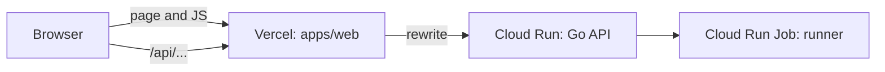

# React + TypeScript frontend on Vercel (with Terraform), and turning the project into a monorepo

This guide adds a **web page** in front of the Go code-runner API from the earlier guide. You log in, pick Python, Node.js or Go, type code, press **Run**, and see the output. The page is deployed on **Vercel**, and the Vercel project itself is created by **Terraform** (Infrastructure as Code, "IaC"), not by clicking in a dashboard.

Your API is already running at `https://codeapi-101353847207.asia-south1.run.app`. By default we do **not** need to change it. Section 5 shows the optional change (CORS) and how to redeploy the API with it, and section 8 shows how to remove everything again when you are done.

> **Status (what is and is not tested).**
> - **Tested here:** the frontend code was **bundled** with esbuild (all imports, JSX and TypeScript syntax are valid), `api.ts` passes `tsc --strict`, and the whole app was **run in a real Chromium browser against a fake API** (register, log in, run code, past runs, a `502` message, a `401` that sends you back to login). The new CORS block in `main.go` passes a `gofmt` syntax check. All of that is real output.
> - **Not tested:** I could not install Vite from npm (the registry is blocked in my sandbox), so **`npm create vite`, `npm install`, `npm run build` and the full `tsc` check with `@types/react` were not run**. The CORS change was **never compiled** (Go modules are blocked too). I could not call your real Cloud Run URL, **I have no Terraform, Vercel account or Google Cloud access here**, so the Terraform files, every `gcloud`, `terraform` and `git` command in sections 5, 6 and 8, and the Vercel dashboard menu names are written from documentation and my own knowledge, not run. `terraform plan` and the first `npm install` are your first real checks. Where a step depends on this, the guide says so.

**Contents**

1. How the pieces fit
2. Create the Vite project from scratch
3. The frontend project (every file)
4. Run it on your computer
5. The CORS question, and redeploying the backend with CORS
6. Deploy on Vercel with Terraform (GitHub, account, token, apply)
7. Turn it into a monorepo
8. Clean up everything (Vercel, Google Cloud, permissions, service accounts, images)
9. Things that can go wrong

---

## 1. How the pieces fit



The browser only ever talks to **one address** (your Vercel site). Anything starting with `/api` is forwarded by Vercel to Cloud Run. Because the browser thinks it is talking to its own site, there is no cross-site call, so no CORS problem (section 5).

---
## 2. Create the Vite project from scratch

You have two ways. **Path A is the fastest. Path B teaches you how the project is made.** Both end in the same folder layout.

### 2.1 Install Node.js

```bash
node -v      # needs a recent version; Vite's docs state the minimum (about 20.19 or newer, or 22.12 or newer)
npm -v
```

If `node` is missing or too old: on macOS `brew install node`, or download the installer from nodejs.org (choose the LTS version). `npm` comes with Node.

### 2.2 Path A: use the zip

```bash
unzip codeplatform-monorepo.zip
cd codeplatform
npm install          # installs the web app's packages (run it in the folder with the root package.json)
npm run web:dev      # starts the page on http://localhost:5173
```

Then skip to section 4.

### 2.3 Path B: build it step by step

**Step 1. Make the monorepo folder and a git repository.**

```bash
mkdir -p codeplatform/apps
cd codeplatform
git init
```

**Step 2. Let Vite create a React + TypeScript starter.**

```bash
cd apps
npm create vite@latest web -- --template react-ts
```

- `npm create vite@latest web` runs Vite's project generator and names the folder `web`.
- `-- --template react-ts` picks "React with TypeScript". (The `--` passes what follows to the generator.)
- I could not run this command here (my sandbox cannot reach npm), so I do not know the exact questions your version asks. If it asks about an **experimental** option (a faster bundler), say **No**. If it asks to **install and start now**, say **No**, because we change files first.

You now have `apps/web/` with roughly: `index.html`, `package.json`, `vite.config.ts`, `tsconfig*.json`, `eslint.config.js`, `public/`, `src/` (with `App.tsx`, `main.tsx`, `App.css`, `index.css`, `assets/`).

**Step 3. Keep the scaffold's version numbers for comparison, then clear the demo.**

```bash
cd web
cp package.json package.scaffold.json      # your reference copy

rm -rf src/assets src/App.css src/index.css public/vite.svg \
       eslint.config.js tsconfig.app.json tsconfig.node.json
```

The demo page (spinning logos and a counter) is deleted. We also delete the extra TypeScript config files and the linter config, because this guide uses one simple `tsconfig.json` and no linter.

**Step 4. Replace the files with the ones in section 3.** Do these in order:

1. `package.json`: replace it with the file in 3.1.
2. `index.html`: replace with 3.2.
3. `vite.config.ts`: replace with 3.3.
4. `tsconfig.json`: replace with 3.4.
5. In `src/`: replace `main.tsx` and `App.tsx`; create `types.ts`, `api.ts`, `styles.css`.
6. Create the folder `src/components/` with `AuthForm.tsx` and `RunPanel.tsx`.
7. Create `vercel.json` and `.env.example` (3.12 and 3.13).

**Step 5. Add the two root files** (in `codeplatform/`, one level above `apps/`): `package.json` (7.3) and `.gitignore` (7.4).

**Step 6. Install and start**, from the folder that holds the root `package.json`:

```bash
cd ../..                 # back to codeplatform/
npm install
npm run web:dev
```

`npm install` here creates `node_modules/` and `package-lock.json` in the root. **Commit `package-lock.json`** (it makes everyone install the same versions). Never commit `node_modules/`.

**If `npm install` complains about versions** ("peer dependency", "ERESOLVE"): the version ranges in my `package.json` were chosen without being able to ask npm what is newest. Open `apps/web/package.scaffold.json` (the generator's own, known-good set) and copy its version numbers for `react`, `react-dom`, `@types/react`, `@types/react-dom`, `@vitejs/plugin-react`, `typescript` and `vite` into your `package.json`. Keep **your** `scripts`. Then delete `package.scaffold.json`.

**Step 7. Check it.** Open `http://localhost:5173`. You should see "Code Runner" and a login form. Then run the two checks from section 4.

### 2.4 What each file is for

| File | Job |
|---|---|
| `index.html` | The one HTML page; React draws into its `#root` div |
| `src/main.tsx` | Starts React |
| `src/App.tsx` | Chooses login form or run screen |
| `src/api.ts` | The only place that calls the API |
| `vite.config.ts` | Vite settings (the dev proxy) |
| `tsconfig.json` | TypeScript settings |
| `vercel.json` | Tells Vercel to forward `/api` to Cloud Run |

---

## 3. The frontend project (every file)

Everything below goes under `apps/web/`. (Section 7 explains why the folder is called that. If you do not want a monorepo yet, just call the folder `web`.) Section 2 showed how to create the project; this section is the content of each file.

```text
apps/web/
├── package.json
├── index.html
├── vite.config.ts
├── tsconfig.json
├── vercel.json
├── .env.example
└── src/
    ├── main.tsx
    ├── App.tsx
    ├── api.ts
    ├── types.ts
    ├── styles.css
    └── components/
        ├── AuthForm.tsx
        └── RunPanel.tsx
```

**Tools used:** React 19 (the UI library), TypeScript (JavaScript with types), and Vite (the tool that serves the page while you develop and builds it for production). The versions in `package.json` are `^` ranges, so npm picks the newest matching one when you install.

### 3.1 `apps/web/package.json`

```json
{
  "name": "web",
  "private": true,
  "version": "0.1.0",
  "type": "module",
  "scripts": {
    "dev": "vite",
    "build": "tsc --noEmit && vite build",
    "typecheck": "tsc --noEmit",
    "preview": "vite preview"
  },
  "dependencies": {
    "react": "^19.0.0",
    "react-dom": "^19.0.0"
  },
  "devDependencies": {
    "@types/react": "^19.0.0",
    "@types/react-dom": "^19.0.0",
    "@vitejs/plugin-react": "^5.0.0",
    "typescript": "^5.6.0",
    "vite": "^7.0.0"
  }
}
```

- `"private": true`: stops you accidentally publishing this to npm.
- `"type": "module"`: files use `import ... from` (modern JavaScript modules).
- `"dev"`: starts the local server. `"build"`: first checks the types (`tsc --noEmit`, which only checks and writes nothing), then makes the production files in `dist/`.
- `dependencies` are needed in the browser (React). `devDependencies` are only tools used while building.

### 3.2 `apps/web/index.html`

```html
<!doctype html>
<html lang="en">
  <head>
    <meta charset="UTF-8" />
    <meta name="viewport" content="width=device-width, initial-scale=1.0" />
    <title>Code Runner</title>
  </head>
  <body>
    <div id="root"></div>
    <script type="module" src="/src/main.tsx"></script>
  </body>
</html>
```

- The empty `<div id="root">` is where React draws the page.
- The `<script type="module" src="/src/main.tsx">` line starts the app. Vite understands TypeScript, so you point straight at the `.tsx` file.

### 3.3 `apps/web/vite.config.ts`

```typescript
import { defineConfig } from "vite";
import react from "@vitejs/plugin-react";

// In local dev, "/api/..." is forwarded to the real API, so the browser
// never makes a cross-origin call (no CORS needed). On Vercel, vercel.json
// does the same job.
export default defineConfig({
  plugins: [react()],
  server: {
    proxy: {
      "/api": {
        target: "https://codeapi-101353847207.asia-south1.run.app",
        changeOrigin: true,
        rewrite: (path) => path.replace(/^\/api/, ""),
      },
    },
  },
});
```

- `plugins: [react()]`: teaches Vite how to handle JSX.
- `server.proxy`: **only for local development**. When your code asks for `/api/auth/login`, the dev server forwards it to Cloud Run as `/auth/login` (`rewrite` removes the `/api` prefix). `changeOrigin: true` sets the Host header to the target's, which Cloud Run needs.

### 3.4 `apps/web/tsconfig.json`

```json
{
  "compilerOptions": {
    "target": "ES2022",
    "lib": ["ES2022", "DOM", "DOM.Iterable"],
    "module": "ESNext",
    "moduleResolution": "bundler",
    "jsx": "react-jsx",
    "strict": true,
    "noEmit": true,
    "skipLibCheck": true,
    "isolatedModules": true,
    "types": ["vite/client"]
  },
  "include": ["src"]
}
```

- `"strict": true`: TypeScript's strictest and most helpful checking. Keep it.
- `"jsx": "react-jsx"`: lets you write JSX without importing React in every file.
- `"types": ["vite/client"]`: adds the type for `import.meta.env` (used in `api.ts`).
- `"include": ["src"]`: only check the `src` folder.

### 3.5 `apps/web/src/types.ts`

```typescript
export type Language = "python" | "node" | "go";

// What POST /run and GET /submissions return (one row of the Submission table).
export interface Submission {
  id: number;
  language: Language;
  code: string;
  stdout: string;
  stderr: string;
  exit_code: number;
  timed_out: boolean;
  created_at: string;
}
```

This is the shape of the data the Go API sends back for a run. It mirrors the Go `Submission` struct and its `json:"..."` tags (`exit_code` and `timed_out` use underscores, so we do too). `Language` can only be one of the three strings, so TypeScript catches a typo like `"pyhton"`.

### 3.6 `apps/web/src/api.ts` (the only file that talks to the API)

```typescript
import type { Language, Submission } from "./types";

// "/api" by default (Vite proxy in dev, Vercel rewrite in production).
const BASE: string = import.meta.env.VITE_API_URL ?? "/api";

// An error that carries the HTTP status, so the UI can react to 401, 429, 502...
export class ApiError extends Error {
  status: number;
  constructor(status: number, message: string) {
    super(message);
    this.status = status;
  }
}

async function request<T>(
  path: string,
  options: { method?: string; body?: unknown; token?: string } = {},
): Promise<T> {
  const headers: Record<string, string> = {};
  if (options.body !== undefined) headers["Content-Type"] = "application/json";
  if (options.token) headers["Authorization"] = `Bearer ${options.token}`;

  let res: Response;
  try {
    res = await fetch(BASE + path, {
      method: options.method ?? "GET",
      headers,
      body: options.body === undefined ? undefined : JSON.stringify(options.body),
    });
  } catch {
    throw new ApiError(0, "Cannot reach the server. Check your internet and try again.");
  }

  // The Go API sends errors as {"error": "..."}.
  const data = await res.json().catch(() => null);
  if (!res.ok) {
    throw new ApiError(res.status, data?.error ?? `Request failed (${res.status})`);
  }
  return data as T;
}

export function register(email: string, password: string) {
  return request<{ id: number; email: string }>("/auth/register", {
    method: "POST",
    body: { email, password },
  });
}

export async function login(email: string, password: string): Promise<string> {
  const data = await request<{ token: string }>("/auth/login", {
    method: "POST",
    body: { email, password },
  });
  return data.token;
}

export function runCode(token: string, language: Language, code: string) {
  return request<Submission>("/run", {
    method: "POST",
    body: { language, code },
    token,
  });
}

export function listSubmissions(token: string) {
  return request<Submission[]>("/submissions", { token });
}
```

Line by line, the important parts:

- `BASE = import.meta.env.VITE_API_URL ?? "/api"`: if the environment variable `VITE_API_URL` exists, use it; otherwise use `/api` (the proxy). Vite replaces `import.meta.env.VITE_...` when it builds. Only names starting with `VITE_` are exposed to the browser, **so never put a secret in one**.
- `class ApiError`: a normal `Error` that also remembers the HTTP `status`. The screens use it to treat `401` (not logged in or token expired) differently from other errors.
- `request<T>(...)`: one helper for every call, so the rest of the app never repeats `fetch` code. `<T>` means "the caller says what type comes back".
- The `try/catch` around `fetch`: `fetch` only throws when the network itself fails (offline, DNS). Then status is `0` and the message is friendly.
- `await res.json().catch(() => null)`: read the body as JSON; if it is not JSON, use `null` instead of crashing.
- `if (!res.ok)`: for any 4xx/5xx the Go API replies `{"error": "..."}` (set in your `ErrorHandler`), so `data?.error` is the message to show. `?.` means "only if `data` is not null".
- `Authorization: Bearer <token>` is how your `authRequired` middleware expects the JWT.
- `register`, `login`, `runCode`, `listSubmissions` are the four endpoints the page needs. `login` returns just the token string.

### 3.7 `apps/web/src/main.tsx`

```tsx
import { StrictMode } from "react";
import { createRoot } from "react-dom/client";
import App from "./App";
import "./styles.css";

createRoot(document.getElementById("root")!).render(
  <StrictMode>
    <App />
  </StrictMode>,
);
```

Finds the `root` div from `index.html` and draws `<App />` inside it. `StrictMode` is a development helper: it runs some effects twice to expose bugs (so in dev you will see two `GET /submissions`; production runs once).

### 3.8 `apps/web/src/App.tsx`

```tsx
import { useState } from "react";
import AuthForm from "./components/AuthForm";
import RunPanel from "./components/RunPanel";

export default function App() {
  // The token lives in memory only: a page refresh logs you out.
  // (Simple and safe from script theft; see the guide for the trade-off.)
  const [token, setToken] = useState<string | null>(null);

  return (
    <main>
      <header>
        <h1>Code Runner</h1>
        {token && <button onClick={() => setToken(null)}>Log out</button>}
      </header>
      {token ? <RunPanel token={token} onExpired={() => setToken(null)} /> : <AuthForm onLogin={setToken} />}
    </main>
  );
}
```

- `useState<string | null>(null)`: the login token, or `null` when logged out.
- Logged out shows `AuthForm`; logged in shows `RunPanel`. `onLogin={setToken}` means "when the form gets a token, store it".
- `onExpired`: when the API says `401`, `RunPanel` calls this, which clears the token and shows the login form again.
- **The token is kept only in memory.** Refreshing the page logs you out. That is the safest simple choice: `localStorage` survives refreshes but can be read by any script that ever runs on your page (an XSS bug). The "proper" fix is an `HttpOnly` cookie set by the API, which needs backend changes, so we skip it here.

### 3.9 `apps/web/src/components/AuthForm.tsx`

```tsx
import { useState, type FormEvent } from "react";
import { login, register } from "../api";

export default function AuthForm({ onLogin }: { onLogin: (token: string) => void }) {
  const [mode, setMode] = useState<"login" | "register">("login");
  const [email, setEmail] = useState("");
  const [password, setPassword] = useState("");
  const [error, setError] = useState("");
  const [busy, setBusy] = useState(false);

  async function submit(e: FormEvent) {
    e.preventDefault();
    setError("");
    setBusy(true);
    try {
      if (mode === "register") await register(email, password);
      // After registering we log straight in.
      onLogin(await login(email, password));
    } catch (err) {
      setError(err instanceof Error ? err.message : "Something went wrong");
    } finally {
      setBusy(false);
    }
  }

  return (
    <form onSubmit={submit} className="card">
      <h2>{mode === "login" ? "Log in" : "Create account"}</h2>
      <input type="email" placeholder="Email" value={email} onChange={(e) => setEmail(e.target.value)} required />
      <input
        type="password"
        placeholder="Password (8+ characters)"
        value={password}
        onChange={(e) => setPassword(e.target.value)}
        minLength={8}
        required
      />
      {error && <p className="error">{error}</p>}
      <button disabled={busy}>{busy ? "Please wait..." : mode === "login" ? "Log in" : "Register"}</button>
      <button type="button" className="link" onClick={() => setMode(mode === "login" ? "register" : "login")}>
        {mode === "login" ? "No account? Register" : "Have an account? Log in"}
      </button>
    </form>
  );
}
```

- Five `useState` values: which form (`login` or `register`), the two inputs, an error message, and `busy` (true while waiting, which disables the button so nobody double-submits).
- `submit`: `e.preventDefault()` stops the browser's own form reload. In register mode it calls `register` first, then **always** calls `login` and hands the token up with `onLogin`.
- `finally { setBusy(false) }` runs whether it worked or failed.
- The inputs are controlled: `value` comes from state and `onChange` writes back to state.
- `minLength={8}` matches the API's "8+ chars" rule so the browser warns before the server has to. The API still checks it (never trust only the browser).
- Auth routes are limited to 20 requests a minute per IP by your Go `limiter`; too many tries shows the API's error text.

### 3.10 `apps/web/src/components/RunPanel.tsx`

```tsx
import { useEffect, useState } from "react";
import { ApiError, listSubmissions, runCode } from "../api";
import type { Language, Submission } from "../types";

const STARTER: Record<Language, string> = {
  python: 'print("hello from python")',
  node: 'console.log("hello from node");',
  go: 'package main\n\nimport "fmt"\n\nfunc main() {\n\tfmt.Println("hello from go")\n}\n',
};

export default function RunPanel({ token, onExpired }: { token: string; onExpired: () => void }) {
  const [language, setLanguage] = useState<Language>("python");
  const [code, setCode] = useState(STARTER.python);
  const [result, setResult] = useState<Submission | null>(null);
  const [history, setHistory] = useState<Submission[]>([]);
  const [error, setError] = useState("");
  const [running, setRunning] = useState(false);

  // One place to handle errors: a 401 means the token expired, so log out.
  function fail(err: unknown) {
    if (err instanceof ApiError && err.status === 401) return onExpired();
    setError(err instanceof Error ? err.message : "Something went wrong");
  }

  useEffect(() => {
    listSubmissions(token).then(setHistory).catch(fail);
  }, [token]);

  function changeLanguage(next: Language) {
    setLanguage(next);
    setCode(STARTER[next]);
  }

  async function run() {
    setError("");
    setRunning(true);
    try {
      const sub = await runCode(token, language, code); // can take up to ~60 s
      setResult(sub);
      setHistory((h) => [sub, ...h]);
    } catch (err) {
      fail(err);
    } finally {
      setRunning(false);
    }
  }

  return (
    <>
      <section className="card">
        <div className="row">
          <select value={language} onChange={(e) => changeLanguage(e.target.value as Language)}>
            <option value="python">Python</option>
            <option value="node">Node.js</option>
            <option value="go">Go</option>
          </select>
          <button onClick={run} disabled={running}>
            {running ? "Running..." : "Run"}
          </button>
        </div>
        <textarea value={code} onChange={(e) => setCode(e.target.value)} spellCheck={false} rows={12} />
        {running && <p className="hint">Starting a fresh container. The first run can take a few seconds (up to a minute).</p>}
        {error && <p className="error">{error}</p>}
        {result && <Output sub={result} />}
      </section>

      <section className="card">
        <h2>Past runs</h2>
        {history.length === 0 && <p className="hint">Nothing yet.</p>}
        {history.map((s) => (
          <details key={s.id}>
            <summary>
              #{s.id} · {s.language} · exit {s.exit_code}
              {s.timed_out ? " · timed out" : ""} · {new Date(s.created_at).toLocaleString()}
            </summary>
            <pre>{s.code}</pre>
            <Output sub={s} />
          </details>
        ))}
      </section>
    </>
  );
}

function Output({ sub }: { sub: Submission }) {
  return (
    <div>
      {sub.timed_out && <p className="error">Timed out (5 second limit).</p>}
      {sub.stdout && <pre className="out">{sub.stdout}</pre>}
      {sub.stderr && <pre className="out err">{sub.stderr}</pre>}
      <p className="hint">Exit code: {sub.exit_code}</p>
    </div>
  );
}
```

- `STARTER`: a "hello" program per language, so the editor is never empty. Switching language swaps in that language's starter (`changeLanguage`).
- `fail(err)`: the single place that handles errors. A `401` calls `onExpired` (logout). Anything else shows the message. A `502` from the API (the runner failed) arrives here as "could not run your code, try again".
- `useEffect(..., [token])`: after the first draw, load past runs once.
- `run()`: sets `running`, calls the API, then puts the result on screen and at the top of the history. A run starts a **new container**, so it can take several seconds (up to about a minute), hence the "Starting a fresh container" hint while `running` is true.
- `Output`: shows a timeout notice, stdout, stderr (in red) and the exit code. Past runs are `<details>` elements you click open. React escapes text, so output like `<script>` is shown as text, not run.

### 3.11 `apps/web/src/styles.css`

```css
body { font-family: system-ui, sans-serif; background: #f4f5f7; color: #1a1a1a; margin: 0; }
main { max-width: 720px; margin: 0 auto; padding: 16px; }
header { display: flex; justify-content: space-between; align-items: center; }
.card { background: #fff; border-radius: 8px; padding: 16px; margin-bottom: 16px; display: flex; flex-direction: column; gap: 10px; }
.row { display: flex; justify-content: space-between; gap: 10px; }
input, select, textarea, button { font: inherit; padding: 8px; border: 1px solid #c8ccd2; border-radius: 6px; }
textarea { font-family: ui-monospace, monospace; }
button { background: #2563eb; color: #fff; border: 0; cursor: pointer; }
button:disabled { opacity: 0.6; cursor: wait; }
button.link { background: none; color: #2563eb; }
pre { background: #111; color: #eee; padding: 10px; border-radius: 6px; overflow-x: auto; margin: 0; }
pre.err { color: #ff8a8a; }
.error { color: #b91c1c; margin: 0; }
.hint { color: #666; font-size: 0.9em; margin: 0; }
```

Plain CSS, nothing special: a centred column, white cards, a dark box for code output.

### 3.12 `apps/web/vercel.json`

```json
{
  "rewrites": [
    {
      "source": "/api/:path*",
      "destination": "https://codeapi-101353847207.asia-south1.run.app/:path*"
    }
  ]
}
```

This tells Vercel: "a request to `/api/anything` should be answered by Cloud Run at `/anything`". It is the production twin of the proxy in `vite.config.ts`. **A URL in `vercel.json` cannot read environment variables**, so the Cloud Run address is written in it. If your Cloud Run URL ever changes, edit it here.

### 3.13 `apps/web/.env.example`

```bash
# Optional. Leave unset to use "/api" (proxied, no CORS needed).
# Set it only if you call the API directly (then the API needs CORS).
# VITE_API_URL=https://codeapi-101353847207.asia-south1.run.app
```

Only needed for the "call the API directly" option in section 5. Copy it to `.env.local` (git ignores that) when you use it.

---
## 4. Run it on your computer

You need Node.js (section 2.1). If you used Path A in section 2, you already ran `npm install`.

```bash
# from the codeplatform/ folder (the one with the root package.json)
npm install
npm run web:dev
```

Open the address it prints (usually `http://localhost:5173`). Register, log in, and run the starter code.

Before deploying, also run:

```bash
npm run web:typecheck
npm run web:build
```

Both must finish without errors. **These two commands are the ones I could not run** (see the status box), so if one fails, the error message points at the file and line; the most likely causes are a version difference in a package or a type nit in a `.tsx` file. Paste the error to me and I will fix it.

---
## 5. The CORS question, and redeploying the backend with CORS

Browsers block a page on `https://site-a.com` from reading replies from `https://site-b.com` unless site B sends special permission headers (CORS). Your Go API sends none by default. So there are two ways:

| | A. Proxy through the same site (the default in this guide) | B. Call Cloud Run directly |
|---|---|---|
| Change the Go API? | **No** | **Yes** (CORS, then redeploy) |
| Frontend setting | nothing (`/api` is the default) | `VITE_API_URL=https://codeapi-...run.app` |
| Extra hop | Yes, through Vercel | No |
| Long requests | One caveat below | Cloud Run's 90 s limit only |

**Caveat for A (not tested).** `/run` can take up to about 60 seconds. I did not verify how long Vercel keeps a proxied request open on your plan. If long runs fail through the proxy, use B.

**If you stay on A, skip the rest of this section.** Sections 5.1 to 5.6 are for B.

### 5.1 What changes in the Go code

`apps/api/main.go` gets one new import and one block. The block is **controlled by an environment variable**, so with the variable unset the API behaves exactly as before.

The new import (inside the existing `import ( ... )` list):

```go
    "github.com/gofiber/fiber/v3/middleware/cors"
```

The new block, placed right after the line `app.Use(recover.New(), logger.New())` and before the routes:

```go
    // CORS is only needed when a web page on ANOTHER site calls this API
    // directly. ALLOWED_ORIGINS is a comma-separated list, for example
    // "https://codeplatform-web.vercel.app". Unset = no CORS headers at all.
    if origins := os.Getenv("ALLOWED_ORIGINS"); origins != "" {
        app.Use(cors.New(cors.Config{
            AllowOrigins: strings.Split(origins, ","),
            AllowMethods: []string{"GET", "POST", "OPTIONS"},
            AllowHeaders: []string{"Authorization", "Content-Type"},
        }))
    }
```

Explanation:

- `os.Getenv("ALLOWED_ORIGINS")`: reads the setting. `os` and `strings` are already imported in this file.
- `strings.Split(origins, ",")`: turns `"a,b"` into the list `["a","b"]`.
- `AllowOrigins`: the **exact** sites allowed to call the API from a browser (scheme and host, no trailing slash, no path). Do not use `"*"` for an API that takes login tokens.
- `AllowHeaders`: the browser sends a "preflight" `OPTIONS` request first when a call carries an `Authorization` header or JSON body, and asks "may I send these headers?". The middleware answers it automatically.
- It sits **before** the routes, so it also answers the preflight for `/run` and `/submissions`, which would otherwise be refused (preflight requests carry no token).

This file in the zip already contains these lines. **I checked it with `gofmt` (syntax) only. I could not compile it** (my sandbox cannot download Go modules). `cors` is part of the Fiber v3 module you already have, so no `go get` is needed. Check it yourself:

```bash
cd apps/api
go build -o /dev/null .
go vet ./...
```

If it complains about a field name in `cors.Config`, run `go doc github.com/gofiber/fiber/v3/middleware/cors Config` and adjust.

### 5.2 Redeploy the API on Cloud Run

You need your Vercel site's exact address first (for example `https://codeplatform-web.vercel.app`). You get it after the first deploy (section 6). Then, from the API folder:

```bash
cd apps/api
source env.sh                      # loads PROJECT_ID, REGION, ... (new terminal = run this again)

export WEB_ORIGIN=https://codeplatform-web.vercel.app    # your real address

gcloud run deploy codeapi \
  --source . \
  --region $REGION \
  --update-env-vars ALLOWED_ORIGINS=$WEB_ORIGIN
```

- `--source .` rebuilds the container from your changed code (this takes a few minutes) and creates a new revision.
- `--update-env-vars` **adds** one variable and keeps the others. (Do **not** use `--set-env-vars` here: it replaces the whole list, and you would lose `GCP_PROJECT`, `RUNNER_JOB`, `RUNS_BUCKET` and the API would stop at start-up.)
- The other settings (service account, secrets, memory, timeout) are kept from the previous revision when you leave the flags out. That is how Cloud Run behaves as I know it; if you want to be sure, run `gcloud run services describe codeapi --region $REGION` afterwards and check the service account, secrets and timeout are unchanged.

**Several origins** (for example your production site and a custom domain): a plain comma would be read by `gcloud` as a separator between variables, so tell it to use another separator by starting the value with `^|^`:

```bash
gcloud run deploy codeapi --source . --region $REGION \
  --update-env-vars "^|^ALLOWED_ORIGINS=https://a.vercel.app,https://www.example.com"
```

**If your API runs on Kubernetes (Part 2 of the first guide):** put `ALLOWED_ORIGINS` in the ConfigMap `k8s/01-config.yaml`, rebuild and push the API image the way you did in Part 2, then apply the ConfigMap and run `kubectl -n codeapi rollout restart deployment/codeapi`. I have not tested this path.

### 5.3 Check it with curl (the "preflight")

```bash
URL=https://codeapi-101353847207.asia-south1.run.app

curl -i -X OPTIONS "$URL/run" \
  -H "Origin: $WEB_ORIGIN" \
  -H "Access-Control-Request-Method: POST" \
  -H "Access-Control-Request-Headers: authorization,content-type"
```

You should see a success status (`200` or `204`) and headers like:

```text
Access-Control-Allow-Origin: https://codeplatform-web.vercel.app
Access-Control-Allow-Headers: Authorization,Content-Type
```

(I am describing what the middleware is documented to do; I have not seen this output myself.) Now try a site that is **not** allowed:

```bash
curl -i -X OPTIONS "$URL/run" \
  -H "Origin: https://evil.example" \
  -H "Access-Control-Request-Method: POST"
```

There must be **no** `Access-Control-Allow-Origin` header in that reply. If there is one, the allow-list is wrong.

Also check that the normal API still works: `curl $URL/health` prints `ok`.

### 5.4 Point the frontend at Cloud Run

The variable is read **when the site is built**, so changing it needs a new deployment.

**With the dashboard (simplest):** Vercel, your project, Settings, Environment Variables. Add `VITE_API_URL` = `https://codeapi-101353847207.asia-south1.run.app`, for **Production**. Then redeploy (Deployments tab, the "..." menu on the latest one, Redeploy, or push a new commit).

**With Terraform** (add to `infra/vercel/main.tf`; not run by me, so treat the attribute names as "check on `terraform plan`"):

```hcl
resource "vercel_project_environment_variable" "api_url" {
  project_id = vercel_project.web.id
  key        = "VITE_API_URL"
  value      = "https://codeapi-101353847207.asia-south1.run.app"
  target     = ["production"]
}
```

Then `terraform apply`, and push a commit (`git commit --allow-empty -m "use direct api" && git push`).

### 5.5 Check it in the browser

Open your Vercel site, press F12, open the **Network** tab, log in. Requests should now go to `codeapi-...run.app` (not `/api/...`), and the **Console** must show no "blocked by CORS policy" line.

**Preview deployments** (from branches) get different addresses like `https://codeplatform-web-git-feature-you.vercel.app`. They are **not** in `ALLOWED_ORIGINS`, so on a preview deployment the browser will show a CORS error. That is correct behaviour: either test on production, or add that address to the list as shown above.

### 5.6 Going back to the proxy (option A)

Remove the `VITE_API_URL` variable (dashboard, or delete the Terraform resource and `terraform apply`), redeploy the site. You can leave `ALLOWED_ORIGINS` set on the API; it does no harm.

---

## 6. Deploy on Vercel with Terraform

**What Terraform does here:** it creates a Vercel *project* connected to your GitHub repo and set to build only `apps/web`. After that, every `git push` deploys: pushes to `main` go to production, other branches get a preview URL.

### 6.1 Put the code on GitHub

Vercel builds from GitHub, so the monorepo must be pushed first. From the `codeplatform/` folder:

```bash
git status                  # make sure node_modules/, env.sh, .env* and *.tfstate are NOT listed
git add -A
git commit -m "first commit: api, web, infra"
git branch -M main
```

Create an empty repository on github.com (New repository, name it `codeplatform`, **do not** tick "add a README"). Then:

```bash
git remote add origin https://github.com/YOUR-NAME/codeplatform.git
git push -u origin main
```

(If you use the GitHub CLI, `gh repo create codeplatform --private --source . --push` does the same in one step.) Open the repo page and check that `apps/api`, `apps/web` and `infra/vercel` are there, and that **no** `env.sh` is.

### 6.2 Create a Vercel account and connect GitHub

1. Go to vercel.com and sign up. The easiest way is **Continue with GitHub**, which also connects your GitHub account. The free "Hobby" plan is enough for this guide.
2. When asked, let Vercel install its GitHub app. You can allow **only the `codeplatform` repository** instead of all repositories.

Terraform's `git_repository` setting only works if Vercel can see the repo, so do not skip this.

### 6.3 Create the access token Terraform needs

Terraform logs in to Vercel with a token, like a password made for programs.

1. In the Vercel dashboard click your avatar, then **Settings**, then **Tokens**. (Menu names may differ slightly; I could not look at the live dashboard.)
2. Click **Create**. Give it a name like `terraform-codeplatform`. Pick the scope (your personal account, or a team if you use one) and an **expiry** (30 days is a good habit for a learning project).
3. **Copy the token immediately.** Vercel shows it only once.

A token can act as you on that scope (create and delete projects), so treat it like a password: never put it in a file you commit, in `main.tf`, or in a chat.

### 6.4 Give the token to Terraform safely

```bash
read -s VERCEL_API_TOKEN      # type or paste the token, nothing is shown, press Enter
export VERCEL_API_TOKEN
```

- `read -s` reads without showing it and, unlike `export VERCEL_API_TOKEN=abc...`, keeps the token out of your shell history.
- `export` makes it visible to Terraform. It lasts only for this terminal window. In a new terminal you must repeat the two lines.
- The provider reads `VERCEL_API_TOKEN` by itself, which is why `provider "vercel" {}` in `main.tf` is empty.

If your Vercel account uses a **team**, resources belong to the team and the provider needs to know which one; the Vercel guide I read does this with a `team_id` argument on each resource. A personal Hobby account does not need it.

### 6.5 Install Terraform

```bash
brew tap hashicorp/tap
brew install hashicorp/tap/terraform
terraform -version
```

(That is HashiCorp's documented macOS route; on other systems use the installer from terraform.io.)

### 6.6 `infra/vercel/main.tf`

```hcl
terraform {
  required_providers {
    vercel = {
      source  = "vercel/vercel"
      version = ">= 0.11"
    }
  }
}

# The token is read from the VERCEL_API_TOKEN environment variable.
provider "vercel" {}

variable "github_repo" {
  type        = string
  description = "GitHub repo that holds the monorepo, like your-name/codeplatform"
}

resource "vercel_project" "web" {
  name      = "codeplatform-web"
  framework = "vite"

  # The monorepo: Vercel builds only this folder.
  root_directory = "apps/web"

  # Every push to this repo deploys (main = production, other branches = preview).
  git_repository = {
    type = "github"
    repo = var.github_repo
  }
}

output "project_id" {
  value = vercel_project.web.id
}
```

Line by line:

- `required_providers`: Terraform downloads the `vercel/vercel` plugin. `>= 0.11` is a loose lower bound I chose because I could not look up the latest version; `terraform init` records the exact version it picked in `.terraform.lock.hcl`, **commit that file**.
- `provider "vercel" {}`: empty on purpose. The provider reads your token from the `VERCEL_API_TOKEN` environment variable, so the secret is never in a file.
- `variable "github_repo"`: you give it the value (`your-name/codeplatform`).
- `resource "vercel_project" "web"`: the project. `framework = "vite"` selects Vite's build settings. `root_directory = "apps/web"` is the monorepo part: Vercel builds only that folder. `git_repository` connects the repo.
- `output "project_id"`: prints the project's ID after `apply`.

`infra/vercel/terraform.tfvars.example`:

```hcl
github_repo = "your-github-name/codeplatform"
```

### 6.7 Run it

```bash
export VERCEL_API_TOKEN="paste-your-token"   # never commit this

cd infra/vercel
cp terraform.tfvars.example terraform.tfvars   # then edit github_repo
terraform init
terraform plan
terraform apply
```

- `init` downloads the provider. `plan` shows what would be created (read it!). `apply` asks you to type `yes`, then creates it.
- Then **push a commit** to `main` (`git commit --allow-empty -m "deploy" && git push`). Vercel builds `apps/web` and gives you a URL like `https://codeplatform-web.vercel.app` (the exact address is on the project page in the Vercel dashboard; you need it for section 5 option B). (If Vercel already deployed on its own when the project was created, you do not need the extra push.)
- To delete everything later: `terraform destroy`.

**State file:** Terraform writes `terraform.tfstate` next to the files. For a personal project, local is fine, and the root `.gitignore` keeps it out of git. For a team, store state remotely (for example in a Cloud Storage bucket with Terraform's `gcs` backend).

**If you would rather not use Terraform:** `cd apps/web && npx vercel` does the same without IaC. The `vercel.json` file works either way.

---
## 7. Turn it into a monorepo

A **monorepo** is one git repository that holds several apps. Here: the Go API, the React site, and the infra files. The benefits: one place to change the API and the page together, one history, one set of issues. The cost: each tool must be told which folder is "its" app (we already did that with `root_directory`).

### 7.1 The layout

```text
codeplatform/
├── package.json            ← root: lists the JavaScript workspaces
├── .gitignore
├── README.md
├── apps/
│   ├── api/                ← your existing Go project, unchanged inside
│   │   ├── go.mod, main.go, auth.go, run.go, models.go
│   │   ├── Dockerfile, Dockerfile.runner, cloudbuild.runner.yaml
│   │   ├── runner/         ← the Python runner stays inside the API folder
│   │   └── k8s/
│   └── web/                ← the React site from section 3
└── infra/
    └── vercel/             ← Terraform from section 6
```

The runner stays inside `apps/api` on purpose: `Dockerfile.runner` and `cloudbuild.runner.yaml` use paths like `runner/runner.py`, so moving the whole folder together breaks nothing. You can split it into `apps/runner` later if you want, but then you must also update those two files' paths.

### 7.2 Move your existing project in

Assuming your Go project is in a folder called `sandbox` (change the name to yours):

```bash
mkdir -p codeplatform/apps codeplatform/infra
mv sandbox codeplatform/apps/api
cd codeplatform
git init
```

(If you followed Path B in section 2 you already made `codeplatform/` and ran `git init`. Then just run `mv ../sandbox apps/api` from inside `codeplatform/` and skip the other lines.)

Then add the other files from this guide (`apps/web/...`, `infra/vercel/...`, root files below). The zip that comes with this guide already has all of this laid out.

### 7.3 Root `package.json`

```json
{
  "name": "codeplatform",
  "private": true,
  "workspaces": ["apps/web"],
  "scripts": {
    "web:dev": "npm run dev --workspace apps/web",
    "web:build": "npm run build --workspace apps/web",
    "web:typecheck": "npm run typecheck --workspace apps/web"
  }
}
```

- `"workspaces": ["apps/web"]`: npm treats `apps/web` as one workspace. One `npm install` at the root installs for all listed workspaces into a shared `node_modules` and a single lockfile. Today there is only one, but when you add a second JavaScript package (for example `packages/shared-types`), you add it here (or use `["apps/*", "packages/*"]`).
- The `scripts` run a script inside a workspace from the root (`npm run web:dev`).
- **The Go and Python folders are not workspaces.** npm does not touch them. Each language keeps its own tools (`go.mod`, `requirements.txt`).

### 7.4 Root `.gitignore`

```bash
node_modules/
dist/
.env
.env.local
.vercel/
.terraform/
*.tfstate
*.tfstate.*
terraform.tfvars
env.sh
```

This keeps secrets and generated files out of git: `.env` files, `env.sh` (it holds your project settings), Terraform state, `node_modules`.

### 7.5 How each app deploys on its own

| App | How it deploys | What triggers it |
|---|---|---|
| `apps/api` | From inside the folder: `cd apps/api` and follow the earlier guide (`gcloud run deploy --source .` and so on). Run all `go` commands there too. | You run it (or CI, below) |
| `apps/web` | Vercel, via the Terraform project (`root_directory = "apps/web"`) | `git push` |
| `infra/vercel` | `terraform apply` | You run it |

The earlier guide's `env.sh` and `k8s/` files keep working because they are used from inside `apps/api`.

### 7.6 Do not rebuild the site when only the API changed (optional)

By default every push rebuilds the site. In the Vercel project settings there is an **Ignored Build Step** setting. A command that exits `0` means "skip this build". This is the usual one for a monorepo:

```bash
git diff --quiet HEAD^ HEAD -- .
```

It exits `0` when nothing under the project's folder changed. I did not test this with Vercel, and the Terraform provider may also offer it as an attribute; check the provider documentation for the exact name before putting it in `main.tf`.

### 7.7 Where to go next

- **Shared types:** the `Submission` type is written twice (Go struct and `types.ts`). With more apps you can move shared TypeScript code into `packages/` and list it in `workspaces`.
- **Turborepo or Nx:** tools that cache builds and run tasks across many apps. Worth it once you have three or more JavaScript packages; overkill today.
- **CI:** a GitHub Actions workflow per app with `paths:` filters (for example run Go tests only when `apps/api/**` changes).

---
## 8. Clean up everything

Do this when you are finished experimenting, so nothing keeps costing money or stays reachable. **Work from the outside in**: first the web part, then the API, then the helpers it used, last the accounts and permissions.

**Three ways, pick one:**

| Way | When |
|---|---|
| **Piece by piece** (8.1 to 8.6) | You want to keep the Google project for other things |
| **Delete the whole Google project** (8.7) | The project was only for this. Fastest and most complete |
| Vercel part only (8.1) | You only want to take the site down |

Before you start, in every new terminal:

```bash
cd apps/api && source env.sh && cd ../..    # loads PROJECT_ID, REGION, BUCKET, ...
gcloud config get-value project             # must print the project you mean to clean
```

Check the last line. **Every delete below is permanent.** Read each command before you run it.

### 8.1 Vercel (the site, the project, the token)

```bash
cd infra/vercel
terraform destroy        # asks you to type yes; deletes the Vercel project and its deployments
```

`terraform destroy` needs `VERCEL_API_TOKEN` set (section 6.4). Then:

1. Open the Vercel dashboard and check the project `codeplatform-web` is gone. If you made it by hand instead of Terraform: Project, Settings, **Delete Project**.
2. **Revoke the token:** Settings, Tokens, delete `terraform-codeplatform`. Do this last, after `destroy`, because `destroy` needs it.
3. Optional: GitHub, Settings, Applications, Installed GitHub Apps, **Vercel**, and remove access to the repo (or uninstall).
4. Delete local Terraform files you do not need: `rm -rf .terraform terraform.tfstate*` inside `infra/vercel`.
5. Optional: delete the GitHub repository (repo page, Settings, bottom, Delete this repository).

### 8.2 The Cloud Run API

```bash
gcloud run services delete codeapi --region $REGION
```

### 8.3 The runner job, secrets, bucket

```bash
gcloud run jobs delete $RUNNER_JOB --region $REGION

gcloud secrets delete jwt-secret
gcloud secrets delete database-url

gcloud storage ls gs://$BUCKET        # look first; normally empty (the API deletes files after each run)
gcloud storage rm -r gs://$BUCKET     # deletes the files AND the bucket
```

- Deleting the job also deletes its permission bindings (the `run.jobsExecutorWithOverrides` one from the first guide's 6.3). Deleting the bucket deletes the bucket bindings from step 5.6. Deleting each secret deletes its `secretAccessor` binding. So these permissions need no separate cleanup.

### 8.4 Artifact Registry (the stored images) and Cloud Build leftovers

```bash
gcloud artifacts repositories list --location=$REGION
```

Delete the repository you made for the runner image, and the one Cloud Run created by itself when you used `--source` (I know it by the name `cloud-run-source-deploy`; delete it only if the list shows it):

```bash
gcloud artifacts repositories delete $REPO --location=$REGION
gcloud artifacts repositories delete cloud-run-source-deploy --location=$REGION
```

Deleting a repository deletes every image inside it. Next, Cloud Build and source deploys can leave **storage buckets** holding your uploaded source code:

```bash
gcloud storage ls
```

You are looking for names such as `gs://run-sources-PROJECT_ID-REGION` and `gs://PROJECT_ID_cloudbuild` (these are the names I know these tools use; the list is the truth). Delete only the ones that are listed **and** that belong to this project:

```bash
gcloud storage rm -r gs://run-sources-${PROJECT_ID}-${REGION}
gcloud storage rm -r gs://${PROJECT_ID}_cloudbuild
```

### 8.5 Permissions and service accounts

First look at which permissions the two accounts still have at the **project** level:

```bash
gcloud projects get-iam-policy $PROJECT_ID \
  --flatten="bindings[].members" \
  --format="table(bindings.role, bindings.members)" | grep -E "api-sa|runner-sa"
```

No output is fine. If a line shows (for example `roles/cloudsql.client`, only if you added it), remove it:

```bash
gcloud projects remove-iam-policy-binding $PROJECT_ID \
  --member="serviceAccount:$API_SA" --role="roles/cloudsql.client"
```

Permissions that **you** added for other accounts while fixing build errors (the first guide's troubleshooting table mentions `roles/artifactregistry.writer` for the Cloud Build account and `roles/artifactregistry.reader` for the cluster's node account) show up in the full policy. List it without the `grep` and remove only the lines **you** added, with `remove-iam-policy-binding` as above. **Do not remove the roles Google created itself** (owner, the default Google-managed service agents).

Then delete the service accounts (any keys they have go with them; if you ever created a key file, delete that file from your computer too):

```bash
gcloud iam service-accounts keys list --iam-account=$API_SA     # normally only system-managed keys
gcloud iam service-accounts delete $API_SA
gcloud iam service-accounts delete $RUNNER_SA
```

This also removes the Workload Identity binding (14.6 of the first guide) and the `serviceAccountUser` binding that lived on `runner-sa`. You may still see `deleted:serviceAccount:...` lines in some policies; they are harmless.

### 8.6 If you also did the Kubernetes part (Part 2 of the first guide)

In this order (the order matters, section 22 of the first guide explains why):

```bash
gcloud container clusters get-credentials $CLUSTER --region $REGION

kubectl -n codeapi delete ingress codeapi        # lets Google remove the load balancer it made
kubectl delete namespace codeapi                 # pods, secrets, the certificate object, the Postgres disk claim

gcloud container clusters delete $CLUSTER --region $REGION
gcloud compute addresses delete codeapi-ip --global
```

Then check for leftovers that keep costing money:

```bash
gcloud compute disks list
gcloud compute forwarding-rules list
gcloud compute backend-services list
gcloud compute url-maps list
gcloud compute target-https-proxies list
gcloud compute ssl-certificates list
gcloud compute addresses list
```

Every list should be empty (or show only things that are not yours). Delete what remains with the matching `gcloud compute ... delete NAME`. Finally delete the **A record** you created at your DNS provider.

### 8.7 The fast way: delete the whole Google project

If the project exists only for this:

```bash
gcloud projects delete $PROJECT_ID
```

- It stops everything and schedules the project and **everything inside it** (services, jobs, buckets, accounts, secrets, clusters) for deletion. You can undo it for about 30 days with `gcloud projects undelete $PROJECT_ID`; after that it is gone.
- The project ID can never be reused.
- It does **not** touch Vercel, GitHub, your DNS, or an external database (Neon). Do 8.1 and 8.8 as well.

### 8.8 Things outside Google and Vercel

| What | Where to remove it |
|---|---|
| The hosted Postgres (Neon or another) | That provider's dashboard: delete the project or database |
| The DNS A record (Kubernetes path) | Your DNS provider |
| The GitHub repository | Repo, Settings, Delete this repository |
| A custom domain you bought for this | Your registrar (cancel auto-renew) |

### 8.9 Prove it is all gone

Skip this if you deleted the whole project (8.7). Otherwise every command should list nothing from this project:

```bash
gcloud run services list
gcloud run jobs list
gcloud secrets list
gcloud storage buckets list
gcloud artifacts repositories list
gcloud iam service-accounts list           # only Google's default accounts may remain
gcloud container clusters list
gcloud compute addresses list
gcloud compute disks list
```

Then open the Google Cloud Console, **Billing**, **Reports**, and look again in a day or two: no new charges should appear. If you want to be extra sure nothing can be billed, unlink billing: `gcloud billing projects unlink $PROJECT_ID`.

### 8.10 Clean your own computer (optional)

```bash
gcloud auth application-default revoke      # the credentials from "application-default login"
gcloud auth list                            # see which accounts are logged in
gcloud auth revoke YOUR-EMAIL               # log that account out of gcloud
gcloud config unset project
rm apps/api/env.sh                          # your helper variables (not secret, but now pointless)
```

To remove `gcloud` itself on macOS (if you installed it by the downloaded archive): delete the `google-cloud-sdk` folder you extracted (for example `rm -rf ~/google-cloud-sdk`), remove the lines the installer added to `~/.zshrc`, and optionally delete `~/.config/gcloud` (it holds your login). Check the path before running `rm -rf`.

### 8.11 Checklist

| Done | Item |
|---|---|
| ☐ | `terraform destroy` finished; Vercel project gone |
| ☐ | Vercel token revoked |
| ☐ | Cloud Run service and job deleted |
| ☐ | Secrets and runs bucket deleted |
| ☐ | Artifact Registry repos and Cloud Build buckets deleted |
| ☐ | Extra IAM roles you added removed; service accounts deleted |
| ☐ | Cluster, IP, disks, load balancer parts deleted (if used) |
| ☐ | External database deleted; DNS record removed |
| ☐ | `gcloud` logged out; ADC revoked |
| ☐ | Billing report checked after a day |

---

## 9. Things that can go wrong

| Symptom | Likely cause | Fix |
|---|---|---|
| Browser console says "blocked by CORS policy" | `VITE_API_URL` is set, so the browser calls Cloud Run directly | Remove it (use `/api`), or add CORS to the API (section 5) |
| Every `/api` call returns 404 on Vercel | `vercel.json` is not in the folder Vercel builds | It must be in `apps/web/` (the project's root directory) |
| `/api/...` works locally but not on Vercel | The rewrite destination is wrong or the API is down | Open `https://codeapi-101353847207.asia-south1.run.app/health`; it should print `ok` |
| `terraform plan` complains about the repo | Vercel is not connected to your GitHub | Section 6.2 |
| `terraform plan` complains about an unknown attribute | The provider changed since I wrote this | Read the error; check the provider's `vercel_project` documentation for the current name |
| A run seems to hang for a minute | A fresh container is starting (cold start) | Normal for the first run; the page shows a hint |
| "Too many requests" on login | The API's limit of 20 per minute per IP | Wait a minute |
| Logged out after refresh | Token is in memory by design | See 3.8 for the trade-off |
| Run fails with `502` | The runner job failed or timed out | Try again; check Cloud Run Job logs from the earlier guide |